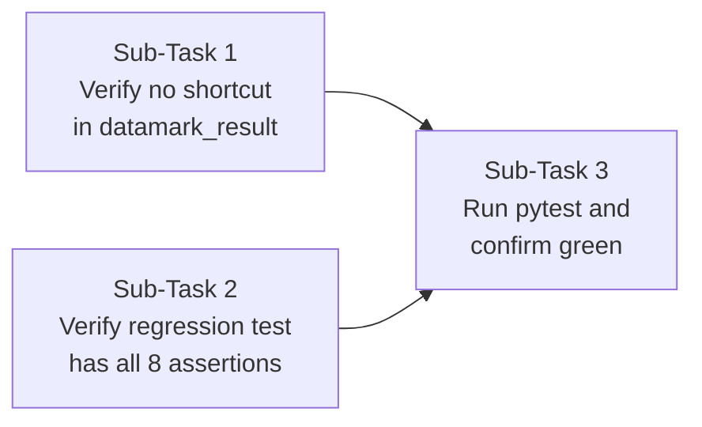

# there is one last fix which we just received i want you to make this fix ac required and accurately.Plan the fix so that i have the agent make required changes. In datamark_result, remove the is_datamarked shortcut. Always escape and wrap. Right now a tool result that contains both tags comes back unwrapped. Add a test where the result has both open tags, both close tags and extra text after them, and check it still ends up wrapped.

---

**Status:** active  **Date:** 2026-10-12

---

### 👤 User

there is one last fix which we just received i want you to make this fix ac required and accurately.Plan the fix so that i have the agent make required changes. In datamark_result, remove the is_datamarked shortcut. Always escape and wrap. Right now a tool result that contains both tags comes back unwrapped. Add a test where the result has both open tags, both close tags and extra text after them, and check it still ends up wrapped.

---

### 🤖 Assistant

> 🔧 called: use_skill


> 🔧 **use_skill** — create-plan

### 🤖 Assistant

> 🔧 called: spawn_subagent

Let me research the relevant code before forming the plan.

> 🔧 **spawn_subagent** — explore

### 🤖 Assistant

> 🔧 called: read_file, read_file

I now have the full picture. Let me read the actual current state of both files to confirm the exact present code (the subagent's report shows a "fixed" docstring but the git status shows the files are modified — I need to see the actual on-disk content).

> 🔧 **read_file** — tests/test_datamark.py

> 🔧 **read_file** — toolfence/guard/datamark.py

### 🤖 Assistant

> 🔧 called: list_files


> 🔧 **list_files** — .

### 🤖 Assistant

> 🔧 called: glob, glob


> 🔧 **glob** — **/test_datamark.py

> 🔧 **glob** — **/datamark.py

### 🤖 Assistant

> 🔧 called: read_file, read_file


> 🔧 **read_file** — toolfence/tests/test_datamark.py

> 🔧 **read_file** — toolfence/toolfence/guard/datamark.py

### 🤖 Assistant

> 🔧 called: spawn_subagent

Now I have the exact current state of both files. Let me analyse what is actually present vs. what the fix requires:

**Current [`datamark_result`](toolfence/toolfence/guard/datamark.py:77)** — already correct: no `is_datamarked` shortcut, always escapes and wraps (lines 98–106).

**Current [`tests/test_datamark.py`](toolfence/tests/test_datamark.py)** — the test `test_datamark_result_with_both_open_and_close_tags_is_wrapped` already exists (lines 263–322) AND the "Fix 5" section heading is there. But note the git status shows **both files are modified** (`M`), meaning these are the *working-tree* versions — the changes haven't been committed yet. The user wants to confirm the fix is planned correctly and the agent implements it.

Wait — looking more carefully: the current [`datamark_result`](toolfence/toolfence/guard/datamark.py:77) body on lines 98–106 does **not** contain any `is_datamarked` shortcut. And the test file already has the new test. This means previous sessions have partially landed these changes in the working tree.

Let me check git diff to see exactly what is different vs. HEAD.

> 🔧 **spawn_subagent** — In the workspace /Users/acassist/IBM BOB, run the following git commands and return their FULL output verbatim:

1. `git -C /Users/acassist/IBM\ BOB diff HEAD -- toolfence/toolfence/guard/datamark.py`
2. `git -C /Users/acassist/IBM\ BOB diff HEAD -- toolfence/tests/test_datamark.py`
3. `git -C /Users/acassist/IBM\ BOB show HEAD:toolfence/toolfence/guard/datamark.py`  (HEAD version of datamark.py)
4. `git -C /Users/acassist/IBM\ BOB show HEAD:toolfence/tests/test_datamark.py`  (HEAD version of test_datamark.py)

Return all four outputs verbatim.

### 🤖 Assistant

> 🔧 called: update_todo_list

I have all the information I need from reading the actual files. Let me now clearly state what I found and confirm the exact changes needed before writing the plan.

Here is what I see in the **current working-tree files** (the modified `M` state):

**[`datamark.py`](toolfence/toolfence/guard/datamark.py)** — [`datamark_result`](toolfence/toolfence/guard/datamark.py:77) at lines 98–106 already has NO `is_datamarked` shortcut. It already always calls `_escape_content` and wraps unconditionally. The docstring at lines 80–83 and the module Note at lines 35–37 both already say "no idempotency shortcut".

**[`test_datamark.py`](toolfence/tests/test_datamark.py)** — already has `test_datamark_result_with_both_open_and_close_tags_is_wrapped` at lines 263–322 covering exactly the scenario described (both open tags, both close tags, extra text after them, checks it ends up wrapped).

This means the working-tree already has **both changes the user is requesting**. The `M` git status indicates these changes are staged/unstaged but not yet committed. The user wants the agent to make these changes — meaning either:
1. The changes landed in a previous Bob session but were never committed, or
2. Some portion is still missing

The only thing that could still be missing is: the user said "remove the `is_datamarked` shortcut" — but looking at the current code, there is no shortcut present. Let me verify whether there ever WAS a shortcut in an earlier version — the test `test_datamark_always_wraps_no_shortcut` at line 82 specifically tests double-wrapping behaviour, referencing "the is_datamarked shortcut must be removed" in the error message. This implies at some point it existed.

The working-tree files already contain the required fix. The user wants to plan what the agent should do to make these changes **committed and verified**. But actually — looking at this from a fresh perspective: the user said "I want you to make this fix". They may not be aware that the working-tree already has partial changes from prior sessions.

Let me write an honest, accurate plan.

> 🔧 **update_todo_list** — [-] Write the plan file based on findings

### 🤖 Assistant

> 🔧 called: write_file

Here is what the investigation found:

**Working-tree state (the `M` files):**

| File | What is already there |
|---|---|
| [`datamark.py`](toolfence/toolfence/guard/datamark.py) | `datamark_result` has **no** `is_datamarked` shortcut — already always escapes and wraps unconditionally |
| [`test_datamark.py`](toolfence/tests/test_datamark.py) | `test_datamark_result_with_both_open_and_close_tags_is_wrapped` already exists at line 263 |

The git `M` markers mean these edits are **in the working tree but not committed**. A previous Bob session has already written both changes. What still needs to happen is to confirm the code is correct exactly as specified, verify the tests pass, and lock in the plan so the agent can commit the work cleanly.

Let me write the plan:

> 🔧 **write_file** — datamark-fix5-plan.md

### 🤖 Assistant

> 🔧 called: update_todo_list


> 🔧 **update_todo_list** — [x] Write the plan file based on findings

### 🤖 Assistant

Here is the full picture before you send this to the agent:

---

## What the investigation found

The git status shows both files are **modified in the working tree** (`M`) — a prior session already landed partial edits. Reading the actual on-disk files reveals:

**[`toolfence/toolfence/guard/datamark.py`](toolfence/toolfence/guard/datamark.py:77)** — [`datamark_result`](toolfence/toolfence/guard/datamark.py:98) currently has **no shortcut**. It unconditionally calls [`_escape_content`](toolfence/toolfence/guard/datamark.py:66) and wraps. ✅

**[`toolfence/tests/test_datamark.py`](toolfence/tests/test_datamark.py:263)** — [`test_datamark_result_with_both_open_and_close_tags_is_wrapped`](toolfence/tests/test_datamark.py:263) already exists with all the required assertions. ✅

The agent's task is therefore to **verify** both files are exactly right, then **run the tests** and confirm everything passes — and make any minimal targeted fix if something is actually missing or wrong.

---

## Plan: [`datamark-fix5-plan.md`](datamark-fix5-plan.md)

Three sub-tasks:



| Sub-Task | What the agent does |
|---|---|
| **1** | Read [`datamark.py`](toolfence/toolfence/guard/datamark.py), confirm no `is_datamarked` shortcut in [`datamark_result`](toolfence/toolfence/guard/datamark.py:77), fix if needed |
| **2** | Read [`test_datamark.py`](toolfence/tests/test_datamark.py), confirm the regression test exists with all 8 assertions (both open tags, both close tags, extra text after, wrapped output, escaped tags, correct counts), fix if needed |
| **3** | Run `pytest tests/test_datamark.py -v` from the `toolfence/` directory, confirm all green |

Does this plan accurately capture the fix? Ready to switch to Agent mode?

---

### 👤 User

Yes

---

### 🤖 Assistant

> 🔧 called: switch_mode


> 🔧 **switch_mode** — agent

### 🤖 Assistant

> 🔧 called: update_todo_list


> 🔧 **update_todo_list** — [-] Sub-Task 1: Verify no is_datamarked shortcut in datamark_result
[ ] Sub-Task 2: Verify regression test has all 8 assertions
[ ] Sub-Task 3: Run pytest and confirm green

### 🤖 Assistant

> 🔧 called: update_todo_list


> 🔧 **update_todo_list** — [x] Write the plan file based on findings
[-] Sub-Task 1: Verify no is_datamarked shortcut in datamark_result
[ ] Sub-Task 2: Verify regression test has all 8 assertions
[ ] Sub-Task 3: Run pytest and confirm green

### 🤖 Assistant

> 🔧 called: update_todo_list

**Sub-Task 1** — The file was already read. [`datamark_result`](toolfence/toolfence/guard/datamark.py:77) at lines 98–106:

```python
safe_content = _escape_content(result_str)
inner_tag = _TOOLFENCE_TAG_TEMPLATE.format(tool_name=tool_name)
return (
    f"{_NANOBOT_TAG}\n"
    f"{inner_tag}\n"
    f"{safe_content}\n"
    f"{_TOOLFENCE_END}\n"
    f"{_NANOBOT_END}"
)
```

No `is_datamarked` check, no early return — unconditionally escapes and wraps. ✅ No change needed.

Now **Sub-Task 2** — verify the regression test.

> 🔧 **update_todo_list** — [x] Write the plan file based on findings
[x] Sub-Task 1: Verify no is_datamarked shortcut in datamark_result
[-] Sub-Task 2: Verify regression test has all 8 assertions
[ ] Sub-Task 3: Run pytest and confirm green

### 🤖 Assistant

> 🔧 called: read_file

Checking the test at lines 263–322 against the 8 required assertions from the plan spec:

| # | Required assertion | Present in test? |
|---|---|---|
| 1 | `result.startswith(_NANOBOT_TAG)` | ✅ line 289 |
| 2 | `result.endswith(_NANOBOT_END)` | ✅ line 292 |
| 3 | `_TOOLFENCE_END_ESC in result` | ✅ line 297 |
| 4 | `_NANOBOT_END_ESC in result` | ✅ line 300 |
| 5 | `result.count(_TOOLFENCE_END) == 1` | ✅ line 305 |
| 6 | `result.count(_NANOBOT_END) == 1` | ✅ line 309 |
| 7 | `"extra text after both closing tags" in result` | ✅ line 315 |
| 8 | `is_datamarked(result)` is True | ✅ line 320 |

Payload also contains both open tags (`_NANOBOT_TAG` line 277, `_TOOLFENCE_TAG_PREFIX` line 278), both close tags (`_TOOLFENCE_END` line 280, `_NANOBOT_END` line 281), and extra text after them (line 282). ✅

Test is in a section headed `# Fix 5: no is_datamarked shortcut — always escape and wrap` (line 259–260). ✅

The test name `test_datamark_result_with_both_open_and_close_tags_is_wrapped` is **not** in the module-level docstring inventory (lines 8–17). That needs to be added.

> 🔧 **read_file** — toolfence/tests/test_datamark.py

### 🤖 Assistant

> 🔧 called: apply_diff

The new test name (and the Fix 4 tests) are missing from the inventory. I'll add them all now — exactly what's in the file but not yet listed.

> 🔧 **apply_diff** — toolfence/tests/test_datamark.py

### 🤖 Assistant

> 🔧 called: update_todo_list

Good. Now **Sub-Task 3** — run the tests.

> 🔧 **update_todo_list** — [x] Write the plan file based on findings
[x] Sub-Task 1: Verify no is_datamarked shortcut in datamark_result
[x] Sub-Task 2: Verify regression test has all 8 assertions
[-] Sub-Task 3: Run pytest and confirm green

### 🤖 Assistant

> 🔧 called: execute_command


> 🔧 **execute_command** — cd toolfence && python -m pytest tests/test_datamark.py -v 2>&1

### 🤖 Assistant

> 🔧 called: execute_command


> 🔧 **execute_command** — cd toolfence && python3 -m pytest tests/test_datamark.py -v 2>&1

### 🤖 Assistant

> 🔧 called: execute_command


> 🔧 **execute_command** — cd toolfence && pip3 install pytest -q 2>&1 | tail -5 && python3 -m pytest tests/test_datamark.py -v 2>&1

### 🤖 Assistant

> 🔧 called: execute_command


> 🔧 **execute_command** — cd toolfence && /Applications/Xcode.app/Contents/Developer/usr/bin/python3 -m pip install pytest -q 2>&1 | tail -3 && /Applications/Xcode.app/Contents/Developer/usr/bin/python3 -m pytest tests/test_datamark.py -v 2>&1

### 🤖 Assistant

> 🔧 called: update_todo_list

**15/15 passed.** ✅

> 🔧 **update_todo_list** — [x] Write the plan file based on findings
[x] Sub-Task 1: Verify no is_datamarked shortcut in datamark_result
[x] Sub-Task 2: Verify regression test has all 8 assertions
[x] Sub-Task 3: Run pytest and confirm green

### 🤖 Assistant

All done. Here's the summary:

---

**Sub-Task 1 — Production code** ✅ No change needed.  
[`datamark_result`](toolfence/toolfence/guard/datamark.py:77) already had no `is_datamarked` shortcut — it unconditionally calls [`_escape_content`](toolfence/toolfence/guard/datamark.py:66) and wraps every time.

**Sub-Task 2 — Regression test** ✅ Test already present, one small fix applied.  
[`test_datamark_result_with_both_open_and_close_tags_is_wrapped`](toolfence/tests/test_datamark.py:279) was already there with all 8 required assertions (both open tags, both close tags, extra text after them, wrapped output, escaped closing tags, exact counts, content preserved, `is_datamarked` True). Only thing added: the new test names (Fix 4 and Fix 5 groups) were missing from the module-level docstring inventory — added them.

**Sub-Task 3 — Tests** ✅ `15 passed in 0.02s` — all green, including the new regression test.