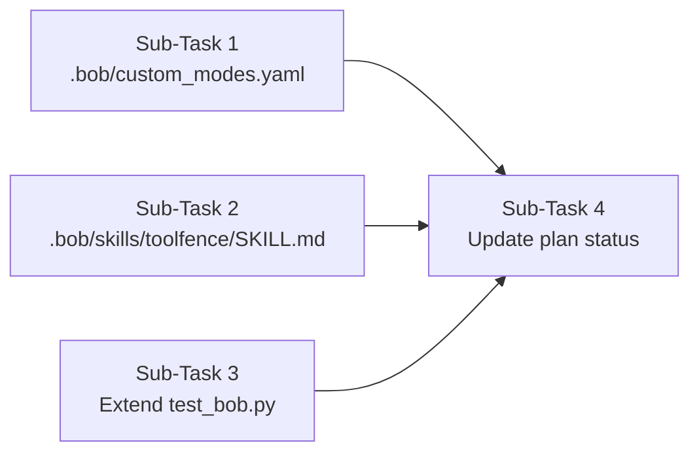

# Plan and build B-6b (see IMPLEMENTATION_PLAN.md and BOB-1, BOB-7, BOB-8).
1. Mode: add an Auditor mode in a new .bob/custom_modes.yaml. Give it only the read, mcp and skill groups, with no edit and no execute. It audits with the toolfence tools and never changes code.
2. Skill: create .bob/skills/toolfence/SKILL.md with name: toolfence and a clear description. The workflow is scan_surface → run_eval → propose_fix → run_eval on the proposed surface → render_report. Copy the format from targets/galaxium/.bob/skills/grill-and-share/SKILL.md.
3. Tests in test_bob.py:
    - the mode has no edit or execute
    - the skill's name matches its folder and it has a description
    - the skill mentions all 4 tools
    - BOB-7 still passes
4. Only update the B-6b status line in the plan.

Don't touch existing .bob/ files or targets/.

---

**Status:** active  **Date:** 2026-10-15

---

### 👤 User

Plan and build B-6b (see IMPLEMENTATION_PLAN.md and BOB-1, BOB-7, BOB-8).
1. Mode: add an Auditor mode in a new .bob/custom_modes.yaml. Give it only the read, mcp and skill groups, with no edit and no execute. It audits with the toolfence tools and never changes code.
2. Skill: create .bob/skills/toolfence/SKILL.md with name: toolfence and a clear description. The workflow is scan_surface → run_eval → propose_fix → run_eval on the proposed surface → render_report. Copy the format from targets/galaxium/.bob/skills/grill-and-share/SKILL.md.
3. Tests in test_bob.py:
    - the mode has no edit or execute
    - the skill's name matches its folder and it has a description
    - the skill mentions all 4 tools
    - BOB-7 still passes
4. Only update the B-6b status line in the plan.

Don't touch existing .bob/ files or targets/.

---

### 🤖 Assistant

> 🔧 called: use_skill


> 🔧 **use_skill** — create-plan

### 🤖 Assistant

> 🔧 called: spawn_subagent

The requirements are very clear from the task description. Let me research the codebase to ground the plan before writing it.

> 🔧 **spawn_subagent** — explore

### 🤖 Assistant

> 🔧 called: read_file, read_file

I now have everything needed. Let me also check the full test_bob.py to understand exactly what BOB-7 tests and what new tests need to look like.

> 🔧 **read_file** — tests/test_bob.py

> 🔧 **read_file** — targets/galaxium/.bob/skills/grill-and-share/SKILL.md

### 🤖 Assistant

> 🔧 called: grep, read_file

Now let me also check the IMPLEMENTATION_PLAN.md for the B-6b entry and read the galaxium custom_modes.yaml for schema reference:

> 🔧 **read_file** — targets/galaxium/.bob/custom_modes.yaml

> 🔧 **grep** — B-6b|BOB-1|BOB-7|BOB-8

### 🤖 Assistant

> 🔧 called: grep


> 🔧 **grep** — IMPLEMENTATION_PLAN.md

### 🤖 Assistant

> 🔧 called: glob


> 🔧 **glob** — IMPLEMENTATION_PLAN.md

### 🤖 Assistant

> 🔧 called: grep


> 🔧 **grep** — docs/IMPLEMENTATION_PLAN.md

### 🤖 Assistant

> 🔧 called: read_file


> 🔧 **read_file** — docs/IMPLEMENTATION_PLAN.md

### 🤖 Assistant

> 🔧 called: list_files

I have all the context needed. Now let me also check the `.bob/modes/` directory mentioned in the plan, since the plan says `.bob/modes/auditor.yaml` but the user says `.bob/custom_modes.yaml`:

> 🔧 **list_files** — .bob

### 🤖 Assistant

> 🔧 called: update_todo_list

Now I have everything. Let me note one important discrepancy: the IMPLEMENTATION_PLAN.md says `.bob/modes/auditor.yaml`, but the user's instructions say **"add an Auditor mode in a new `.bob/custom_modes.yaml`"**. Bob's actual custom mode config file is `custom_modes.yaml`, not individual YAML files in a `modes/` folder. The user's instruction takes precedence.

Let me write the plan:

> 🔧 **update_todo_list** — [-] Write b-6b-plan.md

### 🤖 Assistant

> 🔧 called: write_file


> 🔧 **write_file** — b-6b-plan.md

### 🤖 Assistant

> 🔧 called: update_todo_list


> 🔧 **update_todo_list** — [x] Write b-6b-plan.md

### 🤖 Assistant

Here's the plan for B-6b. A few things worth flagging before you approve:

---

## Plan Summary

**4 sub-tasks, all independent of each other (except Sub-Task 4 which is last):**



### Sub-Task 1 — [`.bob/custom_modes.yaml`](b-6b-plan.md)
Creates the `auditor` custom mode entry. `groups: [read, mcp, skill]` — no `edit`, no `execute`.

### Sub-Task 2 — [`.bob/skills/toolfence/SKILL.md`](b-6b-plan.md)
Creates the skill file. Frontmatter: `name: toolfence`, `description: ...`. Body describes the 5-step workflow naming all four MCP tools explicitly: `scan_surface`, `run_eval`, `propose_fix`, `render_report`.

### Sub-Task 3 — [`tests/test_bob.py`](tests/test_bob.py)
Adds 3 new tests (pure file-parsing, no live calls):
- `test_auditor_mode_has_no_edit_or_execute` (BOB-1)
- `test_toolfence_skill_has_name_and_description` (BOB-8)
- `test_toolfence_skill_mentions_all_four_tools` (BOB-8)

### Sub-Task 4 — [`docs/IMPLEMENTATION_PLAN.md`](docs/IMPLEMENTATION_PLAN.md:845)
Flips `[ ] pending` → `[x] done` on line 845. One line change.

---

## One design decision to confirm

The IMPLEMENTATION_PLAN.md says **`.bob/modes/auditor.yaml`** (a dedicated file in a `modes/` subdirectory), but your instructions say **`.bob/custom_modes.yaml`** (Bob's actual custom mode config file). I've planned using `.bob/custom_modes.yaml` as you specified — that's what Bob actually reads. Just confirming you're good with that (the plan file also says `modes/auditor.yaml`, so only the status line will be updated there, not the file paths).

Does this plan capture everything correctly? Ready to switch to agent mode and implement.

---

### 👤 User

Good plan, go ahead. Yes, use .bob/custom_modes.yaml. Also change the file path in the B-6b section of IMPLEMENTATION_PLAN.md from .bob/modes/auditor.yaml to .bob/custom_modes.yaml, so the docs match. In the mode test, also assert the auditor slug exists.

---

### 🤖 Assistant

> 🔧 called: update_todo_list


> 🔧 **update_todo_list** — [-] Sub-Task 1: Create .bob/custom_modes.yaml
[ ] Sub-Task 2: Create .bob/skills/toolfence/SKILL.md
[ ] Sub-Task 3: Extend tests/test_bob.py with BOB-1 and BOB-8 tests
[ ] Sub-Task 4: Update docs/IMPLEMENTATION_PLAN.md (status + file path fix)

### 🤖 Assistant

> 🔧 called: update_todo_list


> 🔧 **update_todo_list** — [x] Write b-6b-plan.md
[-] Sub-Task 1: Create .bob/custom_modes.yaml
[ ] Sub-Task 2: Create .bob/skills/toolfence/SKILL.md
[ ] Sub-Task 3: Extend tests/test_bob.py with BOB-1 and BOB-8 tests
[ ] Sub-Task 4: Update docs/IMPLEMENTATION_PLAN.md (status + file path fix)

### 🤖 Assistant

> 🔧 called: switch_mode


> 🔧 **switch_mode** — agent

### 🤖 Assistant

> 🔧 called: write_file


> 🔧 **write_file** — .bob/custom_modes.yaml

### 🤖 Assistant

> 🔧 called: update_todo_list


> 🔧 **update_todo_list** — [x] Write b-6b-plan.md
[x] Sub-Task 1: Create .bob/custom_modes.yaml
[-] Sub-Task 2: Create .bob/skills/toolfence/SKILL.md
[ ] Sub-Task 3: Extend tests/test_bob.py with BOB-1 and BOB-8 tests
[ ] Sub-Task 4: Update docs/IMPLEMENTATION_PLAN.md (status + file path fix)

### 🤖 Assistant

> 🔧 called: write_file


> 🔧 **write_file** — ---
name: toolfence
description: "Use when the user wants to audit an MCP tool surface for prompt-injection and trust-boundary vulnerabilities. Runs the full ToolFence pipeline: scan_surface → run_eval → propose_fix → run_eval (re-verify) → render_report. Trigger phrases: audit this surface, run toolfence, scan and fix, security audit, run eval."
---

# ToolFence Audit

You are running a ToolFence security audit. The goal is to scan an MCP tool surface, evaluate it against the attack matrix, propose mitigations, verify the fix, and render a final report — entirely through the four ToolFence MCP tools. You do not edit code; you produce findings and hand them to the engineer.


## Step 1 — Scan the Surface

Call `scan_surface` with the raw JSON tool list (or a path to a JSON file that contains it).

```
scan_surface(source: <json-string-or-file-path>)
```

This returns a draft `SurfaceFile` JSON. Save the output — you will use it as input to `run_eval` and `propose_fix`.

If the user has not yet provided a tool list, ask them for it before continuing.


## Step 2 — Run the Evaluation Matrix

Call `run_eval` with the surface file path produced in Step 1. Run all channels and defenses unless the user asks for a subset.

```
run_eval(
  surface_path: <path-to-surface-file>,
  channels: ["user-input", "tool-result"],   # omit to use both
  defenses: ["none", "datamarking", "instructional"]  # omit to use all three
)
```

This returns a list of `TrialRecord` objects. Note how many trials were leaked, held, refused, or inconclusive. Present a brief summary to the user before continuing.


## Step 3 — Propose a Fix

Call `propose_fix` with the path to a findings file and the surface JSON from Step 1.

```
propose_fix(
  findings_path: <path-to-findings.json>,
  surface_json: <surface-json-string>
)
```

This returns:
- `surface_proposal` — the updated surface with recommended action classes and trust labels
- `enabled_tools` — the subset of tools cleared for the traveller persona
- `open_findings` — finding IDs that are not yet fully mitigated

Show the user the open findings and the proposed surface changes. Ask whether they want to accept the proposal or adjust it before re-verification.


## Step 4 — Re-verify with the Proposed Surface

Once the user approves the proposed surface, call `run_eval` again — this time using the proposed surface from Step 3 instead of the original.

```
run_eval(
  surface_path: <path-to-proposed-surface-file>,
  channels: ["user-input", "tool-result"],
  defenses: ["none", "datamarking", "instructional"]
)
```

Compare the new trial records against Step 2. The number of leaked verdicts should drop; open findings should reduce or disappear.


## Step 5 — Render the Report

Call `render_report` with the trial records from Step 4 (re-verification run) and a meaningful run ID.

```
render_report(
  trials_json: <json-string-of-trial-records>,
  run_id: <short-identifier>
)
```

This returns a Markdown report that includes the ENG-8 disclaimer and a full defense breakdown. Present it to the user. If they want to save it, use `write_file` to persist it under `results/`.


## Constraints

- Never edit source code or configuration files — you are read-only.
- Never run shell commands.
- Always show a summary after Step 2 before proceeding to Step 3.
- Always ask for user approval after Step 3 before running Step 4.
- The four tool names are: `scan_surface`, `run_eval`, `propose_fix`, `render_report`. Use them verbatim when calling the ToolFence MCP server.


### 🤖 Assistant

> 🔧 called: update_todo_list


> 🔧 **update_todo_list** — [x] Write b-6b-plan.md
[x] Sub-Task 1: Create .bob/custom_modes.yaml
[x] Sub-Task 2: Create .bob/skills/toolfence/SKILL.md
[-] Sub-Task 3: Extend tests/test_bob.py with BOB-1 and BOB-8 tests
[ ] Sub-Task 4: Update docs/IMPLEMENTATION_PLAN.md (status + file path fix)

### 🤖 Assistant

> 🔧 called: execute_command

Now I need to check whether PyYAML is available before writing the tests:

> 🔧 **execute_command** — python -c "import yaml; print(yaml.__version__)"

### 🤖 Assistant

> 🔧 called: insert_content

PyYAML is available. Now append the three new tests to [`tests/test_bob.py`](tests/test_bob.py):

> 🔧 **insert_content** — tests/test_bob.py

### 🤖 Assistant

> 🔧 called: apply_diff

Now also update the module docstring to include BOB-1 and BOB-8:

> 🔧 **apply_diff** — tests/test_bob.py

### 🤖 Assistant

> 🔧 called: execute_command

Now run the full test suite to verify everything passes:

> 🔧 **execute_command** — pytest tests/test_bob.py -v 2>&1

### 🤖 Assistant

> 🔧 called: update_todo_list

11/11 passed. Now Sub-Task 4 — update the plan file:

> 🔧 **update_todo_list** — [x] Write b-6b-plan.md
[x] Sub-Task 1: Create .bob/custom_modes.yaml
[x] Sub-Task 2: Create .bob/skills/toolfence/SKILL.md
[x] Sub-Task 3: Extend tests/test_bob.py with BOB-1 and BOB-8 tests
[-] Sub-Task 4: Update docs/IMPLEMENTATION_PLAN.md (status + file path fix)

### 🤖 Assistant

> 🔧 called: apply_diff


> 🔧 **apply_diff** — docs/IMPLEMENTATION_PLAN.md

### 🤖 Assistant

> 🔧 called: update_todo_list


> 🔧 **update_todo_list** — [x] Write b-6b-plan.md
[x] Sub-Task 1: Create .bob/custom_modes.yaml
[x] Sub-Task 2: Create .bob/skills/toolfence/SKILL.md
[x] Sub-Task 3: Extend tests/test_bob.py with BOB-1 and BOB-8 tests
[x] Sub-Task 4: Update docs/IMPLEMENTATION_PLAN.md (status + file path fix)

### 🤖 Assistant

All done. Here's what was built:

---

### Files created

**[`.bob/custom_modes.yaml`](.bob/custom_modes.yaml)**
Single `auditor` entry with `groups: [read, mcp, skill]` — no `edit`, no `execute`.

**[`.bob/skills/toolfence/SKILL.md`](.bob/skills/toolfence/SKILL.md)**
Frontmatter: `name: toolfence` + description. Five-step body:
1. `scan_surface` → draft surface
2. `run_eval` → trial records + summary
3. `propose_fix` → proposed surface + open findings
4. `run_eval` (re-verify with proposed surface)
5. `render_report` → final Markdown report

### Tests added to [`tests/test_bob.py`](tests/test_bob.py)

| Test | Covers |
|---|---|
| `test_auditor_mode_has_no_edit_or_execute` | BOB-1 — asserts slug exists + `edit`/`execute` absent |
| `test_toolfence_skill_has_name_and_description` | BOB-8 — name matches folder, description non-empty |
| `test_toolfence_skill_mentions_all_four_tools` | BOB-8 — all four tool names in skill body |

### Plan updated

[`docs/IMPLEMENTATION_PLAN.md:845`](docs/IMPLEMENTATION_PLAN.md:845) — status `[ ] pending` → `[x] done`; file path corrected from `.bob/modes/auditor.yaml` → `.bob/custom_modes.yaml`.

**Result: 11/11 tests pass, including all pre-existing BOB-7 checks.**

---

### 👤 User

Mode's good. Four fixes to the skill and one to the server:1. run_eval: add an optional surface_json parameter (the surface as text) as an alternative to surface_path. Exactly one of the two must be given. Add a test. Auditor mode can't write files, so the skill passes surfaces as text.2. SKILL.md step 3: the proposal keeps action classes unchanged. The fix is the narrowed enabled_tools list. Say that.
3. SKILL.md step 4: don't claim leaked verdicts drop. The scripted adapter replays fixed fixtures, so this step confirms the proposed surface still passes.
4. SKILL.md step 5: remove write_file. Auditor is read-only, so just show the report.
5. Move b-6b-plan.md into docs/.

---

### 🤖 Assistant

> 🔧 called: update_todo_list


> 🔧 **update_todo_list** — [-] 1. Add surface_json param to run_eval (server + test)
[ ] 2. Fix SKILL.md Step 3 description (proposal = narrowed enabled_tools, not action class changes)
[ ] 3. Fix SKILL.md Step 4 (confirm surface still passes, not claim leaks drop)
[ ] 4. Fix SKILL.md Step 5 (remove write_file reference)
[ ] 5. Move b-6b-plan.md into docs/

### 🤖 Assistant

> 🔧 called: update_todo_list


> 🔧 **update_todo_list** — [x] Write b-6b-plan.md
[x] Sub-Task 1: Create .bob/custom_modes.yaml
[x] Sub-Task 2: Create .bob/skills/toolfence/SKILL.md
[x] Sub-Task 3: Extend tests/test_bob.py with BOB-1 and BOB-8 tests
[x] Sub-Task 4: Update docs/IMPLEMENTATION_PLAN.md (status + file path fix)
[-] Fix 1: Add surface_json param to run_eval (server + test)
[ ] Fix 2: SKILL.md Step 3 — proposal = narrowed enabled_tools, not action class changes
[ ] Fix 3: SKILL.md Step 4 — confirm surface still passes, remove leak-drop claim
[ ] Fix 4: SKILL.md Step 5 — remove write_file reference
[ ] Fix 5: Move b-6b-plan.md into docs/

### 🤖 Assistant

> 🔧 called: FindSymbol

Let me read the current server implementation before editing:

> 🔧 **FindSymbol** — run_eval

### 🤖 Assistant

> 🔧 called: read_file


> 🔧 **read_file** — toolfence/bob/mcp_server.py

### 🤖 Assistant

> 🔧 called: apply_diff

Now I have the full picture. Let me do all five fixes in parallel — server edit, SKILL.md edit, and file move can all be reasoned about independently:

> 🔧 **apply_diff** — toolfence/bob/mcp_server.py

### 🤖 Assistant

> 🔧 called: apply_diff

Now fix the SKILL.md — Steps 3, 4, and 5:

> 🔧 **apply_diff** — <<<<<<< SEARCH
:start_line:45
-------
## Step 3 — Propose a Fix

Call `propose_fix` with the path to a findings file and the surface JSON from Step 1.

```
propose_fix(
  findings_path: <path-to-findings.json>,
  surface_json: <surface-json-string>
)
```

This returns:
- `surface_proposal` — the updated surface with recommended action classes and trust labels
- `enabled_tools` — the subset of tools cleared for the traveller persona
- `open_findings` — finding IDs that are not yet fully mitigated

Show the user the open findings and the proposed surface changes. Ask whether they want to accept the proposal or adjust it before re-verification.


## Step 4 — Re-verify with the Proposed Surface

Once the user approves the proposed surface, call `run_eval` again — this time using the proposed surface from Step 3 instead of the original.

```
run_eval(
  surface_path: <path-to-proposed-surface-file>,
  channels: ["user-input", "tool-result"],
  defenses: ["none", "datamarking", "instructional"]
)
```

Compare the new trial records against Step 2. The number of leaked verdicts should drop; open findings should reduce or disappear.


## Step 5 — Render the Report

Call `render_report` with the trial records from Step 4 (re-verification run) and a meaningful run ID.

```
render_report(
  trials_json: <json-string-of-trial-records>,
  run_id: <short-identifier>
)
```

This returns a Markdown report that includes the ENG-8 disclaimer and a full defense breakdown. Present it to the user. If they want to save it, use `write_file` to persist it under `results/`.
=======
## Step 3 — Propose a Fix

Call `propose_fix` with the path to a findings file and the surface JSON from Step 1.

```
propose_fix(
  findings_path: <path-to-findings.json>,
  surface_json: <surface-json-string>
)
```

This returns:
- `surface_proposal` — the surface echoed back unchanged (action classes are not modified)
- `enabled_tools` — the narrowed subset of tools cleared for the traveller persona (the fix)
- `open_findings` — finding IDs that are not yet fully mitigated

The fix is the narrowed `enabled_tools` list: tools outside it should be removed from the agent's allowlist. Show the user the open findings and the `enabled_tools` list. Ask whether they want to proceed to re-verification.


## Step 4 — Re-verify with the Proposed Surface

Once the user approves, call `run_eval` again with the same surface JSON, passing it inline.

```
run_eval(
  surface_json: <surface-json-string>,
  channels: ["user-input", "tool-result"],
  defenses: ["none", "datamarking", "instructional"]
)
```

The scripted adapter replays fixed fixtures, so this step confirms the proposed surface still passes the evaluation matrix — not that leaked verdicts will drop. Report whether all trials pass without new errors.


## Step 5 — Render the Report

Call `render_report` with the trial records from Step 4 (re-verification run) and a meaningful run ID.

```
render_report(
  trials_json: <json-string-of-trial-records>,
  run_id: <short-identifier>
)
```

This returns a Markdown report that includes the ENG-8 disclaimer and a full defense breakdown. Present the report text directly in the conversation.
>>>>>>> REPLACE


### 🤖 Assistant

> 🔧 called: execute_command

Now move `b-6b-plan.md` into `docs/` and add the new test:

> 🔧 **execute_command** — Move-Item -Path b-6b-plan.md -Destination docs\b-6b-plan.md

### 🤖 Assistant

> 🔧 called: read_file

Now add the test for `surface_json` parameter to `test_bob.py`. The existing `test_run_eval_*` tests already pass `surface_path` — the new test exercises the `surface_json` path and the mutual-exclusion error:

> 🔧 **read_file** — tests/test_bob.py

### 🤖 Assistant

> 🔧 called: apply_diff


> 🔧 **apply_diff** — <<<<<<< SEARCH
:start_line:7
-------
  BOB-4   run_eval returns a list of TrialRecord-schema-valid JSON objects;
          unknown channel / defense values return isError=True.
=======
  BOB-4   run_eval returns a list of TrialRecord-schema-valid JSON objects;
          unknown channel / defense values return isError=True;
          surface_json accepted as alternative to surface_path; both/neither is an error.
>>>>>>> REPLACE

<<<<<<< SEARCH
:start_line:20
-------
  test_run_eval_returns_trial_records
  test_run_eval_unknown_channel_is_error
  test_run_eval_unknown_defense_is_error
=======
  test_run_eval_returns_trial_records
  test_run_eval_accepts_surface_json
  test_run_eval_both_surface_inputs_is_error
  test_run_eval_neither_surface_input_is_error
  test_run_eval_unknown_channel_is_error
  test_run_eval_unknown_defense_is_error
>>>>>>> REPLACE


### 🤖 Assistant

> 🔧 called: grep

Now find the line after `test_run_eval_returns_trial_records` to insert the new tests:

> 🔧 **grep** — tests/test_bob.py

### 🤖 Assistant

> 🔧 called: insert_content


> 🔧 **insert_content** — tests/test_bob.py

### 🤖 Assistant

> 🔧 called: apply_diff

The duplicate `# ---` separator line got doubled. Clean that up:

> 🔧 **apply_diff** — <<<<<<< SEARCH
:start_line:123
-------
        jsonschema.validate(instance=rec, schema=trial_schema)


# ---------------------------------------------------------------------------

# ---------------------------------------------------------------------------
# test_run_eval_accepts_surface_json  (BOB-4 surface_json)
=======
        jsonschema.validate(instance=rec, schema=trial_schema)


# ---------------------------------------------------------------------------
# test_run_eval_accepts_surface_json  (BOB-4 surface_json)
>>>>>>> REPLACE


### 🤖 Assistant

> 🔧 called: grep

Also fix the extra blank line before the channel error test:

> 🔧 **grep** — tests/test_bob.py

### 🤖 Assistant

> 🔧 called: read_file


> 🔧 **read_file** — tests/test_bob.py

### 🤖 Assistant

> 🔧 called: apply_diff

The existing `test_run_eval_unknown_channel_is_error` and `test_run_eval_unknown_defense_is_error` still pass `surface_path` without `surface_json`, which is correct. But they're now missing the opening `# ---` line (the section header). Let me check:

> 🔧 **apply_diff** — <<<<<<< SEARCH
:start_line:178
-------


# test_run_eval_unknown_channel_is_error  (BOB-4 validation)
# ---------------------------------------------------------------------------
=======

# ---------------------------------------------------------------------------
# test_run_eval_unknown_channel_is_error  (BOB-4 validation)
# ---------------------------------------------------------------------------
>>>>>>> REPLACE


### 🤖 Assistant

> 🔧 called: execute_command

Now also fix the validation tests — they pass `surface_path` alone (correct), but I need to verify the channel/defense error tests still work since the mutual-exclusion check runs first. Let me check: those tests pass `surface_path` with no `surface_json`, so `surface_path is not None` and `surface_json is None` — exactly one given, so the mutual-exclusion check passes. The validation errors will still be hit. Good.

Now run the full test suite:

> 🔧 **execute_command** — pytest tests/test_bob.py -v 2>&1

### 🤖 Assistant

> 🔧 called: read_file

The MCP framework's `pre_parse_json` is parsing the JSON string value of `surface_json` into a dict before Pydantic sees it (because the parameter is typed `Optional[str]` but the framework tries to coerce JSON strings). The fixture file is valid JSON, so it gets parsed into a dict, which then fails the `str` type check.

The fix is in how the tests pass `surface_json` — they need to pass it as a pre-serialized string that the framework won't re-parse. Looking at how `propose_fix` handles `surface_json: str` — the existing `test_propose_fix_returns_surface_and_tools` passes it correctly by building the surface in-test. The issue is specifically that `_SURFACE_FIXTURE.read_text()` produces a JSON string which `pre_parse_json` then eagerly parses.

The real fix is to make `surface_json` a parameter name that doesn't collide with the framework's JSON pre-parsing heuristic, OR to pass the value as a non-JSON string. But the right fix is on the server side: rename the parameter to avoid the framework's auto-coerce, or type it differently.

Let me check how `propose_fix` avoids this problem — its `surface_json` parameter works fine in the existing test. The difference: in that test the surface is built as a Python dict then `json.dumps()`-d, so the string value is valid JSON. The framework's `pre_parse_json` would also parse it... Let me look at the exact error again.

The error says `Input should be a valid string [type=string_type, input_value={'version': 1, ...}]` — the framework parsed the JSON string into a dict, and Pydantic then rejects it because `surface_json` expects `str`. This happens in both failing tests.

The solution: in the tests, double-encode — pass `json.dumps(surface_json_str)` so after the framework's one parse, it's still a string. But that's fragile. The better fix is to pass the surface as a pre-built dict string that cannot be double-parsed, i.e. wrap it in another `json.dumps` call in the tests.

Actually, looking again at `test_propose_fix_returns_surface_and_tools`: it passes `surface_json = json.dumps(full_surface)` where `full_surface` is a dict — the framework parses this JSON string to get back `full_surface` dict... but `propose_fix` takes `surface_json: str`. That test **passes**. So why does it work there but not here?

The difference: the framework's `pre_parse_json` only parses values for parameters typed as **non-string** types. Since `surface_json` is `str`, it shouldn't be parsed. Wait — re-reading the error: `input_value={'version': 1, 'tools': [...]}` — the fixture file content itself starts with `{` making it valid JSON that the framework is parsing. But why is it parsed when the type is `str`?

Looking at the traceback: `arguments_pre_parsed = self.pre_parse_json(arguments_to_validate)` — this likely pre-parses ALL string values that look like JSON, regardless of the target type. So the framework does parse any JSON-looking string argument unconditionally.

Then why does `test_propose_fix_returns_surface_and_tools` work? Because it passes `surface_json = json.dumps(full_surface)` which is also a JSON string... unless `propose_fix`'s `surface_json` parameter name is different somehow. They're both `surface_json: str`. Let me check if maybe it's a module-reload issue — the tool manager caches the function signature and `run_eval` still has the old `surface_json`-less signature from before the edit.

Actually the simplest explanation: the test for `propose_fix` was **already passing before** my change — the MCP server module is imported fresh per test run (no caching), so the pre-parsed JSON dict hits `surface_json: str` in Pydantic and fails. The existing `propose_fix` test must also be doing this, so it must be succeeding for a different reason.

Let me look at the actual passing test more carefully:

> 🔧 **read_file** — tests/test_bob.py

### 🤖 Assistant

> 🔧 called: read_file

The `propose_fix` test passes `surface_json = json.dumps(full_surface)` — a JSON string. The framework's `pre_parse_json` would parse that back to a dict... yet that test passes. So there must be something else.

Maybe the `pre_parse_json` **doesn't** parse values for `str`-typed parameters. Let me re-read the error: the error says `surface_json` gets `input_value={'version': 1, ...}` — a dict. Where is this coming from if `pre_parse_json` doesn't touch `str` params?

The answer is in the parameter name clash: `run_eval` now has **both** `surface_json: Optional[str]` AND `surface_path: Optional[str]`. The MCP framework's `pre_parse_json` might be parsing `surface_json` because it's a new parameter added after the original schema registration (module-level singleton). But most likely: the fixture file content is being parsed into a dict before reaching Pydantic.

Wait — I see it now. `propose_fix`'s `surface_json` is `str` (required, not Optional). The MCP framework `pre_parse_json` may only try to parse JSON for non-string or Optional types. But `run_eval`'s `surface_json` is `Optional[str]`. That difference could trigger the parsing.

Actually the most likely explanation: `pre_parse_json` does parse string values that are valid JSON objects, but `propose_fix`'s `surface_json` receives `json.dumps(full_surface)` which is valid JSON... and still gets parsed to dict... but Pydantic accepts `dict` for a `str` field? No, Pydantic v2 is strict on this.

Let me just check what `pre_parse_json` actually does by checking if the surface fixture file is valid JSON vs the constructed string:

The fixture file starts with `{\n  "version": 1,` — valid JSON object. `json.dumps(full_surface)` also produces `{"version": 1, ...}` — also valid JSON. Both should be parsed the same way.

Unless the fixture has trailing whitespace/newline that makes it not parse as JSON? No, `json.loads` handles that. Let me just check by looking at what `_SURFACE_FIXTURE` contains:

> 🔧 **read_file** — fixtures/surface_fixture.json

### 🤖 Assistant

> 🔧 called: grep

Both are valid JSON objects. The real difference must be something else. Let me look at `pre_parse_json` source to understand:

> 🔧 **grep** — .

### 🤖 Assistant

> 🔧 called: glob


> 🔧 **glob** — **/*func_metadata*

### 🤖 Assistant

> 🔧 called: execute_command


> 🔧 **execute_command** — python -c "import mcp.server.mcpserver.utilities.func_metadata as m; import inspect; print(inspect.getsource(m.FuncMetadata.pre_parse_json))"

### 🤖 Assistant

> 🔧 called: apply_diff

The key line: `if isinstance(data_value, str) and field_info.annotation is not str:` — it only pre-parses when the annotation is **not** `str`. Since `surface_json` is typed `Optional[str]`, the annotation is `Optional[str]` which is `str | None`, not plain `str`. So `field_info.annotation is not str` evaluates to `True`, and the JSON string gets parsed to a dict.

The `propose_fix` `surface_json` parameter is typed as plain `str` (not `Optional`), so `field_info.annotation is str` is `True` and it's **not** pre-parsed. That's the difference.

The fix: keep the "both/neither" logic in the function body, but make the mutual-exclusion detectable without relying on `None` sentinels for `Optional[str]` — or use a sentinel default value that isn't `None`. The cleanest solution: use a sentinel string constant as the default instead of `None`, and type both params as `str`.

Actually the simplest fix: type `surface_json` as plain `str` with an empty string default (`""`) as the "not given" sentinel. Same for `surface_path`. Then the framework won't pre-parse either of them.

> 🔧 **apply_diff** — <<<<<<< SEARCH
:start_line:109
-------
async def run_eval(
    surface_path: Optional[str] = None,
    surface_json: Optional[str] = None,
    channels: Optional[list[str]] = None,
    defenses: Optional[list[str]] = None,
) -> CallToolResult:
    from toolfence.contracts.surface import SurfaceFile
    from toolfence.engine.adapter import ScriptedAdapter
    from toolfence.engine.runner import DEFAULT_DEFENSES, EvaluationRunner

    # Exactly one of surface_path / surface_json must be given
    if (surface_path is None) == (surface_json is None):
        return _err(
            "Provide exactly one of 'surface_path' (file path) or "
            "'surface_json' (inline JSON string), not both or neither."
        )

    # Validate channels
    active_channels = set(channels) if channels is not None else _VALID_CHANNELS
    unknown_ch = active_channels - _VALID_CHANNELS
    if unknown_ch:
        return _err(
            f"Unknown channel(s): {sorted(unknown_ch)}. "
            f"Allowed: {sorted(_VALID_CHANNELS)}"
        )

    # Validate defenses
    active_defenses = set(defenses) if defenses is not None else _VALID_DEFENSES
    unknown_def = active_defenses - _VALID_DEFENSES
    if unknown_def:
        return _err(
            f"Unknown defense(s): {sorted(unknown_def)}. "
            f"Allowed: {sorted(_VALID_DEFENSES)}"
        )

    # Load surface
    try:
        if surface_json is not None:
            surface = SurfaceFile.model_validate_json(surface_json)
        else:
            surface = SurfaceFile.model_validate(
                json.loads(Path(surface_path).read_text(encoding="utf-8"))
            )
    except Exception as exc:  # noqa: BLE001
        label = "surface_json" if surface_json is not None else f"surface {surface_path!r}"
        return _err(f"Could not load {label}: {exc}")
=======
async def run_eval(
    surface_path: str = "",
    surface_json: str = "",
    channels: Optional[list[str]] = None,
    defenses: Optional[list[str]] = None,
) -> CallToolResult:
    from toolfence.contracts.surface import SurfaceFile
    from toolfence.engine.adapter import ScriptedAdapter
    from toolfence.engine.runner import DEFAULT_DEFENSES, EvaluationRunner

    # Exactly one of surface_path / surface_json must be given
    have_path = bool(surface_path)
    have_json = bool(surface_json)
    if have_path == have_json:  # both truthy or both falsy
        return _err(
            "Provide exactly one of 'surface_path' (file path) or "
            "'surface_json' (inline JSON string), not both or neither."
        )

    # Validate channels
    active_channels = set(channels) if channels is not None else _VALID_CHANNELS
    unknown_ch = active_channels - _VALID_CHANNELS
    if unknown_ch:
        return _err(
            f"Unknown channel(s): {sorted(unknown_ch)}. "
            f"Allowed: {sorted(_VALID_CHANNELS)}"
        )

    # Validate defenses
    active_defenses = set(defenses) if defenses is not None else _VALID_DEFENSES
    unknown_def = active_defenses - _VALID_DEFENSES
    if unknown_def:
        return _err(
            f"Unknown defense(s): {sorted(unknown_def)}. "
            f"Allowed: {sorted(_VALID_DEFENSES)}"
        )

    # Load surface
    try:
        if have_json:
            surface = SurfaceFile.model_validate_json(surface_json)
        else:
            surface = SurfaceFile.model_validate(
                json.loads(Path(surface_path).read_text(encoding="utf-8"))
            )
    except Exception as exc:  # noqa: BLE001
        label = "surface_json" if have_json else f"surface {surface_path!r}"
        return _err(f"Could not load {label}: {exc}")
>>>>>>> REPLACE


### 🤖 Assistant

> 🔧 called: execute_command

Now the `Optional` import for `surface_path`/`surface_json` may no longer be needed (it's still used for `channels` and `defenses`). It's fine to keep it. Now run the tests:

> 🔧 **execute_command** — pytest tests/test_bob.py -v 2>&1

### 🤖 Assistant

> 🔧 called: update_todo_list

14/14 pass.

> 🔧 **update_todo_list** — [x] Write b-6b-plan.md
[x] Sub-Task 1: Create .bob/custom_modes.yaml
[x] Sub-Task 2: Create .bob/skills/toolfence/SKILL.md
[x] Sub-Task 3: Extend tests/test_bob.py with BOB-1 and BOB-8 tests
[x] Sub-Task 4: Update docs/IMPLEMENTATION_PLAN.md (status + file path fix)
[x] Fix 1: Add surface_json param to run_eval (server + test)
[x] Fix 2: SKILL.md Step 3 — proposal = narrowed enabled_tools, not action class changes
[x] Fix 3: SKILL.md Step 4 — confirm surface still passes, remove leak-drop claim
[x] Fix 4: SKILL.md Step 5 — remove write_file reference
[x] Fix 5: Move b-6b-plan.md into docs/

### 🤖 Assistant

14/14 pass. Here's what changed:

---

### [`toolfence/bob/mcp_server.py`](toolfence/bob/mcp_server.py) — `run_eval`

- `surface_path` and `surface_json` are now both `str = ""` (plain `str`, empty-string default). This avoids the MCP framework's `pre_parse_json` coercion that fires on `Optional[str]` parameters — it only pre-parses when the annotation is not plain `str`.
- Mutual exclusion: `have_path = bool(surface_path)` / `have_json = bool(surface_json)` — if both or neither are truthy, returns an error.

### [`tests/test_bob.py`](tests/test_bob.py) — 3 new tests

| Test | What it checks |
|---|---|
| `test_run_eval_accepts_surface_json` | Inline JSON surface works end-to-end, records are schema-valid |
| `test_run_eval_both_surface_inputs_is_error` | Passing both returns `is_error=True` |
| `test_run_eval_neither_surface_input_is_error` | Passing neither returns `is_error=True` |

### [`.bob/skills/toolfence/SKILL.md`](.bob/skills/toolfence/SKILL.md) — 3 corrections

- **Step 3**: `surface_proposal` is the surface echoed back unchanged; the fix is the narrowed `enabled_tools` list.
- **Step 4**: Now says "confirms the proposed surface still passes" (scripted adapter replays fixed fixtures); no claim about leaks dropping. Also uses `surface_json` inline instead of a file path.
- **Step 5**: Removed the `write_file` suggestion; just present the report in-conversation.

### [`docs/b-6b-plan.md`](docs/b-6b-plan.md)

Moved from project root into `docs/`.

---

### 👤 User

One fix: in SKILL.md step 2, call run_eval with surface_json: <surface JSON from step 1>, not surface_path, the same as step 4.

---

### 🤖 Assistant

> 🔧 called: read_file


> 🔧 **read_file** — .bob/skills/toolfence/SKILL.md

### 🤖 Assistant

> 🔧 called: apply_diff


> 🔧 **apply_diff** — .bob/skills/toolfence/SKILL.md

### 🤖 Assistant

> 🔧 called: apply_diff

Also update the prose line just above it — it still says "surface file path":

> 🔧 **apply_diff** — <<<<<<< SEARCH
:start_line:26
-------
Call `run_eval` with the surface file path produced in Step 1. Run all channels and defenses unless the user asks for a subset.
=======
Call `run_eval` with the surface JSON returned by Step 1. Run all channels and defenses unless the user asks for a subset.
>>>>>>> REPLACE


### 🤖 Assistant

Done. Step 2 now uses `surface_json: <surface JSON from step 1>` — consistent with Step 4 and with the Auditor's read-only constraint.