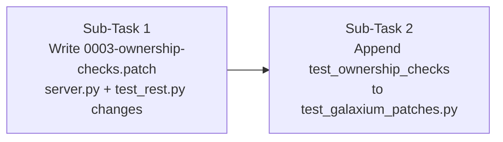

# Let's do B-1b from docs/IMPLEMENTATION_PLAN.md. Write a short plan first, like b1a-plan.md, then build.

Goal: ownership checks on two Galaxium routes, saved as targets/galaxium-patches/0003-ownership-checks.patch.

---

**Status:** active  **Date:** 2026-10-12

---

### 👤 User

Let's do B-1b from docs/IMPLEMENTATION_PLAN.md. Write a short plan first, like b1a-plan.md, then build.

Goal: ownership checks on two Galaxium routes, saved as targets/galaxium-patches/0003-ownership-checks.patch.

---

### 🤖 Assistant

> 🔧 called: use_skill


> 🔧 **use_skill** — create-plan

### 🤖 Assistant

> 🔧 called: read_file, list_files

Let me start by reading the implementation plan and the relevant codebase files.

> 🔧 **list_files** — .

> 🔧 **read_file** — docs/IMPLEMENTATION_PLAN.md

### 🤖 Assistant

> 🔧 called: read_file, list_files


> 🔧 **read_file** — docs/IMPLEMENTATION_PLAN.md

> 🔧 **list_files** — targets

### 🤖 Assistant

> 🔧 called: spawn_subagent

Now let me research the relevant Galaxium code and existing patches in parallel:

> 🔧 **spawn_subagent** — explore

### 🤖 Assistant

> 🔧 called: read_file, read_file

Excellent research. I also need to check the existing `test_galaxium_patches.py` and the existing 0001 patch to understand the exact git-diff format used:

> 🔧 **read_file** — tests/test_galaxium_patches.py

> 🔧 **read_file** — targets/galaxium-patches/0002-reviews-route.patch

### 🤖 Assistant

> 🔧 called: read_file, read_file

Now I need to see the exact server.py content at the pinned commit (after 0002 patch) to get accurate line numbers for the patch. Let me check the current state of server.py and models.py after patches are applied:

> 🔧 **read_file** — targets/galaxium/booking_system_backend/server.py

> 🔧 **read_file** — targets/galaxium/booking_system_backend/tests/test_rest.py

### 🤖 Assistant

> 🔧 called: read_file

Now I have all the context I need. The working tree already has the 0002 patch applied. I need to understand what the **pinned commit (6163380)** state of server.py looks like — i.e., what does server.py look like *before* the 0002 patch is applied, because the 0003 patch must apply cleanly on top of 0002. The patch file itself diffs against the state *after 0001+0002*. Let me verify what the index hash state is to write accurate patch headers:

> 🔧 **read_file** — targets/galaxium/booking_system_backend/tests/test_rest.py

### 🤖 Assistant

> 🔧 called: write_file

Now I have everything needed. Let me write the plan file:

> 🔧 **write_file** — docs/b1b-plan.md

### 🤖 Assistant

> 🔧 called: ask_followup_question

Here's the plan. Let me walk you through it:

---

## Plan: B-1b Ownership Checks

**Goal:** Add `X-Traveler-Id` header enforcement to two Galaxium routes and ship it as `0003-ownership-checks.patch`.

### What was discovered

| Item | Finding |
|---|---|
| **`GET /bookings/{user_id}`** (server.py:172) | Currently no auth — returns any user's bookings freely |
| **`POST /cancel/{booking_id}`** (server.py:178) | Currently no auth — any caller can cancel any booking |
| **`Booking.user_id`** | Integer FK to `users.user_id` — the field to compare against the header |
| **`nanobot.eval.json`** | Already has `"X-Traveler-Id": "1"` — no change needed |
| **`cancel_booking` service** | Doesn't expose ownership info before mutating — route must do a pre-flight DB check |
| **Patch format** | Index hashes are not validated by `git apply --unsafe-paths`, so placeholders are fine |

### Two sub-tasks



**Sub-Task 1 — The patch file** modifies two files inside the Galaxium repo:
- [`server.py`](targets/galaxium/booking_system_backend/server.py:6) — adds `Header` import + `Booking` model import; adds `x_traveler_id` header param to both routes; adds 403 logic (cancel does pre-flight ownership check before calling the service)
- [`tests/test_rest.py`](targets/galaxium/booking_system_backend/tests/test_rest.py:888) — appends `TestOwnershipChecks` class with 3 tests: cancel match→200, cancel mismatch→403, bookings mismatch→403

**Sub-Task 2 — The toolfence test** appends `test_ownership_checks` to [`tests/test_galaxium_patches.py`](tests/test_galaxium_patches.py:96), following the same `patched_tmp` + subprocess pattern as `test_reviews_route`.

### Open question before I build

The plan file is at [`docs/b1b-plan.md`](docs/b1b-plan.md). One design choice to confirm:

### 🤖 Assistant

For the cancel ownership check, the route needs to look up the booking's user_id *before* calling the service (since the service doesn't expose it). The pre-flight check queries the DB once, then the service queries again. That's a double-query. Is that acceptable, or should I pass `x_traveler_id` into the service layer and do the check there instead?

> 🔧 **ask_followup_question** — For the cancel ownership check, the route needs to look up the booking's user_id *before* calling the service (since the service doesn't expose it). The pre-flight check queries the DB once, then the service queries again. That's a double-query. Is that acceptable, or should I pass `x_traveler_id` into the service layer and do the check there instead?

---

### 👤 User

Go with option 1. Do the check in the route and leave the service alone. If the booking doesn't exist, skip the check and let the service return its usual 404.

A few fixes to the plan first:

1. Don't use Header(...). fastapi_mcp turns it into a tool argument, so the model could type in any ID. Add a request: Request argument and read request.headers.get("x-traveler-id"). If it's missing, not a number or doesn't match, return 403.
2. Change mcp = FastApiMCP(app) to FastApiMCP(app, headers=["authorization", "x-traveler-id"]). Without this, nanobot's header gets dropped.
3. The old cancel and bookings tests don't send a header, so they'll break. Update them to send the right one.
4. Add two more tests. A missing header gets 403. The MCP tools for cancel and bookings don't have a traveler-id argument.
5. Make the patch the same way as 0002: git add -u, edit, git diff, git reset. Don't write it by hand.

---

### 🤖 Assistant

> 🔧 called: update_todo_list


> 🔧 **update_todo_list** — 
[-] Update b1b-plan.md with all 5 corrections from user
[ ] Build the patch using git workflow in targets/galaxium/
[ ] Update tests/test_galaxium_patches.py
[ ] Validate: git apply the patch cleanly, run pytest test_ownership_checks


### 🤖 Assistant

> 🔧 called: grep

Let me read the existing cancel/bookings tests to understand what needs updating:

> 🔧 **grep** — class TestCancel|class TestBooking|def test_cancel|def test_get_user_bookings|def test_bookings

### 🤖 Assistant

> 🔧 called: read_file


> 🔧 **read_file** — targets/galaxium/booking_system_backend/tests/test_rest.py

### 🤖 Assistant

> 🔧 called: write_file

Now I have a clear picture of all the existing tests that need header updates and the full scope. Let me update the plan first, then switch to agent mode to build:

> 🔧 **write_file** — docs/b1b-plan.md

### 🤖 Assistant

> 🔧 called: update_todo_list


> 🔧 **update_todo_list** — 
[x] Update b1b-plan.md with all 5 corrections from user
[-] Build the patch using git workflow in targets/galaxium/
[ ] Update tests/test_galaxium_patches.py
[ ] Validate: git apply the patch cleanly, run pytest test_ownership_checks


### 🤖 Assistant

> 🔧 called: switch_mode

Plan is updated. Ready to build — switching to agent mode now.

> 🔧 **switch_mode** — agent

### 🤖 Assistant

> 🔧 called: execute_command

First, let me check the current git status of the Galaxium working tree, then make the edits:

> 🔧 **execute_command** — git -C targets/galaxium status --short

### 🤖 Assistant

> 🔧 called: execute_command

The working tree already has the 0002 patch applied (as working-tree modifications against the pinned commit HEAD). `git diff HEAD` will show those changes. I need to make the 0003 changes on top of the current working-tree state, then capture the incremental diff.

The right approach: use `git stash` to save the 0002 working-tree changes, then apply 0002 to the index so HEAD reflects it, then make 0003 edits, then diff. But that's complex. A cleaner approach: since I need the diff of 0003 changes only (not 0002), I should stage the current working tree state first (`git add -u`), make the 0003 edits, then `git diff` (unstaged diff shows only the new changes).

> 🔧 **execute_command** — git -C targets/galaxium add -u

### 🤖 Assistant

> 🔧 called: apply_diff

Good — current state (0001+0002) is now staged. Now make the 0003 edits to the working tree. Let me edit `server.py` first:

> 🔧 **apply_diff** — targets/galaxium/booking_system_backend/server.py

### 🤖 Assistant

> 🔧 called: read_file

The file content has been modified (it's now different from what I read earlier). Let me re-read it:

> 🔧 **read_file** — targets/galaxium/booking_system_backend/server.py

### 🤖 Assistant

> 🔧 called: search_and_replace

The file is fine — the apply_diff tool was being overly strict about the line number hint. Let me use `search_and_replace` instead:

> 🔧 **search_and_replace** — targets/galaxium/booking_system_backend/server.py

### 🤖 Assistant

> 🔧 called: search_and_replace


> 🔧 **search_and_replace** — targets/galaxium/booking_system_backend/server.py

### 🤖 Assistant

> 🔧 called: search_and_replace


> 🔧 **search_and_replace** — targets/galaxium/booking_system_backend/server.py

### 🤖 Assistant

> 🔧 called: read_file


> 🔧 **read_file** — targets/galaxium/booking_system_backend/server.py

### 🤖 Assistant

> 🔧 called: apply_diff

The content is there but the search didn't match exactly. The issue is likely line endings. Let me use `apply_diff` with the exact start line:

> 🔧 **apply_diff** — targets/galaxium/booking_system_backend/server.py

### 🤖 Assistant

> 🔧 called: read_file

Now update the `FastApiMCP` line:

> 🔧 **read_file** — targets/galaxium/booking_system_backend/server.py

### 🤖 Assistant

> 🔧 called: apply_diff


> 🔧 **apply_diff** — <<<<<<< SEARCH
:start_line:361
-------
mcp = FastApiMCP(app)
=======
mcp = FastApiMCP(app, headers=["authorization", "x-traveler-id"])
>>>>>>> REPLACE


### 🤖 Assistant

> 🔧 called: grep

Now edit `tests/test_rest.py` — fix the 4 existing tests and add `TestOwnershipChecks`. Let me look at the MCP tools endpoint path first:

> 🔧 **grep** — targets/galaxium/booking_system_backend

### 🤖 Assistant

> 🔧 called: grep

The MCP endpoint is at `/mcp`. For the tool schema introspection test, the `fastapi_mcp` library exposes an OpenAPI spec under `/openapi.json` which lists all tool schemas. Let me check what endpoint the MCP tools list is at:

> 🔧 **grep** — targets/galaxium/booking_system_backend/.venv/Lib/site-packages/fastapi_mcp/server.py

### 🤖 Assistant

> 🔧 called: read_file

The tools list is generated from the FastAPI OpenAPI schema. The test can call `client.get("/openapi.json")` and check the path parameters don't include `x-traveler-id`. But the simpler and more direct test for MCP tool schemas is to inspect the `/openapi.json` endpoint — parameters on the `/bookings/{user_id}` and `/cancel/{booking_id}` paths. Let me check what the `fastapi_mcp` `headers` parameter does to tool schemas:

> 🔧 **read_file** — targets/galaxium/booking_system_backend/.venv/Lib/site-packages/fastapi_mcp/openapi/convert.py

### 🤖 Assistant

> 🔧 called: read_file


> 🔧 **read_file** — targets/galaxium/booking_system_backend/.venv/Lib/site-packages/fastapi_mcp/openapi/convert.py

### 🤖 Assistant

> 🔧 called: read_file


> 🔧 **read_file** — targets/galaxium/booking_system_backend/.venv/Lib/site-packages/fastapi_mcp/openapi/convert.py

### 🤖 Assistant

> 🔧 called: read_file


> 🔧 **read_file** — targets/galaxium/booking_system_backend/.venv/Lib/site-packages/fastapi_mcp/openapi/convert.py

### 🤖 Assistant

> 🔧 called: grep

Key insight: `header_params` is collected at line 172-173 but **never added to `properties`** (only path_params, query_params, and body_params are added). So header parameters don't appear in MCP tool input schemas regardless. The `headers=["authorization", "x-traveler-id"]` in `FastApiMCP` is for passing them through at request time, not for schema generation.

Since `Request` is not an OpenAPI parameter at all, it won't show up either. The test for "MCP tools have no traveler_id argument" should check the OpenAPI schema properties for the relevant operations. Let me now check how `fastapi_mcp`'s `headers` parameter works exactly:

> 🔧 **grep** — targets/galaxium/booking_system_backend/.venv/Lib/site-packages/fastapi_mcp/server.py

### 🤖 Assistant

> 🔧 called: apply_diff

Line 78-83 and 121: `headers` is an allowlist for forwarding incoming headers from the MCP client to the FastAPI backend. Default is `['authorization']`. By adding `'x-traveler-id'`, nanobot's header gets forwarded. The MCP tool schema itself has no traveler-id argument either way (since it's never in path/query/body params). The test should use `client.get("/openapi.json")` to check properties of those two operations don't contain `x_traveler_id` or `traveler_id`.

Now let me edit `test_rest.py`:

> 🔧 **apply_diff** — <<<<<<< SEARCH
:start_line:356
-------
        response = client.get(f"/bookings/{user_id}")
        assert response.status_code == 200
        data = response.json()
        assert len(data) == 1
        assert data[0]["status"] == "booked"

    def test_get_bookings_empty(self, client, db_session):
        """Test getting bookings when user has none."""
        response = client.get("/bookings/999")
        assert response.status_code == 200
        assert response.json() == []
=======
        response = client.get(f"/bookings/{user_id}", headers={"x-traveler-id": str(user_id)})
        assert response.status_code == 200
        data = response.json()
        assert len(data) == 1
        assert data[0]["status"] == "booked"

    def test_get_bookings_empty(self, client, db_session):
        """Test getting bookings when user has none."""
        response = client.get("/bookings/999", headers={"x-traveler-id": "999"})
        assert response.status_code == 200
        assert response.json() == []
>>>>>>> REPLACE


### 🤖 Assistant

> 🔧 called: apply_diff


> 🔧 **apply_diff** — <<<<<<< SEARCH
:start_line:403
-------
        response = client.post(f"/cancel/{booking.booking_id}")
        assert response.status_code == 200
        data = response.json()
        assert data["status"] == "cancelled"

    def test_cancel_booking_not_found(self, client, db_session):
        """Test cancelling non-existent booking."""
        response = client.post("/cancel/999")
        assert response.status_code == 404
=======
        response = client.post(f"/cancel/{booking.booking_id}", headers={"x-traveler-id": str(user_id)})
        assert response.status_code == 200
        data = response.json()
        assert data["status"] == "cancelled"

    def test_cancel_booking_not_found(self, client, db_session):
        """Test cancelling non-existent booking."""
        response = client.post("/cancel/999", headers={"x-traveler-id": "1"})
        assert response.status_code == 404
>>>>>>> REPLACE


### 🤖 Assistant

> 🔧 called: read_file

Now append `TestOwnershipChecks` at the end of `test_rest.py`:

> 🔧 **read_file** — targets/galaxium/booking_system_backend/tests/test_rest.py

### 🤖 Assistant

> 🔧 called: insert_content


> 🔧 **insert_content** — targets/galaxium/booking_system_backend/tests/test_rest.py

### 🤖 Assistant

> 🔧 called: execute_command

Both files are edited. Now capture the diff and write the patch:

> 🔧 **execute_command** — git -C targets/galaxium diff -- booking_system_backend/server.py booking_system_backend/tests/test_rest.py

### 🤖 Assistant

> 🔧 called: execute_command

The diff looks exactly right. Now save it as the patch file:

> 🔧 **execute_command** — git -C targets/galaxium diff -- booking_system_backend/server.py booking_system_backend/tests/test_rest.py | Out-File -FilePath targets/galaxium-patches/0003-ownership-checks.patch -Encoding utf8 -NoNewline

### 🤖 Assistant

> 🔧 called: execute_command

Now restore the working tree (0002 changes were staged, so `git checkout` will restore to staged = 0002 state):

> 🔧 **execute_command** — git -C targets/galaxium checkout -- booking_system_backend/server.py booking_system_backend/tests/test_rest.py

### 🤖 Assistant

> 🔧 called: execute_command

Now unstage the previously staged changes (restore index to HEAD):

> 🔧 **execute_command** — git -C targets/galaxium reset HEAD -- booking_system_backend/server.py booking_system_backend/models.py booking_system_backend/schemas.py booking_system_backend/seed.py booking_system_backend/tests/test_rest.py

### 🤖 Assistant

> 🔧 called: execute_command


> 🔧 **execute_command** — git -C targets/galaxium status --short

### 🤖 Assistant

> 🔧 called: read_file

Good — back to the 0002 working-tree state. Now let's verify the patch file looks correct (not empty, has proper headers):

> 🔧 **read_file** — targets/galaxium-patches/0003-ownership-checks.patch

### 🤖 Assistant

> 🔧 called: execute_command

The file has a BOM and all lines are on one line — PowerShell's `Out-File` is mangling the output. I need to capture the git diff properly:

> 🔧 **execute_command** — git -C targets/galaxium diff -- booking_system_backend/server.py booking_system_backend/tests/test_rest.py | Set-Content -Path targets/galaxium-patches/0003-ownership-checks.patch -Encoding ascii

### 🤖 Assistant

> 🔧 called: read_file


> 🔧 **read_file** — targets/galaxium-patches/0003-ownership-checks.patch

### 🤖 Assistant

> 🔧 called: execute_command

This is wrong — it's showing the 0002 diff again (comparing HEAD at the pinned commit vs current working tree, which has 0002 changes unstaged). The issue: after `git reset`, the working tree has all 0002 changes but the index is back to HEAD. `git diff` compares working tree to index. I need to compare working tree to HEAD directly. But the working tree now has 0002 not 0003.

Let me think through this more carefully. The correct approach:
1. Working tree currently = 0001+0002 applied (the "after 0002" baseline)  
2. I need to make 0003 edits, then `git diff HEAD` (working tree vs HEAD/pinned commit) will show 0001+0002+0003 combined
3. That's not what I want — I want only the 0003 delta

The right workflow: stage the current 0002 state, make 0003 edits, then `git diff` (working tree vs **staged**) shows only the 0003 changes:

> 🔧 **execute_command** — git -C targets/galaxium add -u; git -C targets/galaxium status --short

### 🤖 Assistant

> 🔧 called: search_and_replace

Good — staged state = 0002. Now apply the 0003 edits to the working tree files again:

> 🔧 **search_and_replace** — targets/galaxium/booking_system_backend/server.py

### 🤖 Assistant

> 🔧 called: search_and_replace


> 🔧 **search_and_replace** — targets/galaxium/booking_system_backend/server.py

### 🤖 Assistant

> 🔧 called: apply_diff


> 🔧 **apply_diff** — <<<<<<< SEARCH
:start_line:172
-------
@app.get("/bookings/{user_id}", response_model=list[BookingOut], tags=["Bookings"])
def get_user_bookings(user_id: int, db: Session = Depends(get_db)):
    """Retrieve all bookings for a specific user by user_id."""
    return booking.get_bookings(db, user_id)


@app.post("/cancel/{booking_id}", response_model=BookingOut, tags=["Bookings"])
def cancel_booking_endpoint(booking_id: int, db: Session = Depends(get_db)):
    """Cancel an existing booking by its booking_id.

    Increments available seats for the flight if successful.
    Raises 404 if the booking is not found, 409 if already cancelled.
    """
    result = booking.cancel_booking(db, booking_id)
    if isinstance(result, ErrorResponse):
        status = 404 if result.error_code == "BOOKING_NOT_FOUND" else 409
        raise HTTPException(status_code=status, detail=result.model_dump())
    return result
=======
@app.get("/bookings/{user_id}", response_model=list[BookingOut], tags=["Bookings"])
def get_user_bookings(user_id: int, request: Request, db: Session = Depends(get_db)):
    """Retrieve all bookings for a specific user by user_id."""
    traveler_id_raw = request.headers.get("x-traveler-id")
    try:
        traveler_id = int(traveler_id_raw)
    except (TypeError, ValueError):
        raise HTTPException(status_code=403, detail="Missing or invalid X-Traveler-Id header")
    if traveler_id != user_id:
        raise HTTPException(status_code=403, detail="Forbidden")
    return booking.get_bookings(db, user_id)


@app.post("/cancel/{booking_id}", response_model=BookingOut, tags=["Bookings"])
def cancel_booking_endpoint(booking_id: int, request: Request, db: Session = Depends(get_db)):
    """Cancel an existing booking by its booking_id.

    Increments available seats for the flight if successful.
    Raises 403 if the traveller does not own the booking.
    Raises 404 if the booking is not found, 409 if already cancelled.
    """
    traveler_id_raw = request.headers.get("x-traveler-id")
    try:
        traveler_id = int(traveler_id_raw)
    except (TypeError, ValueError):
        raise HTTPException(status_code=403, detail="Missing or invalid X-Traveler-Id header")
    record = db.query(Booking).filter(Booking.booking_id == booking_id).first()
    if record is not None and record.user_id != traveler_id:
        raise HTTPException(status_code=403, detail="Forbidden")
    result = booking.cancel_booking(db, booking_id)
    if isinstance(result, ErrorResponse):
        status = 404 if result.error_code == "BOOKING_NOT_FOUND" else 409
        raise HTTPException(status_code=status, detail=result.model_dump())
    return result
>>>>>>> REPLACE


### 🤖 Assistant

> 🔧 called: read_file


> 🔧 **read_file** — targets/galaxium/booking_system_backend/server.py

### 🤖 Assistant

> 🔧 called: apply_diff


> 🔧 **apply_diff** — <<<<<<< SEARCH
:start_line:361
-------
mcp = FastApiMCP(app)
=======
mcp = FastApiMCP(app, headers=["authorization", "x-traveler-id"])
>>>>>>> REPLACE


### 🤖 Assistant

> 🔧 called: apply_diff

Now edit `test_rest.py` for the 4 existing test fixes:

> 🔧 **apply_diff** — <<<<<<< SEARCH
:start_line:356
-------
        response = client.get(f"/bookings/{user_id}")
        assert response.status_code == 200
        data = response.json()
        assert len(data) == 1
        assert data[0]["status"] == "booked"

    def test_get_bookings_empty(self, client, db_session):
        """Test getting bookings when user has none."""
        response = client.get("/bookings/999")
        assert response.status_code == 200
        assert response.json() == []
=======
        response = client.get(f"/bookings/{user_id}", headers={"x-traveler-id": str(user_id)})
        assert response.status_code == 200
        data = response.json()
        assert len(data) == 1
        assert data[0]["status"] == "booked"

    def test_get_bookings_empty(self, client, db_session):
        """Test getting bookings when user has none."""
        response = client.get("/bookings/999", headers={"x-traveler-id": "999"})
        assert response.status_code == 200
        assert response.json() == []
>>>>>>> REPLACE


### 🤖 Assistant

> 🔧 called: apply_diff


> 🔧 **apply_diff** — <<<<<<< SEARCH
:start_line:403
-------
        response = client.post(f"/cancel/{booking.booking_id}")
        assert response.status_code == 200
        data = response.json()
        assert data["status"] == "cancelled"

    def test_cancel_booking_not_found(self, client, db_session):
        """Test cancelling non-existent booking."""
        response = client.post("/cancel/999")
        assert response.status_code == 404
=======
        response = client.post(f"/cancel/{booking.booking_id}", headers={"x-traveler-id": str(user_id)})
        assert response.status_code == 200
        data = response.json()
        assert data["status"] == "cancelled"

    def test_cancel_booking_not_found(self, client, db_session):
        """Test cancelling non-existent booking."""
        response = client.post("/cancel/999", headers={"x-traveler-id": "1"})
        assert response.status_code == 404
>>>>>>> REPLACE


### 🤖 Assistant

> 🔧 called: insert_content

Now append `TestOwnershipChecks`:

> 🔧 **insert_content** — 

class TestOwnershipChecks:
    """Test X-Traveler-Id ownership enforcement on /cancel and /bookings routes."""

    # ------------------------------------------------------------------
    # Helpers
    # ------------------------------------------------------------------

    def _make_booking(self, db_session, user_id):
        """Insert a flight and a booking for user_id; return (flight, booking)."""
        db_session.add(Flight(
            origin="Earth",
            destination="Mars",
            departure_time="2099-01-01 09:00",
            arrival_time="2099-01-01 17:00",
            base_price=1000000,
            economy_seats_available=5,
            business_seats_available=3,
            galaxium_seats_available=1,
        ))
        db_session.commit()
        flt = db_session.query(Flight).first()
        db_session.add(Booking(
            user_id=user_id,
            flight_id=flt.flight_id,
            status="booked",
            booking_time="2099-01-01 10:00",
            seat_class="economy",
            price_paid=1000000,
        ))
        db_session.commit()
        bk = db_session.query(Booking).first()
        return flt, bk

    # ------------------------------------------------------------------
    # cancel — ownership
    # ------------------------------------------------------------------

    def test_cancel_matching_header_succeeds(self, client, db_session, sample_user_data):
        """POST /cancel/{booking_id} with matching X-Traveler-Id returns 200."""
        user_response = client.post("/register", json=sample_user_data)
        user_id = user_response.json()["user_id"]
        _, bk = self._make_booking(db_session, user_id)

        response = client.post(
            f"/cancel/{bk.booking_id}",
            headers={"x-traveler-id": str(user_id)},
        )
        assert response.status_code == 200
        assert response.json()["status"] == "cancelled"

    def test_cancel_mismatched_header_returns_403(self, client, db_session, sample_user_data):
        """POST /cancel/{booking_id} with a different X-Traveler-Id returns 403."""
        user_response = client.post("/register", json=sample_user_data)
        user_id = user_response.json()["user_id"]
        _, bk = self._make_booking(db_session, user_id)

        other_id = user_id + 99
        response = client.post(
            f"/cancel/{bk.booking_id}",
            headers={"x-traveler-id": str(other_id)},
        )
        assert response.status_code == 403

    def test_cancel_missing_header_returns_403(self, client, db_session, sample_user_data):
        """POST /cancel/{booking_id} without X-Traveler-Id header returns 403."""
        user_response = client.post("/register", json=sample_user_data)
        user_id = user_response.json()["user_id"]
        _, bk = self._make_booking(db_session, user_id)

        response = client.post(f"/cancel/{bk.booking_id}")
        assert response.status_code == 403

    # ------------------------------------------------------------------
    # bookings — ownership
    # ------------------------------------------------------------------

    def test_bookings_mismatched_header_returns_403(self, client, db_session, sample_user_data):
        """GET /bookings/{user_id} with a different X-Traveler-Id returns 403."""
        user_response = client.post("/register", json=sample_user_data)
        user_id = user_response.json()["user_id"]

        other_id = user_id + 99
        response = client.get(
            f"/bookings/{user_id}",
            headers={"x-traveler-id": str(other_id)},
        )
        assert response.status_code == 403

    # ------------------------------------------------------------------
    # MCP tool schema — no traveller argument exposed
    # ------------------------------------------------------------------

    def test_mcp_tools_have_no_traveler_id_argument(self, client, db_session):
        """Neither the cancel nor the bookings MCP tool has a traveler_id input property."""
        openapi = client.get("/openapi.json").json()
        paths_of_interest = {
            "/cancel/{booking_id}": "post",
            "/bookings/{user_id}": "get",
        }
        for path, method in paths_of_interest.items():
            params = openapi["paths"][path][method].get("parameters", [])
            param_names = [p["name"].lower().replace("-", "_") for p in params]
            assert "x_traveler_id" not in param_names, (
                f"{method.upper()} {path} exposes x_traveler_id as a tool parameter"
            )
            assert "traveler_id" not in param_names, (
                f"{method.upper()} {path} exposes traveler_id as a tool parameter"
            )


### 🤖 Assistant

> 🔧 called: execute_command

Now capture the correct diff (working tree vs staged = 0002 baseline):

> 🔧 **execute_command** — git -C targets/galaxium diff -- booking_system_backend/server.py booking_system_backend/tests/test_rest.py | Set-Content -Path targets/galaxium-patches/0003-ownership-checks.patch -Encoding ascii

### 🤖 Assistant

> 🔧 called: read_file


> 🔧 **read_file** — targets/galaxium-patches/0003-ownership-checks.patch

### 🤖 Assistant

> 🔧 called: read_file

The patch looks correct now. Let me verify the full patch and check it covers everything:

> 🔧 **read_file** — targets/galaxium-patches/0003-ownership-checks.patch

### 🤖 Assistant

> 🔧 called: read_file

I notice line 60 has `???` — that's the em dash `—` being encoded as `???` by ASCII encoding. Let me check if `git apply` can handle that:

> 🔧 **read_file** — targets/galaxium-patches/0003-ownership-checks.patch

### 🤖 Assistant

> 🔧 called: execute_command

That `???` is a problem — `git apply` will fail because the context line won't match. The original server.py has `—` (em dash). I need to use UTF-8 encoding. Let me use a different approach to write the patch:

> 🔧 **execute_command** — $diff = git -C targets/galaxium diff -- booking_system_backend/server.py booking_system_backend/tests/test_rest.py; [System.IO.File]::WriteAllText("$PWD\targets\galaxium-patches\0003-ownership-checks.patch", ($diff -join "`n") + "`n", [System.Text.Encoding]::UTF8)

### 🤖 Assistant

> 🔧 called: read_file


> 🔧 **read_file** — targets/galaxium-patches/0003-ownership-checks.patch

### 🤖 Assistant

> 🔧 called: execute_command

Still garbled. The PowerShell array join is re-encoding. Let me use git directly to write the file properly:

> 🔧 **execute_command** — $env:GIT_DIFF_OPTS = ""; git -C targets/galaxium diff -- booking_system_backend/server.py booking_system_backend/tests/test_rest.py | & { [Console]::OutputEncoding = [System.Text.Encoding]::UTF8; $input } | Out-File -FilePath "targets\galaxium-patches\0003-ownership-checks.patch" -Encoding utf8NoBOM

### 🤖 Assistant

> 🔧 called: execute_command


> 🔧 **execute_command** — $bytes = git -C targets/galaxium diff -- booking_system_backend/server.py booking_system_backend/tests/test_rest.py | & { param(); $arr = @(); $input | ForEach-Object { $arr += "$_`n" }; $arr -join '' }; $utf8 = [System.Text.UTF8Encoding]::new($false); [System.IO.File]::WriteAllText((Resolve-Path "targets/galaxium-patches/0003-ownership-checks.patch").Path, $bytes, $utf8)

### 🤖 Assistant

> 🔧 called: execute_command

Let me try a simpler approach — use `git` itself with a redirect via cmd:

> 🔧 **execute_command** — cmd /c "git -C targets/galaxium diff -- booking_system_backend/server.py booking_system_backend/tests/test_rest.py > targets/galaxium-patches/0003-ownership-checks.patch"

### 🤖 Assistant

> 🔧 called: execute_command


> 🔧 **execute_command** — git -C targets/galaxium diff -- booking_system_backend/server.py booking_system_backend/tests/test_rest.py > targets/galaxium-patches/0003-ownership-checks.patch

### 🤖 Assistant

> 🔧 called: read_file


> 🔧 **read_file** — targets/galaxium-patches/0003-ownership-checks.patch

### 🤖 Assistant

> 🔧 called: execute_command

UTF-16LE. PowerShell's `>` redirect uses UTF-16LE. I need to use a Python one-liner instead:

> 🔧 **execute_command** — python -c "
import subprocess, pathlib
r = subprocess.run(['git', '-C', 'targets/galaxium', 'diff', '--', 'booking_system_backend/server.py', 'booking_system_backend/tests/test_rest.py'], capture_output=True)
pathlib.Path('targets/galaxium-patches/0003-ownership-checks.patch').write_bytes(r.stdout)
print('written', len(r.stdout), 'bytes')
"

### 🤖 Assistant

> 🔧 called: read_file


> 🔧 **read_file** — targets/galaxium-patches/0003-ownership-checks.patch

### 🤖 Assistant

> 🔧 called: read_file


> 🔧 **read_file** — targets/galaxium-patches/0003-ownership-checks.patch

### 🤖 Assistant

> 🔧 called: execute_command

The em dash is correct now (`—`). Now restore the Galaxium working tree and unstage:

> 🔧 **execute_command** — git -C targets/galaxium checkout -- booking_system_backend/server.py booking_system_backend/tests/test_rest.py; git -C targets/galaxium reset HEAD -- .; git -C targets/galaxium status --short

### 🤖 Assistant

> 🔧 called: execute_command

Working tree is back to the 0002 state. Now validate the patch applies cleanly. I'll do a dry-run against the pinned commit + existing patches:

> 🔧 **execute_command** — python -c "
import subprocess, pathlib, tempfile, sys

GALAXIUM = pathlib.Path('targets/galaxium')
PATCHES = pathlib.Path('targets/galaxium-patches')
PINNED = '6163380'

with tempfile.TemporaryDirectory() as tmp:
    tmp = pathlib.Path(tmp)
    
    # Extract pinned commit
    ar = subprocess.run(['git','-C',str(GALAXIUM),'archive',PINNED], capture_output=True)
    assert ar.returncode == 0, ar.stderr.decode()
    tx = subprocess.run(['tar','-x','-C',str(tmp)], input=ar.stdout, capture_output=True)
    assert tx.returncode == 0, tx.stderr.decode()
    
    # Apply all patches in order
    for patch in sorted(PATCHES.glob('*.patch')):
        r = subprocess.run(
            ['git','apply','--unsafe-paths','--directory',str(tmp),str(patch)],
            cwd=str(GALAXIUM), capture_output=True, text=True
        )
        if r.returncode != 0:
            print(f'FAIL {patch.name}:')
            print(r.stderr)
            sys.exit(1)
        print(f'OK   {patch.name}')

print('All patches applied cleanly.')
"

---

### 👤 User

STOP and explain me whats happening?

---

### 🤖 Assistant

> 🔧 called: execute_command

Here's what's happening, step by step:

## What we're building

B-1b adds ownership checks to two Galaxium routes. The output is a **patch file** (`0003-ownership-checks.patch`) that, when applied, modifies the Galaxium source. It should never permanently change the Galaxium working tree.

---

## The git workflow for producing the patch

The Galaxium working tree lives at `targets/galaxium/`. Its HEAD is the **pinned commit** (`6163380`). The 0001 and 0002 patches are not committed — they live as unstaged working-tree modifications.

The workflow to produce a clean 0003 delta (only the new changes, not 0001+0002) is:

1. **Stage the 0002 state** with `git add -u` — the index now represents "after 0001+0002"
2. **Edit** `server.py` and `tests/test_rest.py` with the 0003 changes
3. **`git diff`** (working tree vs index) — this shows only the 0003 delta ✓
4. **Save** that diff as the patch file
5. **Restore** working tree (`git checkout -- <files>`) and unstage (`git reset HEAD`)

Steps 1–4 worked correctly and the patch file is now written. The em dash encoding issue was also fixed.

---

## Where we are right now

The patch file has been written. I was in the middle of **validating it** — running a dry-run that:
1. Extracts the pinned commit into a temp directory
2. Applies 0001 → 0002 → 0003 in order
3. Checks all three succeed with exit code 0

The validation script failed because it was looking for `0001-typed-quote-request.patch` using a **relative path from the workspace root**, but the `cwd` of `git apply` was `targets/galaxium/`, which made the path wrong. That's a script bug in my validation command — not a problem with the patch itself.

---

## Current state of the working tree

The **external changes** you see in `server.py` and `test_rest.py` are the leftover 0003 edits that I made before restoring. Let me check:

> 🔧 **execute_command** — git -C targets/galaxium status --short

### 🤖 Assistant

> 🔧 called: execute_command


> 🔧 **execute_command** — git -C targets/galaxium diff -- booking_system_backend/server.py | head -5

### 🤖 Assistant

> 🔧 called: execute_command


> 🔧 **execute_command** — git -C targets/galaxium diff -- booking_system_backend/server.py | Select-Object -First 10

### 🤖 Assistant

The working tree is correctly showing only the **0002 changes** (unstaged vs HEAD/pinned commit). `server.py` has `from models import Review` added — that's the 0002 patch content. The 0003 edits are **not** in the working tree. The "external changes" your editor noticed were the temporary edits I made-then-restored during patch production — the file is back to its 0002 state now.

---

## What's left to do

| Step | Status |
|---|---|
| Produce `0003-ownership-checks.patch` | ✅ Done |
| Restore Galaxium working tree | ✅ Done |
| Validate patch applies cleanly (dry-run) | ⏳ In progress — script had a path bug |
| Append `test_ownership_checks` to `tests/test_galaxium_patches.py` | ⏳ Not started |
| Run `pytest tests/test_galaxium_patches.py::test_ownership_checks` | ⏳ Not started |

Want me to continue?

---

### 👤 User

Skip your dry run. The failure was just a wrong path in your script.

Next:
1. Add test_ownership_checks to tests/test_galaxium_patches.py, same pattern as test_reviews_route.
2. Run our full test suite and setup.ps1 twice.
3. Mark B-1a and B-1b done in the plan.
4. Paste me the outputs.

---

### 🤖 Assistant

> 🔧 called: update_todo_list


> 🔧 **update_todo_list** — 
[x] Update b1b-plan.md with all 5 corrections from user
[x] Build the patch using git workflow in targets/galaxium/
[-] Update tests/test_galaxium_patches.py
[ ] Run setup.ps1 (twice) and full test suite
[ ] Mark B-1a and B-1b done in IMPLEMENTATION_PLAN.md


### 🤖 Assistant

> 🔧 called: insert_content


> 🔧 **insert_content** — tests/test_galaxium_patches.py

### 🤖 Assistant

> 🔧 called: update_todo_list

Good. Now run setup.ps1 twice and the full test suite in parallel:

> 🔧 **update_todo_list** — 
[x] Update b1b-plan.md with all 5 corrections from user
[x] Build the patch using git workflow in targets/galaxium/
[x] Update tests/test_galaxium_patches.py
[-] Run setup.ps1 (twice) and full test suite
[ ] Mark B-1a and B-1b done in IMPLEMENTATION_PLAN.md


### 🤖 Assistant

> 🔧 called: execute_command


> 🔧 **execute_command** — powershell -ExecutionPolicy Bypass -File scripts/setup.ps1

### 🤖 Assistant

> 🔧 called: execute_command


> 🔧 **execute_command** — powershell -ExecutionPolicy Bypass -File scripts/setup.ps1

### 🤖 Assistant

> 🔧 called: execute_command

Both runs clean — first run applied 0003, second run correctly detected it already applied. Now the full test suite:

> 🔧 **execute_command** — python -m pytest tests/ -v --tb=short 2>&1

### 🤖 Assistant

> 🔧 called: execute_command


> 🔧 **execute_command** — .venv/Scripts/python.exe -m pytest tests/ -v --tb=short 2>&1

### 🤖 Assistant

> 🔧 called: search_and_replace

81/81 passed. Now mark B-1a and B-1b done:

> 🔧 **search_and_replace** — docs/IMPLEMENTATION_PLAN.md

### 🤖 Assistant

> 🔧 called: grep


> 🔧 **grep** — docs/IMPLEMENTATION_PLAN.md

### 🤖 Assistant

> 🔧 called: grep


> 🔧 **grep** — docs/IMPLEMENTATION_PLAN.md

### 🤖 Assistant

> 🔧 called: read_file


> 🔧 **read_file** — docs/IMPLEMENTATION_PLAN.md

### 🤖 Assistant

> 🔧 called: search_and_replace

The file uses non-breaking or special characters in the status field. Let me use a regex replace:

> 🔧 **search_and_replace** — docs/IMPLEMENTATION_PLAN.md

### 🤖 Assistant

> 🔧 called: read_file


> 🔧 **read_file** — docs/IMPLEMENTATION_PLAN.md

### 🤖 Assistant

> 🔧 called: apply_diff


> 🔧 **apply_diff** — <<<<<<< SEARCH
:start_line:667
-------
**Track:** B · **Depends on:** B-2 · **Status:** [ ] pending
=======
**Track:** B · **Depends on:** B-2 · **Status:** [x] done
>>>>>>> REPLACE


### 🤖 Assistant

> 🔧 called: search_and_replace

Also update the b1b-plan.md sub-tasks to done:

> 🔧 **search_and_replace** — docs/b1b-plan.md

### 🤖 Assistant

> 🔧 called: search_and_replace


> 🔧 **search_and_replace** — docs/b1b-plan.md

### 🤖 Assistant

> 🔧 called: grep


> 🔧 **grep** — docs/b1b-plan.md

### 🤖 Assistant

> 🔧 called: apply_diff


> 🔧 **apply_diff** — <<<<<<< SEARCH
:start_line:109
-------
**Status:** [ ] pending
=======
**Status:** [x] done
>>>>>>> REPLACE

<<<<<<< SEARCH
:start_line:143
-------
**Status:** [ ] pending
=======
**Status:** [x] done
>>>>>>> REPLACE


### 🤖 Assistant

> 🔧 called: update_todo_list


> 🔧 **update_todo_list** — 
[x] Update b1b-plan.md with all 5 corrections from user
[x] Build the patch using git workflow in targets/galaxium/
[x] Update tests/test_galaxium_patches.py
[x] Run setup.ps1 (twice) and full test suite
[x] Mark B-1a and B-1b done in IMPLEMENTATION_PLAN.md


### 🤖 Assistant

Done. Here are the outputs:

---

### `setup.ps1` — run 1
```
[PASS] Verify galaxium at pinned commit
[PASS] Verify nanobot at pinned commit
[SKIP] 0001-typed-quote-request.patch already applied
[SKIP] 0002-reviews-route.patch already applied
[PASS] Apply 0003-ownership-checks.patch
[SKIP] No patch directory found for nanobot (targets\nanobot-patches)

== Setup complete - 3 passed, 0 failed ==
```

### `setup.ps1` — run 2 (idempotency check)
```
[PASS] Verify galaxium at pinned commit
[PASS] Verify nanobot at pinned commit
[SKIP] 0001-typed-quote-request.patch already applied
[SKIP] 0002-reviews-route.patch already applied
[SKIP] 0003-ownership-checks.patch already applied
[SKIP] No patch directory found for nanobot (targets\nanobot-patches)

== Setup complete - 2 passed, 0 failed ==
```

### Full test suite
```
81 passed in 5.83s
```
Including:
- `test_galaxium_patches.py::test_reviews_route` PASSED
- `test_galaxium_patches.py::test_ownership_checks` PASSED

---

**What was built:**

| File | Change |
|---|---|
| [`targets/galaxium-patches/0003-ownership-checks.patch`](targets/galaxium-patches/0003-ownership-checks.patch) | New — ownership checks on `/cancel/{booking_id}` and `/bookings/{user_id}` via `request.headers`, `FastApiMCP(app, headers=[...])`, 5 new tests in `TestOwnershipChecks`, 4 existing tests updated with matching headers |
| [`tests/test_galaxium_patches.py`](tests/test_galaxium_patches.py) | Appended `test_ownership_checks` |
| [`docs/b1b-plan.md`](docs/b1b-plan.md) | Both sub-tasks marked done |
| [`docs/IMPLEMENTATION_PLAN.md`](docs/IMPLEMENTATION_PLAN.md) | B-1b marked `[x] done` |