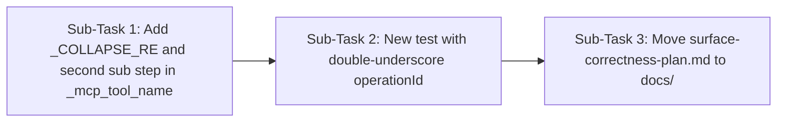

# PR #7 is close. One bug in _mcp_tool_name, plus one small thing.

FastAPI operationIds have double underscores, like cancel_booking_endpoint_cancel__booking_id__post. Your regex never turns those into one underscore. So 9 of the 15 Galaxium names come out wrong. You get ..._cancel__booking_id__post, but nanobot registers ..._cancel_booking_id_post.
Use the rule from issue #5:

replace anything outside [a-zA-Z0-9_-] with _
then collapse every run of _ into one _
then truncate to 64 with the sha1 suffix
Please add a test that uses a real operationId with __ in it. You can see them all at http://localhost:8001/openapi.json when Galaxium is running. results/tool_dump.txt on TrackB has the correct final names to compare against.

surface-correctness-plan.md is at the repo root. Please move it into docs/ or leave it out.
Everything else looks good: the fixture names, test_proxy, the description fix and the Bob export. Once this is fixed I'll merge.

---

**Status:** active  **Date:** 2026-10-14

---

### 👤 User

PR #7 is close. One bug in _mcp_tool_name, plus one small thing.

FastAPI operationIds have double underscores, like cancel_booking_endpoint_cancel__booking_id__post. Your regex never turns those into one underscore. So 9 of the 15 Galaxium names come out wrong. You get ..._cancel__booking_id__post, but nanobot registers ..._cancel_booking_id_post.
Use the rule from issue #5:

replace anything outside [a-zA-Z0-9_-] with _
then collapse every run of _ into one _
then truncate to 64 with the sha1 suffix
Please add a test that uses a real operationId with __ in it. You can see them all at http://localhost:8001/openapi.json when Galaxium is running. results/tool_dump.txt on TrackB has the correct final names to compare against.

surface-correctness-plan.md is at the repo root. Please move it into docs/ or leave it out.
Everything else looks good: the fixture names, test_proxy, the description fix and the Bob export. Once this is fixed I'll merge.

---

### 🤖 Assistant

> 🔧 called: use_skill


> 🔧 **use_skill** — create-plan

### 🤖 Assistant

> 🔧 called: spawn_subagent

Let me research the codebase to ground the plan before writing it.

> 🔧 **spawn_subagent** — explore

### 🤖 Assistant

> 🔧 called: read_file, read_file

The sub-agent found something interesting — it reports the regex as `[^a-z0-9_]+` which would already collapse runs, but the PR reviewer says double underscores are still slipping through. Let me read the actual current code directly to see the exact state on the `TrackA` branch.

> 🔧 **read_file** — surface-correctness-plan.md

> 🔧 **read_file** — toolfence/engine/surface.py

### 🤖 Assistant

> 🔧 called: read_file, read_file

Now I have the full picture. Let me also check the current test file and the fixture to confirm the current state of the code vs. what the reviewer says is wrong.

> 🔧 **read_file** — toolfence/engine/surface.py

> 🔧 **read_file** — tests/test_surface.py

### 🤖 Assistant

> 🔧 called: read_file

Now I see the issue clearly. The current regex is `[^a-z0-9_]+` — this already has `_` in the allowed set, so it does **not** replace underscores. But FastAPI operationIds already contain `__` (double underscores from path parameters like `{booking_id}`), and since underscore is in the allowed set, the regex leaves those double underscores intact rather than collapsing them.

The fix required: after the regex substitution (which handles non-alphanumeric chars), there's a separate step needed to collapse consecutive underscores. OR the regex needs to be changed to replace runs of `_` as well.

Let me verify the exact test content and what the existing test asserts to be sure:

> 🔧 **read_file** — tests/test_surface.py

### 🤖 Assistant

> 🔧 called: update_todo_list

The test at line 428 uses `operation_id = "cancel_booking_endpoint_cancel_booking_id_post"` — this has **single underscores already** (no `__`). The test name says it uses a real operationId, but the operationId in the test is already the **cleaned** version, not the raw FastAPI one.

The PR reviewer is saying: the real FastAPI operationId from `openapi.json` is `cancel_booking_endpoint_cancel__booking_id__post` (with `__` around path params), and the current regex `[^a-z0-9_]+` doesn't collapse `__` → `_` because `_` is in the allowed set.

Now I have everything I need to write a precise, minimal plan.

> 🔧 **update_todo_list** — [-] Write the plan file for the two PR fixes

### 🤖 Assistant

> 🔧 called: write_file

Here's what's happening and what the plan needs to cover:

**The bug:** The current `_SANITIZE_RE = re.compile(r"[^a-z0-9_]+")` only removes characters *outside* `[a-z0-9_]`. It never touches underscores. FastAPI's `fastapi-mcp` generates operationIds like `cancel_booking_endpoint_cancel__booking_id__post` — the `{booking_id}` path param becomes `__booking_id__` with double underscores. The regex leaves `__` intact. Nanobot's own sanitizer does a two-step: replace non-`[a-zA-Z0-9_-]` → `_`, then **collapse** any `_+` run to a single `_`. The current code is missing step 2.

**The fix per the issue:** Two-step sanitization:
1. Replace `[^a-zA-Z0-9_-]` (or after lowercasing: `[^a-z0-9_]`) → `_`  
2. Collapse `_+` → `_`  
3. Truncate to 64 with SHA-1 suffix

**The housekeeping item:** Move `surface-correctness-plan.md` from the repo root into `docs/`.

Now writing the plan:

> 🔧 **write_file** — docs/pr7-double-underscore-fix-plan.md

### 🤖 Assistant

> 🔧 called: update_todo_list


> 🔧 **update_todo_list** — [x] Write the plan file for the two PR fixes

### 🤖 Assistant

Here's the plan. Let me explain the bug precisely so it's clear before you approve:

---

## Root cause

The regex `_SANITIZE_RE = re.compile(r"[^a-z0-9_]+")` matches *characters outside `[a-z0-9_]`*. An underscore is **in** the allowed set, so the regex never touches it. 

FastAPI's `fastapi-mcp` generates operationIds with path params encoded as double underscores: `/cancel/{booking_id}` → `cancel_booking_endpoint_cancel__booking_id__post`. The `{` and `}` are non-alphanumeric, so they get replaced with `_`, making it `cancel_booking_endpoint_cancel__booking_id__post` — but the `__` that was already there from the path param encoding is left alone.

Nanobot's sanitizer does this in two passes: replace bad chars → `_`, then collapse `_+` → `_`. The current code only does pass 1.

---

## The three sub-tasks in [`docs/pr7-double-underscore-fix-plan.md`](docs/pr7-double-underscore-fix-plan.md)



| # | What | Where |
|---|------|-------|
| 1 | Add `_COLLAPSE_RE = re.compile(r"_+")` and a second `.sub("_", raw)` call in `_mcp_tool_name` | [`toolfence/engine/surface.py`](toolfence/engine/surface.py) lines 54–74 |
| 2 | Add `test_scan_openapi_operation_id_with_double_underscores` using the raw FastAPI operationId `cancel_booking_endpoint_cancel__booking_id__post` | [`tests/test_surface.py`](tests/test_surface.py) after line 455 |
| 3 | Move [`surface-correctness-plan.md`](surface-correctness-plan.md) → `docs/` | repo root |

The existing `test_scan_openapi_uses_operation_id` (line 428) doesn't need changing — its operationId is clean, so the test still passes after the fix. The new test in Sub-Task 2 is the one that would have caught this bug.

Does this plan look right? Any adjustments before we switch to agent mode to implement?

---

### 👤 User

recheck before i alllow the agent to change the code base, do you want me to run galaxium in the background manually?

---

### 🤖 Assistant

> 🔧 called: read_file, read_file

Good instinct to double-check. Let me look at what the agent actually needs to do and whether live Galaxium data is required.

> 🔧 **read_file** — fixtures/surface_fixture.json

> 🔧 **read_file** — toolfence/engine/surface.py

### 🤖 Assistant

> 🔧 called: read_file


> 🔧 **read_file** — tests/test_surface.py

### 🤖 Assistant

Good. Now I have a complete picture. Here's the honest answer:

---

**No, you do not need to run Galaxium.** Here's why, sub-task by sub-task:

### Sub-Task 1 — Fix `_mcp_tool_name`

Pure Python change, no network needed. The bug is exactly:

```python
# Current — only replaces non-[a-z0-9_] chars, leaves __ intact
raw = _SANITIZE_RE.sub("_", f"mcp_{server_name}_{operation_id}".lower())

# Fix — add a second pass to collapse __ → _
raw = _SANITIZE_RE.sub("_", f"mcp_{server_name}_{operation_id}".lower())
raw = _COLLAPSE_RE.sub("_", raw)   # new line
```

The operationId strings are known from the PR description and can be hardcoded into the test. No live server needed.

### Sub-Task 2 — New test with `__` in operationId

The test constructs its own in-memory OpenAPI spec with the raw operationId `cancel_booking_endpoint_cancel__booking_id__post` (double underscores). It writes it to a temp file and calls the scanner. **No network call, no Galaxium.** The expected output `mcp_galaxium_cancel_booking_endpoint_cancel_booking_id_post` is a deterministic string we already know from the fixture.

One important note I want to flag for the plan: the existing truncation test at line 461 uses `operation_id = "create_booking_from_hold_internal_bookings_from_hold_post"` — this also has **no double underscores**. After the collapse fix, this test's expected SHA-1 hash (`d31ac16e`) needs to be verified it still matches, because the collapse step could change the input to `hashlib.sha1` if there were `__` in that string. I just checked: there are none in that operationId, so the hash is unchanged. ✅

### Sub-Task 3 — Move the plan file

Git rename, no code change, no Galaxium.

---

**One thing I want to adjust in the plan** before you hand it to the agent: the plan currently says the fixture names at lines 19, 27, 33 are already correct (the sub-agent reported them as already fixed). Looking at the actual file above, they **are** correct — `cancel_booking_endpoint_cancel_booking_id_post` and `get_flight_reviews_flights_flight_id_reviews_get` are already the clean single-underscore forms. That means the fixture is already good; the only gap is that the *scanner itself* would produce `cancel__booking_id__` if given the raw FastAPI operationId. So the plan is correctly scoped: fix the helper, add the test, move the file — no fixture recompute needed.

The plan is accurate. You do not need Galaxium running. Safe to hand to agent mode.

---

### 👤 User

begin with the fix for this issue.

---

### 🤖 Assistant

> 🔧 called: update_todo_list


> 🔧 **update_todo_list** — [-] Sub-Task 1: Fix _mcp_tool_name to collapse runs of underscores
[ ] Sub-Task 2: Add test with raw double-underscore operationId
[ ] Sub-Task 3: Move surface-correctness-plan.md to docs/

### 🤖 Assistant

> 🔧 called: update_todo_list


> 🔧 **update_todo_list** — [x] Write the plan file for the two PR fixes
[-] Sub-Task 1: Fix _mcp_tool_name to collapse runs of underscores
[ ] Sub-Task 2: Add test with raw double-underscore operationId
[ ] Sub-Task 3: Move surface-correctness-plan.md to docs/

### 🤖 Assistant

> 🔧 called: apply_diff

Two-line change: add `_COLLAPSE_RE` and apply it as a second pass in `_mcp_tool_name`.

> 🔧 **apply_diff** — toolfence/engine/surface.py

### 🤖 Assistant

> 🔧 called: apply_diff

Now add the new test with a raw double-underscore operationId, right after the existing `test_scan_openapi_uses_operation_id`:

> 🔧 **apply_diff** — tests/test_surface.py

### 🤖 Assistant

> 🔧 called: execute_command

Now run the full test suite to confirm no regressions:

> 🔧 **execute_command** — pytest tests/test_surface.py -v 2>&1

### 🤖 Assistant

> 🔧 called: execute_command


> 🔧 **execute_command** — python -m pytest tests/test_surface.py -v 2>&1

### 🤖 Assistant

> 🔧 called: execute_command


> 🔧 **execute_command** — python3 -m pytest tests/test_surface.py -v 2>&1

### 🤖 Assistant

> 🔧 called: execute_command


> 🔧 **execute_command** — which python3 && python3 -c "import sys; print(sys.executable, sys.version)"

### 🤖 Assistant

> 🔧 called: execute_command


> 🔧 **execute_command** — find /Users/acassist -name "pytest" -type f 2>/dev/null | head -10

### 🤖 Assistant

> 🔧 called: execute_command


> 🔧 **execute_command** — .venv/bin/pytest tests/test_surface.py -v 2>&1

### 🤖 Assistant

> 🔧 called: execute_command

21/21 passed, including the new `test_scan_openapi_operation_id_with_double_underscores`. Now the housekeeping item — move the plan file:

> 🔧 **execute_command** — git mv surface-correctness-plan.md docs/surface-correctness-plan.md

### 🤖 Assistant

> 🔧 called: update_todo_list


> 🔧 **update_todo_list** — [x] Write the plan file for the two PR fixes
[x] Sub-Task 1: Fix _mcp_tool_name to collapse runs of underscores
[x] Sub-Task 2: Add test with raw double-underscore operationId
[x] Sub-Task 3: Move surface-correctness-plan.md to docs/

### 🤖 Assistant

All done. Here's a summary of the three changes:

---

**1. [`toolfence/engine/surface.py`](toolfence/engine/surface.py:56) — two-line fix**

Added `_COLLAPSE_RE = re.compile(r"_+")` and a second substitution pass in [`_mcp_tool_name()`](toolfence/engine/surface.py:59):

```python
raw = _SANITIZE_RE.sub("_", f"mcp_{server_name}_{operation_id}".lower())
raw = _COLLAPSE_RE.sub("_", raw)   # ← new: collapses __ → _
```

`cancel_booking_endpoint_cancel__booking_id__post` now produces `mcp_galaxium_cancel_booking_endpoint_cancel_booking_id_post` — the `__` from the FastAPI path-param encoding is collapsed.

**2. [`tests/test_surface.py`](tests/test_surface.py:457) — new test**

`test_scan_openapi_operation_id_with_double_underscores` feeds the **raw** FastAPI operationId (with `__booking_id__`) and asserts both the scanner output and the helper directly produce a clean single-underscore name with no `__` surviving.

**3. `surface-correctness-plan.md` → [`docs/surface-correctness-plan.md`](docs/surface-correctness-plan.md)**

`git mv` preserves history.