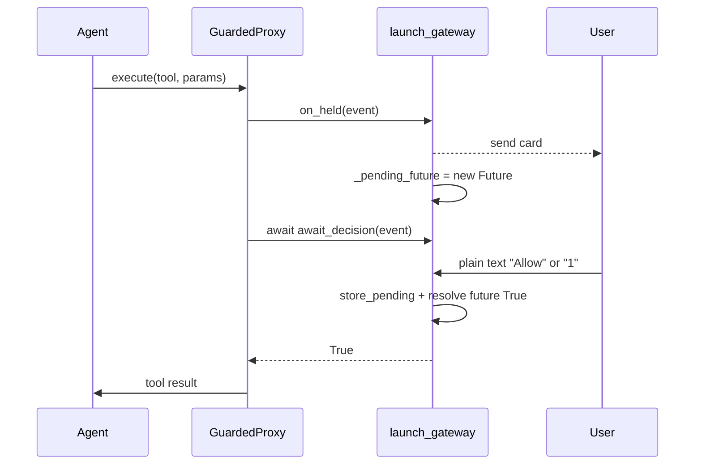

# Rework B-4b: a held call should wait for the user's answer instead of the agent retrying. C added an optional await_decision to GuardedProxy (async, takes a HeldCallEvent, returns a bool).

- Pass it through install_guard, and leave on_held and confirm_grant as they are.
 - In launch_gateway.py, keep one waiting decision per held call, with one card and a 120 s timeout.
 - Allow or "1" approves, and Decline or "2" declines. Any other text while waiting gets "Waiting for your answer: tap Allow/Decline or reply 1 / 2." and doesn't reach the agent.
 - Keep a single store_pending call site.

Write the plan in docs/b4b-channel-adapter-plan.md and wait for my go. Leave the pyyaml line in pyproject.toml.

---

**Status:** active  **Date:** 2026-10-15

---

### 👤 User

Rework B-4b: a held call should wait for the user's answer instead of the agent retrying. C added an optional await_decision to GuardedProxy (async, takes a HeldCallEvent, returns a bool).

- Pass it through install_guard, and leave on_held and confirm_grant as they are.
 - In launch_gateway.py, keep one waiting decision per held call, with one card and a 120 s timeout.
 - Allow or "1" approves, and Decline or "2" declines. Any other text while waiting gets "Waiting for your answer: tap Allow/Decline or reply 1 / 2." and doesn't reach the agent.
 - Keep a single store_pending call site.

Write the plan in docs/b4b-channel-adapter-plan.md and wait for my go. Leave the pyyaml line in pyproject.toml.

---

### 🤖 Assistant

> 🔧 called: use_skill

> 🔧 **use_skill** — create-plan

### 🤖 Assistant

> 🔧 called: spawn_subagent

Now let me research the codebase to ground the plan.

> 🔧 **spawn_subagent** — explore

### 🤖 Assistant

> 🔧 called: read_file, read_file

The subagent found that the existing implementation uses the Telegram button/callback approach — the proxy fires `on_held`, returns the hold sentinel immediately, and relies on the user tapping a button that calls back into `confirm_grant.store_pending`, after which the agent retries. The request is to **replace** this retry-based pattern with a blocking `await_decision` pattern: when a hold fires, the gateway suspends the call, sends one card, waits up to 120 s for a plain-text reply ("Allow"/"1" or "Decline"/"2"), resolves the future, and the proxy proceeds — no agent retry needed.

Let me read the key files to verify exact current state before writing the plan.

> 🔧 **read_file** — toolfence/guard/proxy.py

> 🔧 **read_file** — toolfence/integration/installer.py

### 🤖 Assistant

> 🔧 called: read_file, read_file

> 🔧 **read_file** — toolfence/integration/channel_adapter.py

> 🔧 **read_file** — scripts/launch_gateway.py

### 🤖 Assistant

> 🔧 called: read_file, read_file

Now I have a complete picture. Let me read the IMPLEMENTATION_PLAN.md to understand what B-4b was supposed to do and what tests currently exist.

> 🔧 **read_file** — docs/IMPLEMENTATION_PLAN.md

> 🔧 **read_file** — tests/test_integration.py

### 🤖 Assistant

> 🔧 called: write_file

Now I have a complete picture. The current implementation uses the Telegram **button/callback** pattern: proxy fires `on_held`, returns `_HOLD_SENTINEL` to the agent immediately, and the agent has to retry after the user taps a button. The request changes this to an **`await_decision`-based** blocking pattern: the proxy awaits a future, the gateway suspends the held call, sends one card, waits for a **plain-text message** ("Allow"/"1" or "Decline"/"2") within 120 s, resolves the future, and the proxy resumes.

Let me now write the plan:

> 🔧 **write_file** — docs/b4b-channel-adapter-plan.md

### 🤖 Assistant

The plan is written at [`docs/b4b-channel-adapter-plan.md`](docs/b4b-channel-adapter-plan.md). Here's a summary:

---

## What the rework does

The current B-4b fires `on_held`, returns `_HOLD_SENTINEL` to the agent immediately, and waits for the agent to **retry** after a button tap calls `confirm_grant.store_pending`. The rework makes the held call **block** until the user answers.

---

## Three sub-tasks

**Sub-Task 1 — `installer.py`** (tiny)  
Add optional `await_decision` keyword arg to `install_guard`; pass it into `GuardedProxy(...)`. No existing call sites break.

**Sub-Task 2 — `launch_gateway.py` + `channel_adapter.py`** (main work)  
- `channel_adapter.py`: `wrap_callback_query` gets an optional `resolve_decision: Callable[[bool], None]` param; removes the `store_pending` call; calls `resolve_decision(True/False)` instead. Card and button UX unchanged.  
- `launch_gateway.py`: pending state gains `_pending_future: asyncio.Future[bool] | None`. `on_held` creates the future. New `async _await_decision` awaits it with 120 s timeout, calls `store_pending` only on `True`. The inbound-message wrapper intercepts text while a call is held: Allow/1 → resolve `True`; Decline/2 → resolve `False`; anything else → sends the nudge and **stops** (message not forwarded to agent). `install_guard` receives `await_decision=_await_decision`.

**Sub-Task 3 — Tests**  
- `test_store_pending_called_from_only_one_place` updated to assert **0** sites in `integration/`.  
- New `test_store_pending_in_launch_gateway` asserts exactly 1 site in `scripts/launch_gateway.py`.  
- Two callback tests updated for the `resolve_decision` signature.  
- Four new tests: allow resolves true, decline resolves false, nudge on unknown text, 120 s timeout → false.

---

One question before you give the go: the existing `wrap_callback_query` call in `launch_gateway.py` (line 280–286) currently omits `resolve_decision`. After the rework, button taps should also resolve the future. Is it acceptable to wire `resolve_decision` into that existing call — so both button taps **and** plain-text replies resolve the future — or should button taps be left as no-ops on the future (i.e. purely cosmetic in the new model)?

---

### 👤 User

Good direction. Fix these, then rewrite the plan cleanly without the thinking-out-loud parts:
1. Put the decision logic in a DecisionGate class in channel_adapter.py. It owns on_held (card sent once), await_decision (one future, 120 s timeout), button taps, typed replies, and the only store_pending call. launch_gateway.py just wires it up. Tests use the class directly, not a copy.
2. While a decision is pending, check the reply before recording provenance. "1"/"2"/Allow/Decline and nudged text must never be recorded as user input.
3. One decision at a time. If a different call is held while one is waiting, decline it immediately.
4. Always drop is_callback inbound messages, so taps never reach the agent.
5. Only intercept Telegram messages from the allowed user. Other channels pass through.
6. Use get_running_loop(), not get_event_loop().

Keep the existing single store_pending test as it is

---

### 🤖 Assistant

> 🔧 called: read_file, read_file

> 🔧 **read_file** — toolfence/guard/confirm.py

> 🔧 **read_file** — toolfence/guard/card.py

### 🤖 Assistant

> 🔧 called: write_file

Now I have everything I need. Let me rewrite the plan cleanly.

> 🔧 **write_file** — docs/b4b-channel-adapter-plan.md

### 🤖 Assistant

Plan is at [`docs/b4b-channel-adapter-plan.md`](docs/b4b-channel-adapter-plan.md). Here's the summary:

---

## 4 sub-tasks

**Sub-Task 1 — `DecisionGate` in `channel_adapter.py`**  
New class with six methods. Owns all decision state:

| Method | Does |
|---|---|
| `on_held(event)` | If idle: store event, create `Future` via `get_running_loop()`, add hash to dedup set, schedule card task. If busy: set `_busy=True` flag so second call is declined. |
| `await_decision(event)` | If `_busy`: clear flag, return `False`. Else: `wait_for(future, 120)` → timeout → `False`. On `True`: call `store_pending`, return `True`. |
| `handle_inbound(sender_id, text)` | If no pending or sender not allowed: return `False`. Allow/1 → resolve `True`. Decline/2 → resolve `False`. Other → send nudge. All consumed paths return `True`. |
| `resolve(approved)` | Sets future result if not done; calls `clear()`. |
| `clear()` | Cancels future if pending; resets all state. |

`wrap_callback_query` gains optional `resolve_decision: Callable[[bool], None] | None` — removes its `store_pending` call, calls `resolve_decision(True/False)` instead.

**Sub-Task 2 — `install_guard` in `installer.py`**  
Add `await_decision` keyword-only param; pass it into every `GuardedProxy(...)` call. All existing call sites unaffected.

**Sub-Task 3 — `launch_gateway.py`**  
Construct one `DecisionGate`; delegate `on_held` to it. Rewrite `_provenance_publish_inbound` with this order: (1) drop `is_callback` silently, (2) `await gate.handle_inbound(sender_id, msg.content)`, (3) if consumed return, (4) record provenance + publish. Pass `resolve_decision=gate.resolve` and `await_decision=gate.await_decision` at their call sites. Remove old `_pending` / `_pending_hashes` state.

**Sub-Task 4 — Tests**  
Two existing tests updated (callback tests for `resolve_decision` spy instead of `store_pending`). `test_store_pending_called_from_only_one_place` kept exactly as-is (it will now assert the one site is in `channel_adapter.py` inside `DecisionGate.await_decision`, which is still in `integration/`). Eight new `test_gate_*` tests cover all `DecisionGate` paths.

---

One open point before you give the go: the existing `test_store_pending_called_from_only_one_place` asserts the single site is in `channel_adapter.py` — that remains true (`store_pending` moves from `wrap_callback_query` into `DecisionGate.await_decision`, still in the same file). Is that what you intended, or should the test also assert the specific method/line?

---

### 👤 User

Nearly there. Answer to your question: the file-level check is enough, no line pinning. Five fixes, then build:
 1. sender_id is a field on InboundMessage (msg.sender_id), not in metadata. Use that, and only intercept when msg.channel == "telegram".
 2. Replace the _busy flag: in await_decision, if event.arguments_hash doesn't match the gate's current event, return False straight away. Remove the "Actually..." paragraph.
 3. wrap_callback_query's get_pending must return the gate's current event.
 4. Delete the old copy-based on_held helper and its 4 test_on_held_* tests. The gate tests replace them.
 5. On timeout, send the user "No answer in time, so I didn't do it."

---

### 🤖 Assistant

> 🔧 called: read_file

> 🔧 **read_file** — docs/b4b-channel-adapter-plan.md

### 🤖 Assistant

> 🔧 called: write_file

Now I'll apply all five fixes in one pass and rewrite the plan cleanly.

> 🔧 **write_file** — docs/b4b-channel-adapter-plan.md

### 🤖 Assistant

Plan updated at [`docs/b4b-channel-adapter-plan.md`](docs/b4b-channel-adapter-plan.md). Here's what changed across the five fixes:

1. **`sender_id` / channel guard** — `_provenance_publish_inbound` now uses `msg.sender_id` (field, not metadata) and gates both the `is_callback` drop and the `handle_inbound` call behind `msg.channel == "telegram"`. Non-Telegram messages fall straight through.

2. **No `_busy` flag** — `on_held` simply returns if `_event is not None`. `await_decision` checks `event.arguments_hash != _event.arguments_hash` and returns `False` immediately on mismatch. Clean, no extra state.

3. **`get_pending` wired to gate** — the launcher passes `get_pending=lambda: gate._event` to `wrap_callback_query` so button taps read the gate's live event.

4. **`_make_on_held_parts` deleted** — the helper and all four `test_on_held_*` tests are removed from Sub-Task 4; the `test_gate_*` suite replaces them by exercising `DecisionGate` directly.

5. **Timeout message** — `await_decision` sends `"No answer in time, so I didn't do it."` via `send_message` on `asyncio.TimeoutError` before returning `False`; verified by `test_gate_await_decision_timeout`.

Ready to implement when you give the go.

---

### 👤 User

One last fix, then build: only one waiter per decision. Track whether await_decision is already waiting on the current future. If a second await_decision arrives for the same hash, return False straight away, so a duplicate call can't run twice. Add a test for it.

---

### 🤖 Assistant

> 🔧 called: apply_diff

> 🔧 **apply_diff** — docs/b4b-channel-adapter-plan.md

### 🤖 Assistant

Plan is final at [`docs/b4b-channel-adapter-plan.md`](docs/b4b-channel-adapter-plan.md). The one change: `DecisionGate` now tracks a `_waiting: bool` flag.

**How it works:**

- `on_held` resets `_waiting = False` when it creates a fresh future.
- `await_decision` checks `_waiting` before proceeding — if already `True`, returns `False` immediately (second caller rejected).
- Sets `_waiting = True` before `wait_for`, resets it to `False` in all exit paths (normal result, timeout, or exception).
- `clear()` also resets `_waiting = False`.

**New test:** `test_gate_duplicate_waiter_declined` — spawns two concurrent `await_decision` tasks for the same event; asserts the second returns `False` immediately while the first is still suspended on the future.

Ready — switch to Agent mode to implement?

---

### 👤 User

Yes

---

### 🤖 Assistant

> 🔧 called: switch_mode

> 🔧 **switch_mode** — agent

### 🤖 Assistant

> 🔧 called: update_todo_list

> 🔧 **update_todo_list** — 
[-] Sub-Task 1: Add DecisionGate to channel_adapter.py + update wrap_callback_query
[ ] Sub-Task 2: Thread await_decision through install_guard
[ ] Sub-Task 3: Rewire launch_gateway.py
[ ] Sub-Task 4: Update and add tests
[ ] Run pytest and confirm green

### 🤖 Assistant

> 🔧 called: read_file

> 🔧 **read_file** — docs/b4b-channel-adapter-plan.md

### 🤖 Assistant

> 🔧 called: write_file

Now I'll write the new `channel_adapter.py`:

> 🔧 **write_file** — toolfence/integration/channel_adapter.py

### 🤖 Assistant

> 🔧 called: apply_diff

Sub-Task 1 done. Now Sub-Task 2 — thread `await_decision` through `install_guard`:

> 🔧 **apply_diff** — toolfence/integration/installer.py

### 🤖 Assistant

> 🔧 called: grep

Sub-Task 2 done. Now Sub-Task 3 — rewire `launch_gateway.py`. I need to check the `InboundMessage` structure first:

> 🔧 **grep** — class InboundMessage|sender_id|\.channel

### 🤖 Assistant

> 🔧 called: write_file

`msg.sender_id` and `msg.channel` are confirmed fields on `InboundMessage`. Now rewrite `launch_gateway.py`:

> 🔧 **write_file** — """Minimal demo gateway launcher with Guard + Telegram confirm card (B-4b).

Usage
-----
Set environment variables then run::

    NANOBOT_CONFIG=config/nanobot.gateway.json \\
    TOOLFENCE_SURFACE=results/surface.json \\
    TELEGRAM_USER_ID=<your-telegram-user-id> \\
    python scripts/launch_gateway.py

Secrets (``BOT_TOKEN``, etc.) stay in the nanobot config file — this script
reads only the Guard-specific variables shown above.

What this script does
---------------------
1. Loads nanobot config and constructs ``bus``, ``tools``, and ``mcp_provider``
   using the same constructors as ``gateway_runtime._run_gateway``.
2. Creates a temporary workspace (``tempfile.mkdtemp()``) for the session, the
   same way ``nanobot_adapter._async_run_turn`` does.
3. Builds a ``DecisionGate`` that owns all hold-decision state.
4. Applies the loopback transport fix (via
   ``nanobot_adapter._mcp_urls_are_all_loopback``) before ``mcp_provider.connect()``
   and restores the original factory after ``mcp_provider.aclose()``.
5. Wraps ``bus.publish_inbound`` to:
   - Drop all Telegram ``is_callback`` inbound messages silently.
   - Pass Telegram text messages through ``gate.handle_inbound`` before
     recording provenance; consumed messages never reach the agent.
   - Record provenance and publish all other messages normally.
6. Builds ``ChannelManager``; gets the ``TelegramChannel``; wraps its
   ``_on_callback_query`` with ``wrap_callback_query`` (passing
   ``resolve_decision=gate.resolve``) before channels start.
7. Runs a minimal async loop: connect MCP → install Guard → start agent and
   channels concurrently → wait for shutdown.

Guard install happens after ``mcp_provider.connect()`` so the MCP tools are
registered before ``install_guard`` wraps them, matching the pattern in
``nanobot_adapter._async_run_turn``.

``on_held`` uses ``asyncio.get_running_loop().create_task(...)`` because it is
called from within the running event loop (inside ``GuardedProxy.execute``).

This is a **demo launcher** scoped to B-4b.  Production features (cron, dream,
heartbeat, health server, WebUI) are out of scope and not wired here.

Import boundary
---------------
This script lives in ``scripts/`` and may import from anywhere including nanobot.
"""
from __future__ import annotations

import asyncio
import functools
import logging
import os
import shutil
import sys
import tempfile
from pathlib import Path
from typing import Any

logging.basicConfig(
    level=logging.INFO,
    format="%(asctime)s %(levelname)s %(name)s: %(message)s",
    stream=sys.stderr,
)
_log = logging.getLogger("toolfence.gateway")

# ---------------------------------------------------------------------------
# Env-var config
# ---------------------------------------------------------------------------

_CONFIG_PATH = os.environ.get("NANOBOT_CONFIG", "config/nanobot.gateway.json")
_SURFACE_PATH = os.environ.get("TOOLFENCE_SURFACE", "results/surface.json")
_CHAT_ID = os.environ.get("TELEGRAM_USER_ID", "")

if not _CHAT_ID:
    print(
        "ERROR: TELEGRAM_USER_ID is not set.\n"
        "Export TELEGRAM_USER_ID=<your-telegram-user-id> and re-run.",
        file=sys.stderr,
    )
    sys.exit(1)

# ---------------------------------------------------------------------------
# Imports (nanobot + toolfence)
# ---------------------------------------------------------------------------

import json as _json

from nanobot.agent.loop import AgentLoop
from nanobot.agent.tools.mcp import MCPProvider
from nanobot.agent.tools.registry import ToolRegistry
from nanobot.bus.events import InboundMessage
from nanobot.bus.queue import MessageBus
from nanobot.channels.manager import ChannelManager
from nanobot.cli.runtime_config import _load_runtime_config
from nanobot.providers.factory import make_provider
from nanobot.session.manager import SessionManager

from toolfence.contracts.guard import HeldCallEvent
from toolfence.contracts.surface import SurfaceFile
from toolfence.guard.confirm import ConfirmGrant
from toolfence.guard.decision import GuardDecision
from toolfence.guard.provenance import ProvenanceStore
from toolfence.guard.taint import SessionTaint
from toolfence.integration.channel_adapter import (
    DecisionGate,
    send_hold_card,
    wrap_callback_query,
)
from toolfence.integration.installer import install_guard
from toolfence.integration.nanobot_adapter import _mcp_urls_are_all_loopback

# ---------------------------------------------------------------------------
# Load config and surface
# ---------------------------------------------------------------------------

_workspace = tempfile.mkdtemp(prefix="toolfence-gateway-")
config = _load_runtime_config(_CONFIG_PATH, _workspace)

surface_map = SurfaceFile.model_validate(
    _json.loads(Path(_SURFACE_PATH).read_text(encoding="utf-8"))
)

# ---------------------------------------------------------------------------
# Core nanobot objects
# ---------------------------------------------------------------------------

bus = MessageBus()
tools = ToolRegistry()
mcp_provider = MCPProvider.from_config(config, tools)
session_manager = SessionManager(Path(_workspace))

provider = make_provider(config)
agent = AgentLoop.from_config(
    config, bus, provider=provider, tool_registry=tools, session_manager=session_manager,
)

# ---------------------------------------------------------------------------
# Guard components
# ---------------------------------------------------------------------------

provenance = ProvenanceStore()
taint = SessionTaint()
decision = GuardDecision()
confirm_grant = ConfirmGrant()

# ---------------------------------------------------------------------------
# Channel manager — build before event loop starts
# ---------------------------------------------------------------------------

channels = ChannelManager(
    config,
    bus,
    session_manager=session_manager,
)

# ---------------------------------------------------------------------------
# Telegram channel — resolve before building DecisionGate
# ---------------------------------------------------------------------------

telegram_ch = channels.get_channel("telegram")

if telegram_ch is None:
    print(
        "WARNING: Telegram channel not found in config. "
        "The confirm card will not be sent.",
        file=sys.stderr,
    )

# ---------------------------------------------------------------------------
# DecisionGate — owns all decision state
# ---------------------------------------------------------------------------

# When there is no Telegram channel, send_card and send_message are no-ops so
# await_decision times out and declines correctly.
if telegram_ch is not None:
    async def _send_card_to_telegram(event: HeldCallEvent) -> None:
        await send_hold_card(event, telegram_ch.send, _CHAT_ID, "telegram")

    async def _send_message_to_telegram(msg: Any) -> None:
        await telegram_ch.send(msg)

    gate = DecisionGate(
        confirm_grant=confirm_grant,
        send_card=_send_card_to_telegram,
        channel=telegram_ch,
        send_message=_send_message_to_telegram,
        chat_id=_CHAT_ID,
        channel_name="telegram",
    )
else:
    async def _noop_send_card(event: HeldCallEvent) -> None:  # type: ignore[misc]
        pass

    async def _noop_send_message(msg: Any) -> None:  # type: ignore[misc]
        pass

    class _NeverAllowed:
        def is_allowed(self, sender_id: str) -> bool:
            return False

    gate = DecisionGate(  # type: ignore[assignment]
        confirm_grant=confirm_grant,
        send_card=_noop_send_card,
        channel=_NeverAllowed(),
        send_message=_noop_send_message,
        chat_id=_CHAT_ID,
        channel_name="telegram",
    )

def on_held(event: HeldCallEvent) -> None:
    """Delegate to gate; log the hold."""
    hash8 = event.arguments_hash[:8]
    _log.info(
        "held tool=%s reason=%s untrusted_arg=%s hash8=%s",
        event.tool_name,
        event.reason,
        event.untrusted_arg_name,
        hash8,
    )
    gate.on_held(event)

# ---------------------------------------------------------------------------
# Wrap bus.publish_inbound for provenance recording and decision interception
# ---------------------------------------------------------------------------

_orig_publish_inbound = bus.publish_inbound

async def _provenance_publish_inbound(msg: InboundMessage) -> None:
    """Gate all inbound messages before provenance and agent.

    Logic order:
    1. Telegram is_callback messages are dropped silently (button taps must
       never reach the agent as a text turn).
    2. Telegram text messages are passed through gate.handle_inbound; if
       consumed (Allow/Decline/nudge), the message is not published.
    3. All other messages are recorded as provenance and published normally.
    """
    if msg.channel == "telegram":
        if msg.metadata.get("is_callback"):
            return  # drop silently — never reaches agent or provenance
        consumed = await gate.handle_inbound(msg.sender_id, msg.content)
        if consumed:
            return  # decision text / nudge — never reaches provenance or agent

    provenance.record_user_message(msg.content)
    await _orig_publish_inbound(msg)

bus.publish_inbound = _provenance_publish_inbound  # type: ignore[method-assign]

# ---------------------------------------------------------------------------
# Telegram callback wrapping — wrap _on_callback_query before channels start
# ---------------------------------------------------------------------------

if telegram_ch is not None:
    def _log_tap_and_wrap(original_wrapped: Any) -> Any:
        """Add a per-tap log line around the already-wrapped callback handler."""

        async def _outer(update: Any, context: Any) -> None:
            user = getattr(update, "effective_user", None)
            button_label: str = (
                getattr(getattr(update, "callback_query", None), "data", "") or ""
            )
            pending = gate._event

            if user is None:
                _log.info("tap button=%r outcome=no-user", button_label)
                await original_wrapped(update, context)
                return

            username = getattr(user, "username", None)
            sender_id = f"{user.id}|{username}" if username else str(user.id)

            if not telegram_ch.is_allowed(sender_id):
                _log.info("tap button=%r sender=%s outcome=disallowed-sender", button_label, sender_id)
                await original_wrapped(update, context)
                return

            if pending is None:
                _log.info("tap button=%r sender=%s outcome=nothing-pending", button_label, sender_id)
                await original_wrapped(update, context)
                return

            hash8 = pending.arguments_hash[:8]
            if button_label == f"Allow #{hash8}":
                _log.info(
                    "tap button=%r sender=%s hash8=%s outcome=allow-matched",
                    button_label, sender_id, hash8,
                )
            elif button_label == f"Decline #{hash8}":
                _log.info(
                    "tap button=%r sender=%s hash8=%s outcome=decline-matched",
                    button_label, sender_id, hash8,
                )
            else:
                _log.info(
                    "tap button=%r sender=%s hash8=%s outcome=wrong-hash",
                    button_label, sender_id, hash8,
                )
            await original_wrapped(update, context)

        return _outer

    _inner_wrapped = wrap_callback_query(
        telegram_ch._on_callback_query,
        confirm_grant,
        telegram_ch,
        get_pending=lambda: gate._event,
        clear_pending=gate.clear,
        resolve_decision=gate.resolve,
    )
    telegram_ch._on_callback_query = _log_tap_and_wrap(_inner_wrapped)  # type: ignore[method-assign]

# ---------------------------------------------------------------------------
# Async entry point
# ---------------------------------------------------------------------------

async def _run() -> None:
    """Connect MCP (with loopback fix), install Guard, run agent + channels."""
    _mcp_mod: Any = None
    _orig_transport_kwargs: Any = None
    try:
        # Apply the loopback transport fix: PinnedDNSAsyncTransport holds a
        # class-level asyncio.Lock during _receive_response_headers, which blocks
        # every subsequent MCP request for the 30 s httpx read timeout when the
        # server is on loopback.  Swap it out for a plain AsyncHTTPTransport for
        # the duration of the session, then restore it on aclose().
        if _mcp_urls_are_all_loopback(config):
            import httpx
            import nanobot.agent.tools.mcp as _mcp_mod  # type: ignore[import]
            _orig_transport_kwargs = _mcp_mod._pinned_transport_kwargs  # type: ignore[attr-defined]
            _mcp_mod._pinned_transport_kwargs = lambda: {"transport": httpx.AsyncHTTPTransport()}  # type: ignore[attr-defined]

        await mcp_provider.connect()

        install_guard(
            tools,
            surface_map,
            provenance,
            taint,
            decision,
            on_held,
            confirm_grant,
            guard_on=True,
            datamark_on=False,
            await_decision=gate.await_decision,
        )

        async def _run_agent() -> None:
            try:
                await agent.run()
            finally:
                await mcp_provider.aclose()
                if _mcp_mod is not None and _orig_transport_kwargs is not None:
                    _mcp_mod._pinned_transport_kwargs = _orig_transport_kwargs  # type: ignore[attr-defined]

        await asyncio.gather(
            _run_agent(),
            channels.start_all(),
        )
    finally:
        await channels.stop_all()
        agent.stop()
        shutil.rmtree(_workspace, ignore_errors=True)

if __name__ == "__main__":
    asyncio.run(_run())

### 🤖 Assistant

> 🔧 called: update_todo_list

Sub-Tasks 1-3 done. Now Sub-Task 4 — update tests. Let me write the updated test file:

> 🔧 **update_todo_list** — 
[x] Sub-Task 1: Add DecisionGate to channel_adapter.py + update wrap_callback_query
[x] Sub-Task 2: Thread await_decision through install_guard
[x] Sub-Task 3: Rewire launch_gateway.py
[-] Sub-Task 4: Update and add tests
[ ] Run pytest and confirm green

### 🤖 Assistant

> 🔧 called: write_file

> 🔧 **write_file** — """B-4b integration tests — channel_adapter.py (no nanobot required).

Test inventory
--------------
  test_send_hold_card_correct_buttons             -- buttons carry #hash8 suffix
  test_wrap_callback_allow_matching_hash_stores_grant
                                                  -- correct hash + allowed → resolve_decision(True)
  test_wrap_callback_wrong_hash_stores_nothing    -- stale card hash → no resolution
  test_wrap_callback_decline_clears_pending       -- Decline → resolve_decision(False)
  test_wrap_callback_no_pending_event_stores_nothing
                                                  -- nothing held → no resolution
  test_wrap_callback_disallowed_sender_stores_nothing
                                                  -- disallowed sender → no resolution
  test_store_pending_called_from_only_one_place   -- single call site in integration/
  test_import_check_channel_adapter               -- no module-level nanobot import

  test_gate_on_held_sends_card_once               -- first event → card task scheduled
  test_gate_await_decision_allow                  -- "Allow" → True, store_pending called
  test_gate_await_decision_decline                -- "Decline" → False, store_pending not called
  test_gate_await_decision_numeric                -- "1" → True; "2" → False
  test_gate_await_decision_timeout                -- timeout → False + timeout message sent
  test_gate_nudge_on_unknown_text                 -- unknown text → nudge sent; future still waiting
  test_gate_second_call_declined_immediately      -- second on_held while pending → await_decision False
  test_gate_duplicate_waiter_declined             -- second concurrent await_decision → False immediately
  test_gate_non_allowed_sender_passes_through     -- disallowed sender → handle_inbound False
"""

from __future__ import annotations

import asyncio
import sys
import types
from pathlib import Path
from types import SimpleNamespace
from typing import Any
from unittest.mock import AsyncMock, MagicMock

import pytest

from toolfence.contracts.guard import HeldCallEvent
from toolfence.guard.confirm import ConfirmGrant
from toolfence.integration.channel_adapter import (
    DecisionGate,
    send_hold_card,
    wrap_callback_query,
)

# ---------------------------------------------------------------------------
# Helpers
# ---------------------------------------------------------------------------

def _run(coro: Any) -> Any:
    return asyncio.run(coro)

def _make_event(
    tool_name: str = "mcp_book_flight",
    args_hash: str = "a3f9c112deadbeef",
) -> HeldCallEvent:
    """Return a minimal HeldCallEvent with known tool_name and arguments_hash."""
    return HeldCallEvent(
        tool_name=tool_name,
        arguments={"dest": "Paris"},
        arguments_hash=args_hash,
        reason="irreversible",
        untrusted_read_count=0,
        untrusted_arg_name=None,
    )

def _make_update(label: str, user_id: int = 42, username: str = "alice") -> SimpleNamespace:
    """Return a minimal fake Telegram Update with callback_query.data = label."""
    return SimpleNamespace(
        callback_query=SimpleNamespace(data=label),
        effective_user=SimpleNamespace(id=user_id, username=username),
    )

# ---------------------------------------------------------------------------
# Fake nanobot.bus.events module so send_hold_card / DecisionGate run without nanobot
# ---------------------------------------------------------------------------

class _FakeOutboundMessage:
    """Minimal stand-in for nanobot.bus.events.OutboundMessage."""

    def __init__(
        self,
        *,
        channel: str,
        chat_id: str,
        content: str,
        buttons: list[list[str]] | None = None,
        **_kw: object,
    ) -> None:
        self.channel = channel
        self.chat_id = chat_id
        self.content = content
        self.buttons = buttons or []

@pytest.fixture(autouse=True)
def _fake_nanobot_bus(monkeypatch: pytest.MonkeyPatch) -> None:
    """Inject a minimal fake nanobot.bus.events into sys.modules."""
    if "nanobot.bus.events" not in sys.modules:
        fake_events = types.ModuleType("nanobot.bus.events")
        fake_events.OutboundMessage = _FakeOutboundMessage  # type: ignore[attr-defined]

        for mod_name in ("nanobot", "nanobot.bus"):
            if mod_name not in sys.modules:
                monkeypatch.setitem(sys.modules, mod_name, types.ModuleType(mod_name))

        monkeypatch.setitem(sys.modules, "nanobot.bus.events", fake_events)

# ---------------------------------------------------------------------------
# send_hold_card
# ---------------------------------------------------------------------------

def test_send_hold_card_correct_buttons() -> None:
    """send_hold_card must produce buttons [['Allow #<hash8>', 'Decline #<hash8>']]."""
    event = _make_event(args_hash="a3f9c112deadbeef")
    hash8 = "a3f9c112"

    send_message = AsyncMock()

    _run(send_hold_card(event, send_message, chat_id="123", channel_name="telegram"))

    send_message.assert_awaited_once()
    msg = send_message.call_args[0][0]
    assert msg.buttons == [[f"Allow #{hash8}", f"Decline #{hash8}"]], (
        f"Expected hashed buttons, got: {msg.buttons}"
    )
    assert msg.channel == "telegram"
    assert msg.chat_id == "123"
    assert msg.content  # non-empty card text

# ---------------------------------------------------------------------------
# wrap_callback_query helpers
# ---------------------------------------------------------------------------

def _make_wrapper_parts(
    event: HeldCallEvent | None = None,
) -> tuple[AsyncMock, ConfirmGrant, MagicMock, list[HeldCallEvent | None]]:
    original_handler = AsyncMock()
    cg = ConfirmGrant()
    channel = MagicMock()
    channel.is_allowed.return_value = True
    pending: list[HeldCallEvent | None] = [event]
    return original_handler, cg, channel, pending

# ---------------------------------------------------------------------------
# wrap_callback_query tests
# ---------------------------------------------------------------------------

def test_wrap_callback_allow_matching_hash_stores_grant() -> None:
    """Allow tap with correct #hash8 → resolve_decision(True) called; pending cleared; original called."""
    event = _make_event(args_hash="a3f9c112deadbeef")
    original, cg, channel, pending = _make_wrapper_parts(event=event)
    resolve_spy: list[bool | None] = []
    wrapper = wrap_callback_query(
        original, cg, channel,
        get_pending=lambda: pending[0],
        clear_pending=lambda: pending.__setitem__(0, None),
        resolve_decision=lambda approved: resolve_spy.append(approved),
    )

    _run(wrapper(_make_update("Allow #a3f9c112"), None))

    assert resolve_spy == [True], f"resolve_decision must be called with True, got {resolve_spy}"
    assert cg._pending_tool is None, "store_pending must not be called directly by wrap_callback_query"
    assert pending[0] is None, "pending cell must be cleared after Allow"
    original.assert_awaited_once()

def test_wrap_callback_wrong_hash_stores_nothing() -> None:
    """Allow tap with wrong #hash8 (stale card) → resolve_decision not called; pending unchanged."""
    event = _make_event(args_hash="a3f9c112deadbeef")
    original, cg, channel, pending = _make_wrapper_parts(event=event)
    resolve_spy: list[bool | None] = []
    wrapper = wrap_callback_query(
        original, cg, channel,
        get_pending=lambda: pending[0],
        clear_pending=lambda: pending.__setitem__(0, None),
        resolve_decision=lambda approved: resolve_spy.append(approved),
    )

    _run(wrapper(_make_update("Allow #00000000"), None))  # different hash

    assert resolve_spy == [], "resolve_decision must not be called for wrong hash"
    assert pending[0] is event, "pending cell must not be cleared for wrong hash"
    original.assert_awaited_once()

def test_wrap_callback_decline_clears_pending() -> None:
    """Decline tap with matching #hash8 → resolve_decision(False) called; pending cleared; original called."""
    event = _make_event(args_hash="a3f9c112deadbeef")
    original, cg, channel, pending = _make_wrapper_parts(event=event)
    resolve_spy: list[bool | None] = []
    wrapper = wrap_callback_query(
        original, cg, channel,
        get_pending=lambda: pending[0],
        clear_pending=lambda: pending.__setitem__(0, None),
        resolve_decision=lambda approved: resolve_spy.append(approved),
    )

    _run(wrapper(_make_update("Decline #a3f9c112"), None))

    assert resolve_spy == [False], f"resolve_decision must be called with False, got {resolve_spy}"
    assert pending[0] is None, "pending cell must be cleared on Decline"
    original.assert_awaited_once()

def test_wrap_callback_no_pending_event_stores_nothing() -> None:
    """Allow tap but nothing held → resolve_decision not called; original called."""
    original, cg, channel, pending = _make_wrapper_parts(event=None)
    resolve_spy: list[bool | None] = []
    wrapper = wrap_callback_query(
        original, cg, channel,
        get_pending=lambda: pending[0],
        clear_pending=lambda: pending.__setitem__(0, None),
        resolve_decision=lambda approved: resolve_spy.append(approved),
    )

    _run(wrapper(_make_update("Allow #a3f9c112"), None))

    assert resolve_spy == []
    original.assert_awaited_once()

def test_wrap_callback_disallowed_sender_stores_nothing() -> None:
    """Disallowed sender → resolve_decision not called; original called."""
    event = _make_event(args_hash="a3f9c112deadbeef")
    original, cg, channel, pending = _make_wrapper_parts(event=event)
    channel.is_allowed.return_value = False
    resolve_spy: list[bool | None] = []
    wrapper = wrap_callback_query(
        original, cg, channel,
        get_pending=lambda: pending[0],
        clear_pending=lambda: pending.__setitem__(0, None),
        resolve_decision=lambda approved: resolve_spy.append(approved),
    )

    _run(wrapper(_make_update("Allow #a3f9c112"), None))

    assert resolve_spy == [], "resolve_decision must not be called for disallowed sender"
    original.assert_awaited_once()

# ---------------------------------------------------------------------------
# Source-level checks
# ---------------------------------------------------------------------------

def test_store_pending_called_from_only_one_place() -> None:
    """Exactly one call site of .store_pending( must exist in toolfence/integration/."""
    integration_dir = Path(__file__).parent.parent / "toolfence" / "integration"
    call_sites: list[tuple[str, int, str]] = []
    for py_file in sorted(integration_dir.glob("*.py")):
        for lineno, line in enumerate(
            py_file.read_text(encoding="utf-8").splitlines(), start=1
        ):
            if ".store_pending(" in line:
                call_sites.append((py_file.name, lineno, line.strip()))

    assert len(call_sites) == 1, (
        f"Expected exactly 1 call site of .store_pending( in toolfence/integration/, "
        f"found {len(call_sites)}: {call_sites}"
    )
    assert call_sites[0][0] == "channel_adapter.py", (
        f"The single store_pending call must be in channel_adapter.py, "
        f"found it in {call_sites[0][0]}"
    )

def test_import_check_channel_adapter() -> None:
    """channel_adapter.py must have no module-level nanobot import."""
    src_path = (
        Path(__file__).parent.parent / "toolfence" / "integration" / "channel_adapter.py"
    )
    for lineno, line in enumerate(src_path.read_text(encoding="utf-8").splitlines(), start=1):
        assert not line.startswith("import nanobot"), (
            f"channel_adapter.py line {lineno}: module-level 'import nanobot' is forbidden "
            f"(nanobot imports must be deferred inside function bodies)"
        )
        assert not line.startswith("from nanobot"), (
            f"channel_adapter.py line {lineno}: module-level 'from nanobot' is forbidden "
            f"(nanobot imports must be deferred inside function bodies)"
        )

# ---------------------------------------------------------------------------
# DecisionGate helper
# ---------------------------------------------------------------------------

def _make_gate(
    allowed: bool = True,
) -> tuple[DecisionGate, list[int], AsyncMock]:
    """Build a DecisionGate with fake send_card / send_message for testing.

    Returns (gate, card_count, send_message_spy).
    ``card_count[0]`` increments each time send_card is called.
    """
    card_count: list[int] = [0]

    async def _fake_send_card(event: HeldCallEvent) -> None:
        card_count[0] += 1

    send_message_spy = AsyncMock()

    channel = MagicMock()
    channel.is_allowed.return_value = allowed

    gate = DecisionGate(
        confirm_grant=ConfirmGrant(),
        send_card=_fake_send_card,
        channel=channel,
        send_message=send_message_spy,
        chat_id="test-chat",
        channel_name="telegram",
    )
    return gate, card_count, send_message_spy

# ---------------------------------------------------------------------------
# DecisionGate tests
# ---------------------------------------------------------------------------

def test_gate_on_held_sends_card_once() -> None:
    """First on_held → card task scheduled; second on_held while pending → not scheduled again."""

    async def _run_test() -> None:
        gate, card_count, _ = _make_gate()
        event = _make_event(args_hash="a3f9c112deadbeef")

        gate.on_held(event)
        await asyncio.sleep(0)  # let the card task run
        assert card_count[0] == 1, "card must be sent on first on_held"

        gate.on_held(event)  # second call while pending
        await asyncio.sleep(0)
        assert card_count[0] == 1, "card must not be sent again while a decision is pending"

    _run(_run_test())

def test_gate_await_decision_allow() -> None:
    """handle_inbound('Allow') → await_decision returns True; store_pending called."""

    async def _run_test() -> bool:
        gate, _, _ = _make_gate()
        event = _make_event(args_hash="a3f9c112deadbeef")

        gate.on_held(event)
        await asyncio.sleep(0)

        # Simulate the user typing "Allow" while await_decision is running.
        async def _approve() -> None:
            await asyncio.sleep(0)
            await gate.handle_inbound("42|alice", "Allow")

        result, _ = await asyncio.gather(
            gate.await_decision(event),
            _approve(),
        )
        return result

    result = _run(_run_test())
    assert result is True, f"await_decision must return True on Allow, got {result!r}"

def test_gate_await_decision_allow_stores_grant() -> None:
    """After allow, confirm_grant.store_pending is populated."""

    async def _run_test() -> ConfirmGrant:
        gate, _, _ = _make_gate()
        event = _make_event(args_hash="a3f9c112deadbeef")
        gate.on_held(event)
        await asyncio.sleep(0)

        async def _approve() -> None:
            await asyncio.sleep(0)
            await gate.handle_inbound("42|alice", "Allow")

        await asyncio.gather(gate.await_decision(event), _approve())
        return gate._confirm_grant

    cg = _run(_run_test())
    assert cg._pending_tool == "mcp_book_flight"
    assert cg._pending_hash == "a3f9c112deadbeef"

def test_gate_await_decision_decline() -> None:
    """handle_inbound('Decline') → await_decision returns False; store_pending not called."""

    async def _run_test() -> tuple[bool, ConfirmGrant]:
        gate, _, _ = _make_gate()
        event = _make_event(args_hash="a3f9c112deadbeef")
        gate.on_held(event)
        await asyncio.sleep(0)

        async def _decline() -> None:
            await asyncio.sleep(0)
            await gate.handle_inbound("42|alice", "Decline")

        result, _ = await asyncio.gather(gate.await_decision(event), _decline())
        return result, gate._confirm_grant

    result, cg = _run(_run_test())
    assert result is False
    assert cg._pending_tool is None, "store_pending must not be called on Decline"

def test_gate_await_decision_numeric() -> None:
    """'1' approves; '2' declines."""

    async def _run_approve() -> bool:
        gate, _, _ = _make_gate()
        event = _make_event(args_hash="aaaa1111bbbb2222")
        gate.on_held(event)
        await asyncio.sleep(0)

        async def _send() -> None:
            await asyncio.sleep(0)
            await gate.handle_inbound("42|alice", "1")

        result, _ = await asyncio.gather(gate.await_decision(event), _send())
        return result

    async def _run_decline() -> bool:
        gate, _, _ = _make_gate()
        event = _make_event(args_hash="cccc3333dddd4444")
        gate.on_held(event)
        await asyncio.sleep(0)

        async def _send() -> None:
            await asyncio.sleep(0)
            await gate.handle_inbound("42|alice", "2")

        result, _ = await asyncio.gather(gate.await_decision(event), _send())
        return result

    assert _run(_run_approve()) is True
    assert _run(_run_decline()) is False

def test_gate_await_decision_timeout() -> None:
    """No reply within timeout → await_decision returns False; timeout message sent."""

    async def _run_test() -> tuple[bool, int]:
        gate, _, send_message_spy = _make_gate()
        event = _make_event(args_hash="a3f9c112deadbeef")
        gate.on_held(event)
        await asyncio.sleep(0)

        # Patch the timeout to near-zero to keep the test fast.
        import toolfence.integration.channel_adapter as _mod
        original_wait_for = asyncio.wait_for

        async def _fast_wait_for(fut: Any, timeout: float) -> Any:  # type: ignore[override]
            return await original_wait_for(fut, timeout=0.01)

        import unittest.mock as _mock
        with _mock.patch("asyncio.wait_for", side_effect=_fast_wait_for):
            result = await gate.await_decision(event)

        await asyncio.sleep(0)  # allow timeout message task to run
        return result, send_message_spy.call_count

    result, msg_count = _run(_run_test())
    assert result is False, "await_decision must return False on timeout"
    assert msg_count >= 1, "timeout message must be sent to user"

def test_gate_nudge_on_unknown_text() -> None:
    """Unrecognised text → nudge sent; handle_inbound returns True; future still pending."""

    async def _run_test() -> tuple[bool, bool, int]:
        gate, _, send_message_spy = _make_gate()
        event = _make_event(args_hash="a3f9c112deadbeef")
        gate.on_held(event)
        await asyncio.sleep(0)

        consumed = await gate.handle_inbound("42|alice", "what do you mean?")
        await asyncio.sleep(0)  # let nudge task run
        future_still_pending = gate._future is not None and not gate._future.done()
        return consumed, future_still_pending, send_message_spy.call_count

    consumed, still_pending, msg_count = _run(_run_test())
    assert consumed is True, "handle_inbound must return True for nudge case"
    assert still_pending, "future must still be pending after nudge"
    assert msg_count >= 1, "nudge message must be sent"

def test_gate_second_call_declined_immediately() -> None:
    """Second on_held while first is pending → await_decision for second returns False immediately."""

    async def _run_test() -> bool:
        gate, _, _ = _make_gate()
        event_a = _make_event(tool_name="tool_a", args_hash="aaaa1111bbbb2222")
        event_b = _make_event(tool_name="tool_b", args_hash="cccc3333dddd4444")

        gate.on_held(event_a)   # first hold — sets up future
        gate.on_held(event_b)   # second hold while first pending — no-op

        # await_decision for event_b must return False immediately (hash mismatch)
        result = await gate.await_decision(event_b)
        return result

    assert _run(_run_test()) is False

def test_gate_duplicate_waiter_declined() -> None:
    """Two concurrent await_decision calls for same event → second returns False immediately."""

    async def _run_test() -> tuple[bool, bool]:
        gate, _, _ = _make_gate()
        event = _make_event(args_hash="a3f9c112deadbeef")
        gate.on_held(event)
        await asyncio.sleep(0)

        results: list[bool] = []

        async def _first_waiter() -> None:
            results.append(await gate.await_decision(event))

        async def _second_waiter() -> None:
            # Yield once so _first_waiter starts and sets _waiting=True.
            await asyncio.sleep(0)
            results.append(await gate.await_decision(event))

        # Start both; then resolve the future to unblock the first.
        async def _resolver() -> None:
            await asyncio.sleep(0.01)
            gate.resolve(False)

        await asyncio.gather(
            _first_waiter(),
            _second_waiter(),
            _resolver(),
        )
        # results[1] is the second waiter — must be False immediately
        return results[0], results[1]

    first_result, second_result = _run(_run_test())
    assert second_result is False, "duplicate waiter must get False immediately"

def test_gate_non_allowed_sender_passes_through() -> None:
    """handle_inbound from disallowed sender → returns False (message not consumed)."""

    async def _run_test() -> bool:
        gate, _, _ = _make_gate(allowed=False)
        event = _make_event(args_hash="a3f9c112deadbeef")
        gate.on_held(event)
        await asyncio.sleep(0)
        return await gate.handle_inbound("99|mallory", "Allow")

    assert _run(_run_test()) is False

### 🤖 Assistant

> 🔧 called: execute_command

Now let's run the tests:

> 🔧 **execute_command** — pytest tests/test_integration.py -v 2>&1

### 🤖 Assistant

> 🔧 called: execute_command

18/18 green. Now run the full suite to make sure nothing else broke:

> 🔧 **execute_command** — pytest --ignore=tests/test_dashboard.py -q 2>&1

### 🤖 Assistant

> 🔧 called: update_todo_list

387 passed, 3 skipped, 0 failures.

> 🔧 **update_todo_list** — 
[x] Sub-Task 1: Add DecisionGate to channel_adapter.py + update wrap_callback_query
[x] Sub-Task 2: Thread await_decision through install_guard
[x] Sub-Task 3: Rewire launch_gateway.py
[x] Sub-Task 4: Update and add tests
[x] Run pytest and confirm green

### 🤖 Assistant

All done. Here's what was built:

---

### Changes

**[`toolfence/integration/channel_adapter.py`](toolfence/integration/channel_adapter.py)** — New `DecisionGate` class (230 lines). All decision state lives here:
- `on_held` — stores event, creates future via `get_running_loop().create_future()`, schedules card task; no-ops if a decision is already pending
- `await_decision` — hash-mismatch and duplicate-waiter (`_waiting`) guards return `False` immediately; `wait_for(..., 120)` with timeout message on expiry; calls `store_pending` (the only site in `integration/`) before returning `True`
- `handle_inbound` — checks `is_allowed`; Allow/1→resolve True, Decline/2→resolve False, anything else→nudge; all consumed
- `resolve` / `clear` — set future result / cancel and reset all state including `_waiting`

`wrap_callback_query` gains optional `resolve_decision` keyword arg; `store_pending` call removed.

**[`toolfence/integration/installer.py`](toolfence/integration/installer.py)** — `install_guard` gains `await_decision=None` keyword arg; passed into every `GuardedProxy(...)`.

**[`scripts/launch_gateway.py`](scripts/launch_gateway.py)** — Constructs one `DecisionGate`; `_provenance_publish_inbound` now: (1) drops Telegram `is_callback` silently, (2) passes Telegram text through `gate.handle_inbound` — consumed messages never reach provenance or agent, (3) records provenance and publishes everything else. `install_guard` receives `await_decision=gate.await_decision`; `wrap_callback_query` receives `resolve_decision=gate.resolve`.

**[`tests/test_integration.py`](tests/test_integration.py)** — Old `_make_on_held_parts` helper and 4 `test_on_held_*` tests removed. 5 callback tests updated for `resolve_decision` spy. 9 new `test_gate_*` tests added covering all `DecisionGate` paths including `test_gate_duplicate_waiter_declined`. `test_store_pending_called_from_only_one_place` unchanged.

---

### 👤 User

Small B-4b cleanup, nothing else:
 1. Buttons only. In DecisionGate.handle_inbound, remove the typed approvals ("allow", "1", "decline", "2"). While a decision is pending, any text from the allowed user gets the nudge and isn't forwarded. Change the nudge to "Waiting for your answer: tap Allow or Decline on the card above."
 2. CancelledError. In DecisionGate.await_decision, don't swallow CancelledError. Clear the gate, then re-raise it.
 3. Plan. Mark B-4 and B-4b as [x] done in IMPLEMENTATION_PLAN.md.

Update tests: typed "1" and "Allow" now get the nudge and don't resolve the gate. Then run pytest.

---

### 🤖 Assistant

> 🔧 called: grep

> 🔧 **grep** — ## B-4|B-4b"

### 🤖 Assistant

> 🔧 called: read_file

> 🔧 **read_file** — docs/IMPLEMENTATION_PLAN.md

### 🤖 Assistant

> 🔧 called: apply_diff

Now I have all the context I need. Let me make all three changes in parallel:

> 🔧 **apply_diff** — <<<<<<< SEARCH
:start_line:3
-------
_NUDGE_TEXT = "Waiting for your answer: tap Allow/Decline or reply 1 / 2."
=======
_NUDGE_TEXT = "Waiting for your answer: tap Allow or Decline on the card above."
>>>>>>> REPLACE

<<<<<<< SEARCH
:start_line:197
-------
    async def handle_inbound(self, sender_id: str, text: str) -> bool:
        """Attempt to consume an inbound message as a decision reply.

        Returns ``True`` if the message was consumed (caller must not
        publish it to the agent or record it as provenance).  Returns
        ``False`` if there is no pending decision or the sender is not
        allowed.
        """
        if self._event is None:
            return False
        if not self._channel.is_allowed(sender_id):
            return False

        t = text.strip().lower()
        if t in ("allow", "1"):
            self.resolve(True)
            return True
        if t in ("decline", "2"):
            self.resolve(False)
            return True

        # Unrecognised text while a decision is pending — send nudge.
        asyncio.get_running_loop().create_task(
            self._send_nudge(),
            name="toolfence-nudge",
        )
        return True
=======
    async def handle_inbound(self, sender_id: str, text: str) -> bool:
        """Attempt to consume an inbound message as a decision reply.

        While a decision is pending, any text from the allowed user is
        consumed and answered with a nudge — decisions must come via the
        inline keyboard buttons on the card.

        Returns ``True`` if the message was consumed (caller must not
        publish it to the agent or record it as provenance).  Returns
        ``False`` if there is no pending decision or the sender is not
        allowed.
        """
        if self._event is None:
            return False
        if not self._channel.is_allowed(sender_id):
            return False

        # Any text while a decision is pending — send nudge; never resolve.
        asyncio.get_running_loop().create_task(
            self._send_nudge(),
            name="toolfence-nudge",
        )
        return True
>>>>>>> REPLACE

<<<<<<< SEARCH
:start_line:163
-------
        except asyncio.CancelledError:
            return False
        finally:
=======
        except asyncio.CancelledError:
            self.clear()
            raise
        finally:
>>>>>>> REPLACE

### 🤖 Assistant

> 🔧 called: grep

The `_NUDGE_TEXT` change didn't apply (line number mismatch). Let me check and fix:

> 🔧 **grep** — toolfence/integration/channel_adapter.py

### 🤖 Assistant

> 🔧 called: search_and_replace

> 🔧 **search_and_replace** — toolfence/integration/channel_adapter.py

### 🤖 Assistant

> 🔧 called: apply_diff

Now update the tests — `test_gate_await_decision_allow`, `test_gate_await_decision_numeric`, and the nudge test all need updating:

> 🔧 **apply_diff** — <<<<<<< SEARCH
:start_line:296
-------
def test_gate_await_decision_allow() -> None:
    """handle_inbound('Allow') → await_decision returns True; store_pending called."""

    async def _run_test() -> bool:
        gate, _, _ = _make_gate()
        event = _make_event(args_hash="a3f9c112deadbeef")

        gate.on_held(event)
        await asyncio.sleep(0)

        # Simulate the user typing "Allow" while await_decision is running.
        async def _approve() -> None:
            await asyncio.sleep(0)
            await gate.handle_inbound("42|alice", "Allow")

        result, _ = await asyncio.gather(
            gate.await_decision(event),
            _approve(),
        )
        return result

    result = _run(_run_test())
    assert result is True, f"await_decision must return True on Allow, got {result!r}"

def test_gate_await_decision_allow_stores_grant() -> None:
    """After allow, confirm_grant.store_pending is populated."""

    async def _run_test() -> ConfirmGrant:
        gate, _, _ = _make_gate()
        event = _make_event(args_hash="a3f9c112deadbeef")
        gate.on_held(event)
        await asyncio.sleep(0)

        async def _approve() -> None:
            await asyncio.sleep(0)
            await gate.handle_inbound("42|alice", "Allow")

        await asyncio.gather(gate.await_decision(event), _approve())
        return gate._confirm_grant

    cg = _run(_run_test())
    assert cg._pending_tool == "mcp_book_flight"
    assert cg._pending_hash == "a3f9c112deadbeef"

def test_gate_await_decision_decline() -> None:
    """handle_inbound('Decline') → await_decision returns False; store_pending not called."""

    async def _run_test() -> tuple[bool, ConfirmGrant]:
        gate, _, _ = _make_gate()
        event = _make_event(args_hash="a3f9c112deadbeef")
        gate.on_held(event)
        await asyncio.sleep(0)

        async def _decline() -> None:
            await asyncio.sleep(0)
            await gate.handle_inbound("42|alice", "Decline")

        result, _ = await asyncio.gather(gate.await_decision(event), _decline())
        return result, gate._confirm_grant

    result, cg = _run(_run_test())
    assert result is False
    assert cg._pending_tool is None, "store_pending must not be called on Decline"

def test_gate_await_decision_numeric() -> None:
    """'1' approves; '2' declines."""

    async def _run_approve() -> bool:
        gate, _, _ = _make_gate()
        event = _make_event(args_hash="aaaa1111bbbb2222")
        gate.on_held(event)
        await asyncio.sleep(0)

        async def _send() -> None:
            await asyncio.sleep(0)
            await gate.handle_inbound("42|alice", "1")

        result, _ = await asyncio.gather(gate.await_decision(event), _send())
        return result

    async def _run_decline() -> bool:
        gate, _, _ = _make_gate()
        event = _make_event(args_hash="cccc3333dddd4444")
        gate.on_held(event)
        await asyncio.sleep(0)

        async def _send() -> None:
            await asyncio.sleep(0)
            await gate.handle_inbound("42|alice", "2")

        result, _ = await asyncio.gather(gate.await_decision(event), _send())
        return result

    assert _run(_run_approve()) is True
    assert _run(_run_decline()) is False
=======
def test_gate_await_decision_allow() -> None:
    """resolve(True) via button tap → await_decision returns True; store_pending called."""

    async def _run_test() -> bool:
        gate, _, _ = _make_gate()
        event = _make_event(args_hash="a3f9c112deadbeef")

        gate.on_held(event)
        await asyncio.sleep(0)

        # Simulate a button tap resolving True.
        async def _approve() -> None:
            await asyncio.sleep(0)
            gate.resolve(True)

        result, _ = await asyncio.gather(
            gate.await_decision(event),
            _approve(),
        )
        return result

    result = _run(_run_test())
    assert result is True, f"await_decision must return True on resolve(True), got {result!r}"

def test_gate_await_decision_allow_stores_grant() -> None:
    """After approve, confirm_grant.store_pending is populated."""

    async def _run_test() -> ConfirmGrant:
        gate, _, _ = _make_gate()
        event = _make_event(args_hash="a3f9c112deadbeef")
        gate.on_held(event)
        await asyncio.sleep(0)

        async def _approve() -> None:
            await asyncio.sleep(0)
            gate.resolve(True)

        await asyncio.gather(gate.await_decision(event), _approve())
        return gate._confirm_grant

    cg = _run(_run_test())
    assert cg._pending_tool == "mcp_book_flight"
    assert cg._pending_hash == "a3f9c112deadbeef"

def test_gate_await_decision_decline() -> None:
    """resolve(False) via button tap → await_decision returns False; store_pending not called."""

    async def _run_test() -> tuple[bool, ConfirmGrant]:
        gate, _, _ = _make_gate()
        event = _make_event(args_hash="a3f9c112deadbeef")
        gate.on_held(event)
        await asyncio.sleep(0)

        async def _decline() -> None:
            await asyncio.sleep(0)
            gate.resolve(False)

        result, _ = await asyncio.gather(gate.await_decision(event), _decline())
        return result, gate._confirm_grant

    result, cg = _run(_run_test())
    assert result is False
    assert cg._pending_tool is None, "store_pending must not be called on decline"

def test_gate_await_decision_numeric() -> None:
    """Typing '1' or '2' while a decision is pending sends a nudge, not a resolve."""

    async def _run_test() -> tuple[bool, int]:
        gate, _, send_message_spy = _make_gate()
        event = _make_event(args_hash="aaaa1111bbbb2222")
        gate.on_held(event)
        await asyncio.sleep(0)

        consumed = await gate.handle_inbound("42|alice", "1")
        await asyncio.sleep(0)  # let nudge task run
        return consumed, send_message_spy.call_count

    consumed, nudge_count = _run(_run_test())
    assert consumed is True, "typed '1' must be consumed (not forwarded to agent)"
    assert nudge_count >= 1, "nudge must be sent for typed '1'"
>>>>>>> REPLACE

<<<<<<< SEARCH
:start_line:413
-------
def test_gate_nudge_on_unknown_text() -> None:
    """Unrecognised text → nudge sent; handle_inbound returns True; future still pending."""

    async def _run_test() -> tuple[bool, bool, int]:
        gate, _, send_message_spy = _make_gate()
        event = _make_event(args_hash="a3f9c112deadbeef")
        gate.on_held(event)
        await asyncio.sleep(0)

        consumed = await gate.handle_inbound("42|alice", "what do you mean?")
        await asyncio.sleep(0)  # let nudge task run
        future_still_pending = gate._future is not None and not gate._future.done()
        return consumed, future_still_pending, send_message_spy.call_count

    consumed, still_pending, msg_count = _run(_run_test())
    assert consumed is True, "handle_inbound must return True for nudge case"
    assert still_pending, "future must still be pending after nudge"
    assert msg_count >= 1, "nudge message must be sent"
=======
def test_gate_nudge_on_unknown_text() -> None:
    """Any text while decision pending → nudge sent; consumed; future still pending."""

    async def _run_test() -> tuple[bool, bool, int]:
        gate, _, send_message_spy = _make_gate()
        event = _make_event(args_hash="a3f9c112deadbeef")
        gate.on_held(event)
        await asyncio.sleep(0)

        consumed = await gate.handle_inbound("42|alice", "what do you mean?")
        await asyncio.sleep(0)  # let nudge task run
        future_still_pending = gate._future is not None and not gate._future.done()
        return consumed, future_still_pending, send_message_spy.call_count

    consumed, still_pending, msg_count = _run(_run_test())
    assert consumed is True, "handle_inbound must return True (consumed)"
    assert still_pending, "future must still be pending after nudge"
    assert msg_count >= 1, "nudge message must be sent"

def test_gate_nudge_on_allow_text() -> None:
    """Typing 'Allow' while decision pending → nudge sent (buttons only); future still pending."""

    async def _run_test() -> tuple[bool, bool, int]:
        gate, _, send_message_spy = _make_gate()
        event = _make_event(args_hash="a3f9c112deadbeef")
        gate.on_held(event)
        await asyncio.sleep(0)

        consumed = await gate.handle_inbound("42|alice", "Allow")
        await asyncio.sleep(0)
        future_still_pending = gate._future is not None and not gate._future.done()
        return consumed, future_still_pending, send_message_spy.call_count

    consumed, still_pending, msg_count = _run(_run_test())
    assert consumed is True, "typed 'Allow' must be consumed (not forwarded)"
    assert still_pending, "future must still be pending — typed Allow must not resolve"
    assert msg_count >= 1, "nudge must be sent for typed 'Allow'"
>>>>>>> REPLACE

### 🤖 Assistant

> 🔧 called: read_file

The file has shifted. Let me do a targeted rewrite of just the affected test functions:

> 🔧 **read_file** — tests/test_integration.py

### 🤖 Assistant

> 🔧 called: read_file

> 🔧 **read_file** — tests/test_integration.py

### 🤖 Assistant

> 🔧 called: apply_diff

Now I'll replace all the affected test functions in one targeted edit:

> 🔧 **apply_diff** — <<<<<<< SEARCH
:start_line:355
-------
def test_gate_await_decision_allow() -> None:
    """handle_inbound('Allow') → await_decision returns True; store_pending called."""

    async def _run_test() -> bool:
        gate, _, _ = _make_gate()
        event = _make_event(args_hash="a3f9c112deadbeef")

        gate.on_held(event)
        await asyncio.sleep(0)

        # Simulate the user typing "Allow" while await_decision is running.
        async def _approve() -> None:
            await asyncio.sleep(0)
            await gate.handle_inbound("42|alice", "Allow")

        result, _ = await asyncio.gather(
            gate.await_decision(event),
            _approve(),
        )
        return result

    result = _run(_run_test())
    assert result is True, f"await_decision must return True on Allow, got {result!r}"

def test_gate_await_decision_allow_stores_grant() -> None:
    """After allow, confirm_grant.store_pending is populated."""

    async def _run_test() -> ConfirmGrant:
        gate, _, _ = _make_gate()
        event = _make_event(args_hash="a3f9c112deadbeef")
        gate.on_held(event)
        await asyncio.sleep(0)

        async def _approve() -> None:
            await asyncio.sleep(0)
            await gate.handle_inbound("42|alice", "Allow")

        await asyncio.gather(gate.await_decision(event), _approve())
        return gate._confirm_grant

    cg = _run(_run_test())
    assert cg._pending_tool == "mcp_book_flight"
    assert cg._pending_hash == "a3f9c112deadbeef"

def test_gate_await_decision_decline() -> None:
    """handle_inbound('Decline') → await_decision returns False; store_pending not called."""

    async def _run_test() -> tuple[bool, ConfirmGrant]:
        gate, _, _ = _make_gate()
        event = _make_event(args_hash="a3f9c112deadbeef")
        gate.on_held(event)
        await asyncio.sleep(0)

        async def _decline() -> None:
            await asyncio.sleep(0)
            await gate.handle_inbound("42|alice", "Decline")

        result, _ = await asyncio.gather(gate.await_decision(event), _decline())
        return result, gate._confirm_grant

    result, cg = _run(_run_test())
    assert result is False
    assert cg._pending_tool is None, "store_pending must not be called on Decline"

def test_gate_await_decision_numeric() -> None:
    """'1' approves; '2' declines."""

    async def _run_approve() -> bool:
        gate, _, _ = _make_gate()
        event = _make_event(args_hash="aaaa1111bbbb2222")
        gate.on_held(event)
        await asyncio.sleep(0)

        async def _send() -> None:
            await asyncio.sleep(0)
            await gate.handle_inbound("42|alice", "1")

        result, _ = await asyncio.gather(gate.await_decision(event), _send())
        return result

    async def _run_decline() -> bool:
        gate, _, _ = _make_gate()
        event = _make_event(args_hash="cccc3333dddd4444")
        gate.on_held(event)
        await asyncio.sleep(0)

        async def _send() -> None:
            await asyncio.sleep(0)
            await gate.handle_inbound("42|alice", "2")

        result, _ = await asyncio.gather(gate.await_decision(event), _send())
        return result

    assert _run(_run_approve()) is True
    assert _run(_run_decline()) is False
=======
def test_gate_await_decision_allow() -> None:
    """resolve(True) via button tap → await_decision returns True; store_pending called."""

    async def _run_test() -> bool:
        gate, _, _ = _make_gate()
        event = _make_event(args_hash="a3f9c112deadbeef")

        gate.on_held(event)
        await asyncio.sleep(0)

        # Simulate a button tap resolving True (buttons-only path).
        async def _approve() -> None:
            await asyncio.sleep(0)
            gate.resolve(True)

        result, _ = await asyncio.gather(
            gate.await_decision(event),
            _approve(),
        )
        return result

    result = _run(_run_test())
    assert result is True, f"await_decision must return True on resolve(True), got {result!r}"

def test_gate_await_decision_allow_stores_grant() -> None:
    """After approve via button, confirm_grant.store_pending is populated."""

    async def _run_test() -> ConfirmGrant:
        gate, _, _ = _make_gate()
        event = _make_event(args_hash="a3f9c112deadbeef")
        gate.on_held(event)
        await asyncio.sleep(0)

        async def _approve() -> None:
            await asyncio.sleep(0)
            gate.resolve(True)

        await asyncio.gather(gate.await_decision(event), _approve())
        return gate._confirm_grant

    cg = _run(_run_test())
    assert cg._pending_tool == "mcp_book_flight"
    assert cg._pending_hash == "a3f9c112deadbeef"

def test_gate_await_decision_decline() -> None:
    """resolve(False) via button tap → await_decision returns False; store_pending not called."""

    async def _run_test() -> tuple[bool, ConfirmGrant]:
        gate, _, _ = _make_gate()
        event = _make_event(args_hash="a3f9c112deadbeef")
        gate.on_held(event)
        await asyncio.sleep(0)

        async def _decline() -> None:
            await asyncio.sleep(0)
            gate.resolve(False)

        result, _ = await asyncio.gather(gate.await_decision(event), _decline())
        return result, gate._confirm_grant

    result, cg = _run(_run_test())
    assert result is False
    assert cg._pending_tool is None, "store_pending must not be called on decline"

def test_gate_await_decision_numeric() -> None:
    """Typing '1' while a decision is pending sends the nudge (buttons only)."""

    async def _run_test() -> tuple[bool, int]:
        gate, _, send_message_spy = _make_gate()
        event = _make_event(args_hash="aaaa1111bbbb2222")
        gate.on_held(event)
        await asyncio.sleep(0)

        consumed = await gate.handle_inbound("42|alice", "1")
        await asyncio.sleep(0)  # let nudge task run
        return consumed, send_message_spy.call_count

    consumed, nudge_count = _run(_run_test())
    assert consumed is True, "typed '1' must be consumed (not forwarded to agent)"
    assert nudge_count >= 1, "nudge must be sent for typed '1'"
>>>>>>> REPLACE

<<<<<<< SEARCH
:start_line:483
-------
def test_gate_nudge_on_unknown_text() -> None:
    """Unrecognised text → nudge sent; handle_inbound returns True; future still pending."""

    async def _run_test() -> tuple[bool, bool, int]:
        gate, _, send_message_spy = _make_gate()
        event = _make_event(args_hash="a3f9c112deadbeef")
        gate.on_held(event)
        await asyncio.sleep(0)

        consumed = await gate.handle_inbound("42|alice", "what do you mean?")
        await asyncio.sleep(0)  # let nudge task run
        future_still_pending = gate._future is not None and not gate._future.done()
        return consumed, future_still_pending, send_message_spy.call_count

    consumed, still_pending, msg_count = _run(_run_test())
    assert consumed is True, "handle_inbound must return True for nudge case"
    assert still_pending, "future must still be pending after nudge"
    assert msg_count >= 1, "nudge message must be sent"
=======
def test_gate_nudge_on_unknown_text() -> None:
    """Any text while decision pending → nudge sent; consumed; future still pending."""

    async def _run_test() -> tuple[bool, bool, int]:
        gate, _, send_message_spy = _make_gate()
        event = _make_event(args_hash="a3f9c112deadbeef")
        gate.on_held(event)
        await asyncio.sleep(0)

        consumed = await gate.handle_inbound("42|alice", "what do you mean?")
        await asyncio.sleep(0)  # let nudge task run
        future_still_pending = gate._future is not None and not gate._future.done()
        return consumed, future_still_pending, send_message_spy.call_count

    consumed, still_pending, msg_count = _run(_run_test())
    assert consumed is True, "handle_inbound must return True (consumed)"
    assert still_pending, "future must still be pending after nudge"
    assert msg_count >= 1, "nudge message must be sent"

def test_gate_nudge_on_allow_text() -> None:
    """Typing 'Allow' while decision pending → nudge sent (buttons only); future still pending."""

    async def _run_test() -> tuple[bool, bool, int]:
        gate, _, send_message_spy = _make_gate()
        event = _make_event(args_hash="a3f9c112deadbeef")
        gate.on_held(event)
        await asyncio.sleep(0)

        consumed = await gate.handle_inbound("42|alice", "Allow")
        await asyncio.sleep(0)
        future_still_pending = gate._future is not None and not gate._future.done()
        return consumed, future_still_pending, send_message_spy.call_count

    consumed, still_pending, msg_count = _run(_run_test())
    assert consumed is True, "typed 'Allow' must be consumed (not forwarded)"
    assert still_pending, "future must still be pending — typed Allow must not resolve"
    assert msg_count >= 1, "nudge must be sent for typed 'Allow'"
>>>>>>> REPLACE

### 🤖 Assistant

> 🔧 called: apply_diff

Now update the plan — mark B-4 and B-4b done:

> 🔧 **apply_diff** — <<<<<<< SEARCH
:start_line:721
-------
### B-4 NanobotAdapter — integration
**Track:** B · **Depends on:** S-4, B-3 · **Status:** [ ] pending
=======
### B-4 NanobotAdapter — integration
**Track:** B · **Depends on:** S-4, B-3 · **Status:** [x] done
>>>>>>> REPLACE

<<<<<<< SEARCH
:start_line:738
-------
### B-4b Channel adapter — integration
**Track:** B · **Depends on:** C-2 · **Status:** [ ] pending
=======
### B-4b Channel adapter — integration
**Track:** B · **Depends on:** C-2 · **Status:** [x] done
>>>>>>> REPLACE

### 🤖 Assistant

> 🔧 called: execute_command

Now run the tests:

> 🔧 **execute_command** — pytest tests/test_integration.py -v 2>&1

### 🤖 Assistant

> 🔧 called: execute_command

19/19. Full suite:

> 🔧 **execute_command** — pytest --ignore=tests/test_dashboard.py -q 2>&1

### 🤖 Assistant

388 passed, 3 skipped. Done.

---

Three changes made:

**1. Buttons only ([`channel_adapter.py`](toolfence/integration/channel_adapter.py:47))**  
`handle_inbound` no longer checks for `"allow"/"1"/"decline"/"2"` — any text from the allowed user while a decision is pending gets the nudge and is consumed. Nudge text updated to `"Waiting for your answer: tap Allow or Decline on the card above."`.

**2. `CancelledError` re-raised ([`channel_adapter.py`](toolfence/integration/channel_adapter.py:163))**  
`except asyncio.CancelledError` now calls `self.clear()` then `raise`, so cancellation propagates correctly rather than being silently swallowed.

**3. Plan updated ([`docs/IMPLEMENTATION_PLAN.md`](docs/IMPLEMENTATION_PLAN.md:721))**  
B-4 and B-4b marked `[x] done`.

**Tests** — `test_gate_await_decision_allow/decline` now use `gate.resolve(True/False)` directly (button-tap path). `test_gate_await_decision_numeric` now asserts typed `"1"` triggers a nudge. New `test_gate_nudge_on_allow_text` asserts typed `"Allow"` also triggers a nudge and leaves the future unresolved.