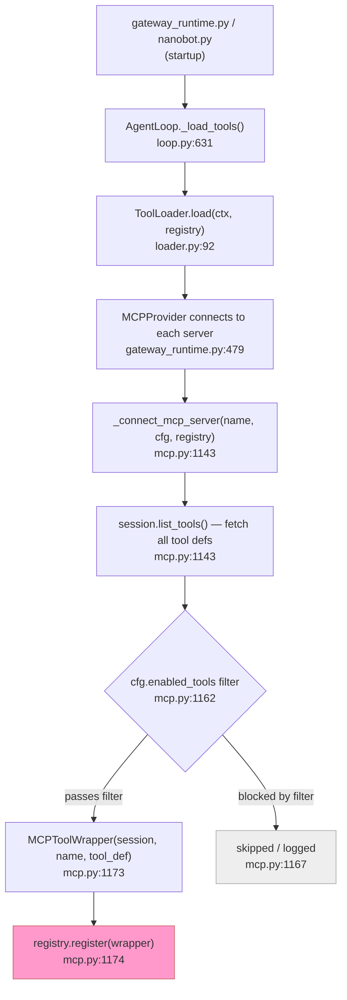
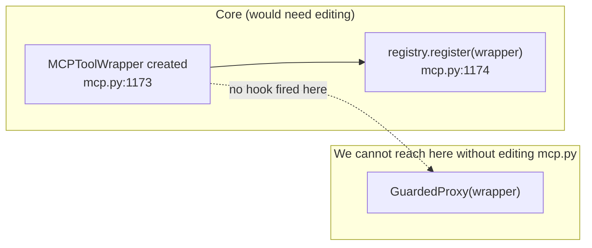
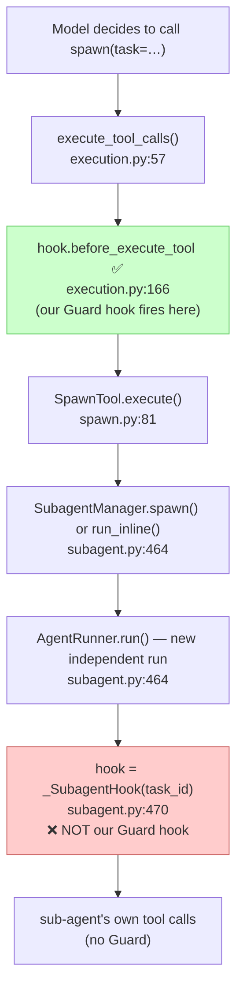
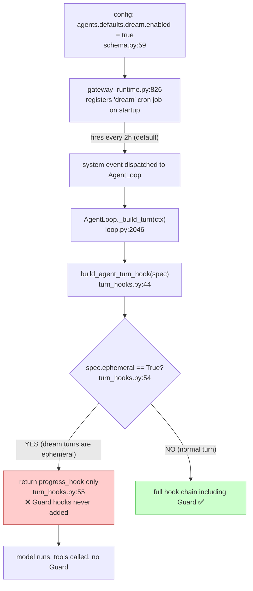
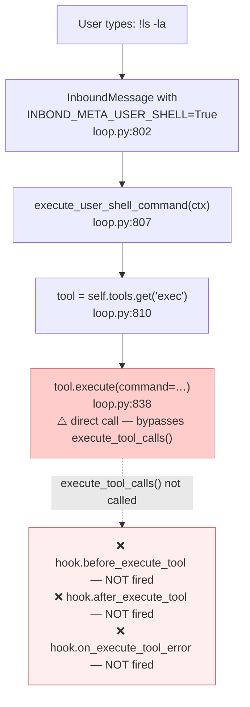

Source: targets/nanobot, 2026-10-08

## 1. Trace of one tool call

- **Model reply decoded:** `AgentRunner` calls the LLM and gets a `LLMResponse` with `tool_calls: list[ToolCallRequest]`. *(not read — this is in `runner.py`/`loop.py`; the entry to execution is the call below)*
- **Dispatch to executor:** [`execution.py:57`](../../targets/nanobot/nanobot/agent/tools/execution.py:57) — `execute_tool_calls(tools, tool_calls, hook=..., context=...)` iterates over calls
- **Before-hook fired:** [`execution.py:166`](../../targets/nanobot/nanobot/agent/tools/execution.py:166) — `await hook.before_execute_tool(context, tool_call, tool, params)` — outside the `try`, return value ignored
- **Tool runs:** [`execution.py:173-175`](../../targets/nanobot/nanobot/agent/tools/execution.py:172) — `result = await tool.execute(**params)` (or `tools.execute(name, params)` if tool not pre-resolved)
- **Error path (exception):** [`execution.py:178-195`](../../targets/nanobot/nanobot/agent/tools/execution.py:178) — caught, calls `hook.on_execute_tool_error`, returns `payload, event` — skips after-hook
- **Error path (ToolResult.error string):** [`execution.py:197-214`](../../targets/nanobot/nanobot/agent/tools/execution.py:197) — `is_tool_error_result(result)` is true, calls `hook.on_execute_tool_error`, returns — skips after-hook
- **After-hook fired (success only):** [`execution.py:216`](../../targets/nanobot/nanobot/agent/tools/execution.py:216) — `await hook.after_execute_tool(context, tool_call, tool, params, result)` — return value ignored
- **Result returned to loop:** [`execution.py:218-224`](../../targets/nanobot/nanobot/agent/tools/execution.py:218) — `(result, event)` tuple returned up the call stack, appended to `tool_results`, handed back to the model as a tool message

---

## 2. Hooks: what they can and cannot do

- **`before_execute_tool` signature:** [`hook.py:108-115`](../../targets/nanobot/nanobot/agent/hook.py:108) — `async def`, returns `None`. **Cannot block the call, cannot replace params, cannot raise to stop the turn.**
- **`after_execute_tool` signature:** [`hook.py:117-125`](../../targets/nanobot/nanobot/agent/hook.py:117) — `async def`, returns `None`. **Cannot replace the result.**
- **Raising in a hook:** [`hook.py:175-186`](../../targets/nanobot/nanobot/agent/hook.py:175) — `CompositeHook._for_each_hook_safe` catches and logs all exceptions unless `hook._reraise is True`. Even with `_reraise=True` the exception propagates out of `before_execute_tool` at [`execution.py:166`](../../targets/nanobot/nanobot/agent/tools/execution.py:166) — this line is **outside** the `try/except` at line 167, so a raise there would propagate up and abort the turn. **But this only works with `_reraise=True` on the hook; the default silently swallows.**
- **When tool raises:** [`execution.py:178-179`](../../targets/nanobot/nanobot/agent/tools/execution.py:178) — `on_execute_tool_error` is called instead of `after_execute_tool`. The after-hook **never fires** on error.

---

## 3. MCP tools: registration, metadata, `enabled_tools`

- **Registration path:** [`mcp.py:1143-1174`](../../targets/nanobot/nanobot/agent/tools/mcp.py:1143) — `session.list_tools()` fetches all tool defs; each is wrapped in `MCPToolWrapper(session, name, tool_def)` and passed to `registry.register(wrapper)`
- **`MCPToolWrapper.__init__`:** [`mcp.py:602-615`](../../targets/nanobot/nanobot/agent/tools/mcp.py:602) — stores `tool_def.description or tool_def.name` as description; builds name as `mcp_{server_name}_{tool_def.name}` (sanitized). **No `read_only` property on `MCPToolWrapper`** — only the resource wrapper ([`mcp.py:796`](../../targets/nanobot/nanobot/agent/tools/mcp.py:796)) and prompt wrapper ([`mcp.py:914`](../../targets/nanobot/nanobot/agent/tools/mcp.py:914)) return `read_only=True`. The base `Tool.read_only` default is `False` ([`base.py:217-219`](../../targets/nanobot/nanobot/agent/tools/base.py:217)). Every MCP **tool** is therefore state-changing by default.
- **`enabled_tools`:** [`mcp.py:1154-1172`](../../targets/nanobot/nanobot/agent/tools/mcp.py:1154) — `cfg.enabled_tools` is a set; `"*"` means allow all. If a tool's raw name and its `mcp_{server}_{name}` wrapped name are both absent from the set, it is silently skipped. Unmatched entries produce a warning ([`mcp.py:1185-1193`](../../targets/nanobot/nanobot/agent/tools/mcp.py:1185)).

---

## 4. Open check 1 — Can we wrap MCP tools at registration without editing core files?

The question is: where do MCP tools get registered, and can we intercept that point from outside?

### What happens today (the registration flow)



The **only** place `MCPToolWrapper` is handed to the registry is at [`mcp.py:1173-1174`](../../targets/nanobot/nanobot/agent/tools/mcp.py:1173), deep inside a private function. There is no callback or event fired after it.

### Why a pre-registration hook is blocked



`registry.register` is **public** ([`registry.py:30`](../../targets/nanobot/nanobot/agent/tools/registry.py:30)) — it's just `self._tools[tool.name] = tool`. So `register` itself isn't blocked. The blocker is that there is **no callback between "wrapper created" and "wrapper stored"** unless you edit `mcp.py`.

### What IS possible without core edits — post-registration replacement

```mermaid
sequenceDiagram
    participant Startup as startup file<br/>(nanobot.py / gateway_runtime.py)
    participant Loop as AgentLoop
    participant Registry as ToolRegistry
    participant Guard as our GuardedProxy

    Startup->>Loop: _load_tools() — MCP tools registered
    Note over Registry: registry._tools = {<br/>  "mcp_galaxium_cancel_booking": MCPToolWrapper,<br/>  "mcp_galaxium_book": MCPToolWrapper, …<br/>}
    Startup->>Registry: registry.get("mcp_galaxium_cancel_booking")
    Registry-->>Startup: MCPToolWrapper instance
    Startup->>Guard: GuardedProxy(wrapper)
    Startup->>Registry: registry.register(proxy)
    Note over Registry: registry._tools["mcp_galaxium_cancel_booking"] = GuardedProxy ✅
```

**This works with no core edits**, because `register` simply overwrites the entry by name ([`registry.py:32`](../../targets/nanobot/nanobot/agent/tools/registry.py:32): `self._tools[tool.name] = tool`). The execution path in [`execution.py:172-175`](../../targets/nanobot/nanobot/agent/tools/execution.py:172) then calls `tool.execute(**params)` on whatever is in the registry — which would be our proxy.

**The catch:** the replacement must happen *after* `_load_tools()` completes but *before* the first turn runs. The three wiring sites are `nanobot.py:136`, `cli/commands.py:386`, and `cli/gateway_runtime.py:488` — each must register the proxy after MCP connection finishes. That touches startup files, not core agent logic.

---

## 5. Open check 4 — Sub-agents, Dream turns, and `!` shell

These three paths all **bypass the parent turn's hooks**. Here is each one illustrated.

### Path A — Sub-agents (`spawn` tool)



- Our hook fires when `spawn` is *called* as a tool — but that only sees `task=<string>`, not the sub-agent's subsequent tool calls.
- The sub-agent runs with `_SubagentHook` ([`subagent.py:470`](../../targets/nanobot/nanobot/agent/subagent.py:470)), a private hook with no Guard logic.

**To disable:** `SpawnTool.create()` raises if `ctx.subagent_manager is None` ([`spawn.py:57`](../../targets/nanobot/nanobot/agent/tools/spawn.py:57)), so setting `subagent_manager=None` in `ToolContext` prevents `spawn` from loading. No config key exists — this is a one-line code change.

---

### Path B — Dream turns (memory consolidation)



The key line is [`turn_hooks.py:54-55`](../../targets/nanobot/nanobot/agent/turn_hooks.py:54):
```python
if spec.ephemeral and not spec.run_extra_hooks_for_ephemeral:
    return progress_hook   # ← only the progress hook; registered hooks are skipped
```

Dream turns are ephemeral by construction (their `session_key` starts with `"dream:"`, [`loop.py:2052`](../../targets/nanobot/nanobot/agent/loop.py:2052)), so Guard is never in the chain.

**To disable:** set `agents.defaults.dream.enabled: false` in the config JSON. This is checked at [`gateway_runtime.py:826`](../../targets/nanobot/nanobot/cli/gateway_runtime.py:826) before the cron job is ever registered. Config change only, no code edit.

---

### Path C — `!` shell command (user-typed `!ls`)



Normal tool calls go through [`execution.py:_execute_tool_call`](../../targets/nanobot/nanobot/agent/tools/execution.py:115) which fires all hooks. The `!` path calls `tool.execute()` directly at [`loop.py:838`](../../targets/nanobot/nanobot/agent/loop.py:838), completely bypassing that machinery.

**To disable:** if `self.tools.get("exec")` returns `None`, the handler short-circuits with `"Shell execution is disabled"` ([`loop.py:811-812`](../../targets/nanobot/nanobot/agent/loop.py:811)). Never register the `exec` tool, or `registry.unregister("exec")` after loading.

---

## Summary table

| Path | Our hooks fire? | How to disable |
|------|----------------|----------------|
| Normal MCP tool call | ✅ Yes (before + after) | n/a |
| Sub-agent's tool calls | ❌ No — `_SubagentHook` only | Set `ctx.subagent_manager = None` (code change) |
| Dream turn tool calls | ❌ No — ephemeral skips registered hooks | `agents.defaults.dream.enabled: false` in config JSON |
| MCP reconnect (Galaxium restart) | ❌ No — fresh `MCPToolWrapper`s replace Guard proxies silently | Re-wrap after reconnect, or verify all tools are wrapped every turn |
| `!` shell command | ❌ No — `tool.execute()` called directly | Never register / unregister `exec` tool |
| Post-registration MCP proxy | ✅ Possible — replace via `registry.register()` | (this is the solution, not a risk) |

---

## Channels and model

### Open check 2 — OutboundMessage.buttons

**Data structure:** [`bus/events.py:67`](../../targets/nanobot/nanobot/bus/events.py:67) — `buttons: list[list[str]] = field(default_factory=list)`. A list of rows, each row a list of label strings. E.g. `[["Allow", "Decline"]]` = one row, two buttons.

**WebUI / WebSocket channel — buttons silently dropped.** [`channels/websocket/runtime.py:1185-1228`](../../targets/nanobot/nanobot/channels/websocket/runtime.py:1185) builds the JSON payload sent to the browser (`event`, `text`, `media`, `reply_to`, `turn_id`, `tool_events`, `agent_ui`). The `msg.buttons` field is **never read** and never added to the payload. The test at [`test_websocket_channel.py:2273`](../../targets/nanobot/nanobot/channels/websocket/tests/test_websocket_channel.py:2273) sends a message with `buttons=[["Yes","No"]]` but only asserts on `text`, `media`, and `reply_to` — confirming buttons are not forwarded to the browser.

**Telegram — full round trip works.**

Outbound path: [`channels/telegram/runtime.py:1177-1178`](../../targets/nanobot/nanobot/channels/telegram/runtime.py:1177):
```python
buttons = cast(list[list[str]], getattr(msg, "buttons", None) or [])
reply_markup = self._build_keyboard(buttons) if buttons else None
```
Buttons are rendered as a Telegram `InlineKeyboardMarkup` attached to the message.

Inbound path (button press): [`channels/telegram/runtime.py:2211-2244`](../../targets/nanobot/nanobot/channels/telegram/runtime.py:2211) — `_on_callback_query()` receives the Telegram callback, takes `button_label = query.data` ([`runtime.py:2225`](../../targets/nanobot/nanobot/channels/telegram/runtime.py:2225)), dismisses the spinner (`query.answer()`), removes the keyboard (`edit_reply_markup(None)`), then calls `_handle_message(content=button_label, metadata={is_callback:True, …})` ([`runtime.py:2232-2244`](../../targets/nanobot/nanobot/channels/telegram/runtime.py:2232)). The press **re-enters the agent loop as a normal `InboundMessage`** with the button label as content — identical to typed text. This matches the `goal_permission` pattern ([`goal_permission.py:56-67`](../../targets/nanobot/nanobot/agent/goal_permission.py:56)) where a grant is only valid as fresh user input.

**Keyboard fallback:** [`runtime.py:1183-1184`](../../targets/nanobot/nanobot/channels/telegram/runtime.py:1183) — if `_build_keyboard` returns `None`, labels are spliced into the message text as `[Allow]  [Decline]`; user types the word and it still works.

**Conclusion:** WebUI does not render buttons — confirmed. Use Telegram for the live demo confirm card; show a static replay on the public dashboard. A WebUI fix (reading `buttons` from the JSON payload in the browser) is out of scope (§7).

---

### Open check 3 — OpenRouter provider config

**Provider registry:** [`providers/registry.py:192-204`](../../targets/nanobot/nanobot/providers/registry.py:192) — `env_key="OPENROUTER_API_KEY"`, `default_api_base="https://openrouter.ai/api/v1"`, backend `"openai_compat"`.

**Config file:** JSON, not YAML. Default path is `~/.nanobot/config.json`; override with `-c <path>`. The model is **not** set under `providers.openrouter` — that key is ignored there and nanobot falls back to `claude-opus-4-5`. Model and provider must be set under `agents.defaults`:

```json
{
  "agents": {
    "defaults": {
      "model": "ibm-granite/granite-4.2-8b",
      "provider": "openrouter",
      "dream": { "enabled": false }
    }
  },
  "providers": {
    "openrouter": {
      "apiKey": "${OPENROUTER_API_KEY}",
      "extraBody": {
        "provider": { "order": ["DeepInfra"], "allow_fallbacks": false },
        "reasoning": { "effort": "none" }
      }
    }
  }
}
```

**API key from environment:** yes — [`config/loader.py:226`](../../targets/nanobot/nanobot/config/loader.py:226) resolves `${VAR}` references at load time. Documented in [`docs/providers.md:99`](../../targets/nanobot/docs/providers.md:99).

**Extra request fields (upstream host pinning):** [`config/schema.py:206`](../../targets/nanobot/nanobot/config/schema.py:206) — `extra_body: dict[str, Any] | None = None` on `ProviderConfig`. The `extraBody.provider.order` array takes the exact host string from OpenRouter's provider routing — here `"DeepInfra"`.

**Reasoning:** nanobot does not send reasoning settings for Granite (it only does this for Kimi, MiMo and Qwen; openai_compat_provider.py:1039, :1055), so we set it ourselves in extraBody: "reasoning": {"effort": "none"}. The spike checks that reasoning tokensare 0. To try thinking, change "none" to "low" there.

---

### Open check 3 — MCP server over HTTP/SSE

[`config/schema.py:363-375`](../../targets/nanobot/nanobot/config/schema.py:363) — `MCPServerConfig` fields: `type: Literal["stdio", "sse", "streamableHttp"] | None`, `url: str`, `headers: dict[str, str]`.

Galaxium uses `mount_http()`, so the transport is `"streamableHttp"`. To connect to Galaxium's local MCP endpoint (in `config.json`):
```json
{
  "tools": {
    "mcpServers": {
      "galaxium": {
        "type": "streamableHttp",
        "url": "http://localhost:8001/mcp"
      }
    }
  }
}
```

---

### Open check 6 — MCP reconnect drops Guard proxies (finding)

**What happens:** When the Galaxium backend restarts, nanobot reconnects and re-registers all MCP tools ([`mcp.py:1657`](../../targets/nanobot/nanobot/agent/tools/mcp.py:1657) — reconnect path, then same flow as §3). Fresh `MCPToolWrapper` instances are written into the registry under the same names, **silently replacing our `GuardedProxy` wrappers**. No error is raised; execution continues with unguarded tools.

**Required test:** add a test that:
1. starts with Guard proxies installed for all Galaxium tools,
2. simulates a reconnect (re-runs the MCP registration path),
3. asserts that either (a) the proxies are re-applied automatically, or (b) the turn is blocked because a bare `MCPToolWrapper` is detected.

**Design options:**
- **Re-wrap on reconnect:** hook the reconnect/re-registration event and re-run the proxy installation loop after it completes.
- **Per-turn verification:** before each turn, check that every `mcp_galaxium_*` entry in the registry is a `GuardedProxy`; abort the turn (or raise) if any bare wrapper is found.

Either option requires tracking which tool names must be wrapped and acting if the invariant breaks.

---

### Open check 5 — Python version and Windows install

**Required Python:** [`pyproject.toml:6`](../../targets/nanobot/pyproject.toml:6) — `requires-python = ">=3.11"`. Python 3.12 (brief §6) satisfies this.

**Windows PowerShell install** (from [`README.md:145-152`](../../targets/nanobot/README.md:145)):
```powershell
cd targets\nanobot
python -m venv .venv
.\.venv\Scripts\Activate.ps1
python -m pip install -e .
# dev extras:
python -m pip install -e ".[dev]"
```
